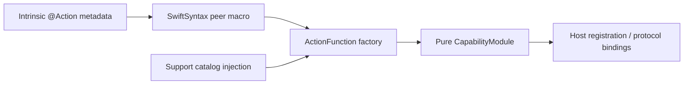

# Callable Action Macro

Purpose: declare intrinsic metadata beside a business function. Design goals: one attribute/signature, canonical invocation and explicit dependency injection.



✅ @Action generates factories accepting ActionHandler or ActionCompletionHandler with FunctionInput. Functions may return ordinary values that their catalog adapts to ActionCompletion.value. Metadata includes address, kind/completion, serialization key, resources and constant/dynamic budgets.

```swift
@Action(domain: "UI", module: "Gaze", title: "moveEyes", serializationKey: "UI")
public static func moveEyes(invocation: any FunctionInput, using update: ...) async throws { ... }
```

✅ Protocol availability, direct/scheduled execution and native feedback are absent from the attribute and generated ActionFunction. Host-created ActionBinding owns these policies; Agent configuration/code separately grants exposure and permission. Support catalogs explicitly bind dependencies and Swift checks captured values. Invalid attachment produces a compiler diagnostic. SwiftSyntax603.0.2 remains pinned.

❌ No runtime reflection, automatic permissions, global registration, dependency injection or physical/model acceptance. Native wire contracts remain in Runtime/Gateway/AgentCore.

✅ ADR0161: standard callable inputs use FunctionInput/FunctionContracts; common execution and call protocols belong to independent Gateway targets. This directory retains its existing ownership, resource/permission and lifecycle boundaries. ❌ Remaining feature Signal/continuation and physical acceptance are separate work.
