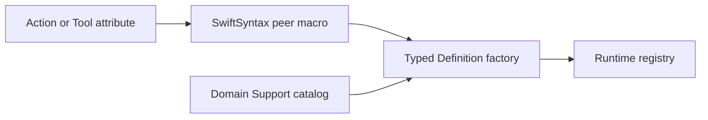

# Behavior definition macros

Purpose: keep metadata next to its canonical implementation. Design goal: eliminate duplicated paths/titles without changing runtime ownership.



✅ Static functions receive two `nameDefinition` factories for returning/completing handlers. Action attributes accept resource and budget resolver functions; Tool attributes accept resources. Swift validates types and captured values. SwiftSyntax603.0.2 is pinned to the already resolved dependency.

❌ No runtime reflection, global registration, permission changes or injected-device construction. Invalid attachment produces a compiler diagnostic.

## Authoring

```swift
@Action(module: "NexArm", title: "点头", kind: .finite,
        completion: "Fresh arrival; retain failed child outcomes.",
        resources: NexArmRegistration.resources,
        timeout: NexArmRegistration.budget)
public static func nodHead(invocation: ActionInvocation, using perform: @escaping @Sendable (NexArmActions.GestureRequest, ActionInvocation) async throws -> Void) async throws {
    // Validate parameters and await the injected capability.
}
```

The domain Support catalog calls `NexArmActions.nodHeadDefinition(handler: ...)` or `completing: ...`. The attribute generates metadata factories, not dependency injection or argument validation. `@Tool(path: "UI.print", title: "print", resources: [])` generates matching Tool factories. Ordinary constructors remain available for runtime-built definitions and tests.

✅ Action factories now construct ActionIdentifier from Actions/Contracts. Tool factories consume Tools-owned definitions; no runtime Agent dependency is generated.
