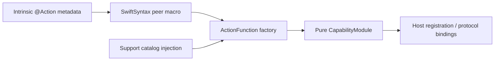

# Callable Action Macro

Purpose: declare intrinsic metadata beside a business function. Design goals: one attribute/signature, canonical invocation and explicit dependency injection.

ActionCatalogMacro implements the current MemberMacro expansion signature with `conformingTo`, avoiding the deprecated compatibility default. It collects the same factories and generates the same declarations without adding conformances.



@Action generates factories accepting ActionHandler or ActionCompletionHandler with FunctionInput. Functions may return ordinary values that their catalog adapts to ActionCompletion.value. Metadata includes address, kind/completion, resources and constant/dynamic budgets.

```swift
@Action(domain: "UI", module: "Gaze", title: "moveEyes")
public static func moveEyes(invocation: any FunctionInput, using update: ...) async throws { ... }
```

Protocol availability, direct/scheduled execution and native feedback are absent from the attribute and generated ActionFunction. Host-created ActionBinding owns these policies; Agent configuration/code separately grants exposure and permission. Support catalogs explicitly bind dependencies and Swift checks captured values. Invalid attachment produces a compiler diagnostic. SwiftSyntax603.0.2 remains pinned.

standard callable inputs use FunctionInput/FunctionContracts; common execution and call protocols belong to independent Gateway targets. This directory retains its existing ownership, resource/permission and lifecycle boundaries.

## Action-owned documentation and Skill instruction contract

`@Action` 生成同名 Declaration 值与两个 Definition 工厂，二者使用同一声明。`@ActionCatalog` 读取被标注模块的现有函数工厂调用，生成 declarations；仅本地 AST 分析，无反射或全局自动注册。域组合仍由 CapabilityModules 显式完成。

## Channel-owned Action ordering

@Action and generated ActionFunction factories have no serialization argument or implicit exclusion. Host scheduling stays outside macro generation.

## Action timeout contract

BehaviorDefinitionMacro 将 dynamicTimeout 与 timeout 传入 ActionFunction，动态预算优先级由运行时统一校验。

## 待实现

- 宏生成代码与真实模型、原生 wire 协议交互的独立验收。

## Pure input preparation

@Action emits validatingInput by reusing leading pure argument-decoding/validation statements. Expansion stops before injected capability references, await or return. Authors keep that prefix effect-free; actual business preconditions/effects remain in the handler and run again at execution. Both preparation and execution use the same validator.
