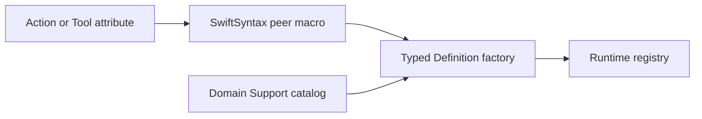

# Behavior definition macros

Purpose: keep metadata next to its canonical implementation. Design goal: eliminate duplicated paths/titles without changing runtime ownership.



✅ Static functions receive two `nameDefinition` factories for returning/completing handlers. Action attributes accept an optional serializationKey and resource and budget resolver functions; Tool attributes accept resources and an optional Duration timeout; both generated factory overloads retain it. Swift validates types and captured values. SwiftSyntax603.0.2 is pinned to the already resolved dependency.

❌ No runtime reflection, global registration, permission changes or injected-device construction. Invalid attachment produces a compiler diagnostic.

## Authoring

```swift
@Action(domain: "NexArm", module: "Gesture", title: "点头", kind: .finite,
        completion: "Fresh arrival; retain failed child outcomes.",
        serializationKey: "NexArm",
        resources: NexArmRegistration.resources,
        timeout: NexArmRegistration.budget)
public static func nodHead(invocation: ActionInvocation, using perform: @escaping @Sendable (NexArmActions.GestureRequest, ActionInvocation) async throws -> Void) async throws {
    // Validate parameters and await the injected capability.
}
```

The domain Support catalog calls `NexArmActions.nodHeadDefinition(handler: ...)` or `completing: ...`. The attribute generates metadata factories, not dependency injection or argument validation. `@Tool(path: "UI.Caption.print", title: "print", resources: [], timeout: .seconds(5))` generates matching Tool factories. Ordinary constructors remain available for runtime-built definitions and tests.

✅ Action factories now construct ActionIdentifier from Actions/Runtime/Contracts. Tool factories consume the same Runtime-owned definitions; no runtime Agent dependency is generated.

✅ Both generated Action factories retain serializationKey in definition metadata; the runtime registry validates it. ❌ Macros do not assign Agent permissions. The factory signature selects canonical implementation availability; Agent grants remain separate.

✅ ADR0156: canonical execution addresses use domain/module/function; Agent v6 bindings resolve native names separately. Existing serialization/resource and output permissions are preserved.


✅ ADR0157: canonical executable definitions and shared outcomes replace duplicate protocol metadata; consumers import Actions/ActionRuntime. Protocol request views remain adapters, and production permission/resource boundaries are preserved.

❌ Physical acceptance and additional business capability exposure are not established by this migration.

✅ Action and Tool attributes both construct ActionDefinition; Tool factories normalize request/context into the same handler contract. Distinct factory signatures are protocol adapters, not separate business metadata stores.
