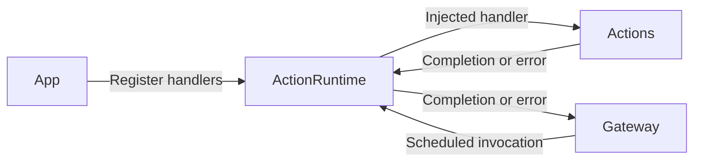
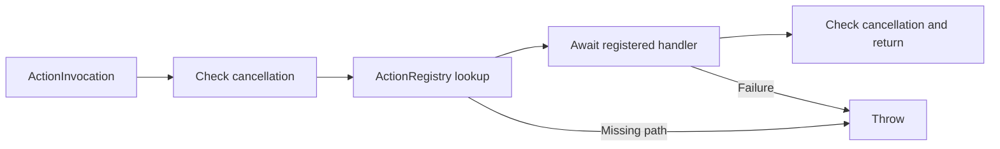

# ActionRuntime — Action Registration and Execution

Maps resolved Action paths to App-supplied handlers. The goal is explicit handler selection and awaited execution; Gateway owns scheduling. This target depends only on AgentCore.

## Directory structure

```text
ActionRuntime/
├── ActionRegistry.swift        # Immutable path-to-handler allowlist
├── ActionExecutor.swift        # Lookup, cancellation checks and awaited execution
├── ActionInvocation.swift      # Resolved call with trusted output context
├── ActionExecutionError.swift  # Admission and execution errors
└── README.md                   # Module contract and status
```

## Upstream and downstream

Arrows show runtime calls; Actions is an injected handler library, not a target dependency.



## Internal flow



The immutable registry is shared safely across tasks. Execution creates no queue or detached work. A handler must await its promised effect and cooperate with cancellation. Failure propagates to Gateway; already completed effects are not rolled back. [Channel scheduling](../Gateway/Output/Scheduling/README.md) owns bounds, ordering, resource exclusion and cleanup barriers.

## Feature status

- ✅ Explicit registration, trusted invocation context, awaited completion and cancellation checks.
- ❌ Standard ActionResult and feedback through InputGateway; current success returns Void.

## Issue record

| Status | Issue / next step |
| --- | --- |
| Open | Cleanup relies on handler cooperation; no forced interruption or runtime timeout exists. |
| Resolved — 2026-09-27 audit | Separated execution from Gateway admission and scheduling in both diagrams. |
