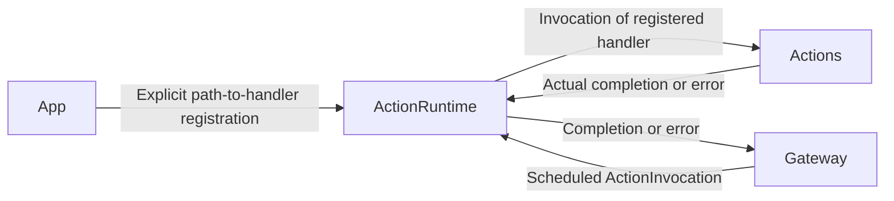

# ActionRuntime — Action Registration and Execution

ActionRuntime maps resolved action paths to executable Swift handlers, following architecture section 29. It separates the execution mechanism from concrete behavior implementations and Gateway scheduling.

## Direct relationships

Handlers are supplied by App. ActionRuntime has no compile-time dependency on Actions and depends only on AgentCore. The diagram shows runtime calls through those handlers.

## Implementation status

- ✅ `ActionRegistry.swift`: immutable ActionPath-to-ActionHandler allowlist; unregistered paths fail explicitly.
- ✅ `ActionExecutor.swift`: looks up and awaits a handler, checking cancellation before and after execution.
- ✅ `ActionInvocation.swift`: resolved ActionCall and trusted OutputEnvelope association.
- ✅ `ActionExecutionError.swift`: shared action admission and execution errors.
- ❌ Standard `ActionResult` and conversion into feedback signals. Success currently returns Void; failure throws.

Gateway checks registration before queue admission and owns capacity, FIFO ordering, module exclusion, and cancellation/completion barriers. ActionRuntime does not create another queue. Immutable registration can be shared across tasks; handler implementations must uphold completion and cooperative cancellation contracts.

## Maintenance

Keep this README synchronized with changes to responsibilities, files, interfaces, and implementation status. ✅ means implemented; ❌ means planned or incomplete. Do not create unused placeholder modules. The [technical architecture](../README.md) defines the target; the [layout audit](../../docs/Repository-Structure.md) records implementation exceptions.
