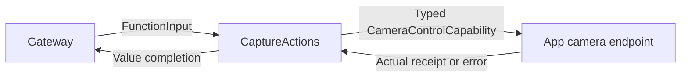

# Camera Functions

## Summary

Seven camera/photo functions with strict arguments, honest native receipts and injected camera ownership.

## Ownership and boundaries

CaptureActions.swift owns callable bodies; CameraActions is the namespace. App CameraCoordinator owns capture/lease/permission/export; Photographer owns business selection. Functions take no additional camera.capture lease, which would conflict with the native capture owner.

## External relationships and data flow

Runtime arrows show data or capability calls; dashed arrows show injection.

## Function contract

| Camera.Capture function | Parameters | Completion |
| --- | --- | --- |
| open / close | None | Native command receipt with operation and acknowledged enabled/facing state |
| flip | Required facing=front/back | Target selection; healthy same-facing idempotence, disabled capture fails |
| retry | None | Explicit native retry/permission path |
| takePhoto | None | photoID/width/height/MIME after actual capture/presentation boundary |
| savePhoto / ignorePhoto | Optional photoID UUID | Actual saved/ignored receipt, UUID and alreadySaved where applicable |

Reject unknown parameters and malformed/oversized UUIDs before effects. Cancellation is checked before/after native work. Save has a 60-second cooperative budget; no camera command queue exists in the function domain. App rejects overlap and stale foreground/root/task ownership. open does not promise model readiness; close joins native/perception cleanup.

Host binds scheduled Actions and fixed returning Tools; Photographer model declares Camera Actions only. Direct typed UI publication and conversational Photographer task selection use the same functions. Photo read authorization retains original source/session/input; no fabricated capture/album success is returned.

✅ Typed camera commands, capture and photo disposition are implemented.

## Related design

[Parent design](../README.md) · [Support](Support/README.md)
