# Camera Actions

Purpose: expose explicit camera/vision controls through OutputGateway. Design goals: domain-owned entries, typed host injection, no direct device ownership and honest completion.

| Entry | Contract |
| --- | --- |
| Camera.Capture.open | No arguments; idempotently enable capture and vision intent |
| Camera.Capture.close | No arguments; idempotently disable capture and vision |
| Camera.Capture.flip | Required facing=front/back; select target lens, healthy same-target request is idempotent; disabled camera fails |

✅ CaptureActions.swift owns @Action entries; Support/CameraModule.swift owns definitions, capability and errors. All entries check cancellation and reject unknown arguments before effects. Host registration retains completion-only native success without ToolResult or Action history. Host errors propagate.

```mermaid
flowchart LR
    Agent[Assistant JSON Tool declaration] --> Gateway[OutputGateway permissions]
    Gateway --> Runtime[FunctionContracts]
    Runtime --> Entry[CameraActions]
    Entry --> Adapter[App session validation]
    Adapter --> Owner[CameraCoordinator]
    Owner --> Permission[Permission and foreground check]
    Permission --> Lease[Existing camera capture lease]
    Lease --> Capture[Native camera and vision lifecycle]
```

✅ App validates the active Assistant voice session and foreground. The coordinator rejects overlapping Tool operations with busy; UI/scene changes can supersede an admitted operation, which then fails cancellation. There is no Tool queue. Open/flip wait for native capture reconciliation; close waits for capture release and vision cleanup. Open does not promise pose-model readiness. Existing bounded frame streams and permission validation remain.

✅ Camera function constraints claim no camera.capture lock: they request the single App camera owner to change intent; that owner alone acquires/renews/releases the lease. Taking another lease at Gateway would conflict with the active capture owner. Camera Actions imports only Foundation/FunctionContracts and gains no PlatformKit dependency.

❌ Native model Tool event transport, background capture, forced interruption of native calls and physical-device acceptance are not added. Cancelling after an intent is accepted does not roll back that intent; scene shutdown still owns cleanup.

✅ ADR0151: this domain is compiled once in Actions; both ActionCall and ToolCall entries use FunctionContracts contracts. Host injection and permission/feedback behavior are unchanged.
✅ Shared execution from ADR0157 is retained; ADR0160 separates callable functions from host bindings.

✅ ADR0152: functions are classified by domain before protocol unification. Canonical namespaces use `<Domain>Actions`; production uses one pure `<Domain>Module`; host registration creates Action/Tool projections. Legacy aliases are retired; isolated registration views retain one canonical catalog.
✅ Unified definitions and compatibility retirement are implemented in ADR0157.

## Cohesive module files — ADR0154

Purpose: implement directory/module-file/function ownership while preserving current protocol APIs. The domain Actions enum remains a used namespace facade; callable bodies belong exclusively to the files below. Support owns one domain catalog, values and host capabilities.

- [CaptureActions.swift](CaptureActions.swift)

✅ Implementations are split without forwarding or duplicated metadata/handlers. Generated factories and existing call paths, permissions, resources and scheduling are unchanged.
✅ Three-field addresses, Agent v6 configuration and shared definitions/results are implemented in ADR0156/0157.

✅ ADR0159 — Unified invocation: all business functions, injected capabilities and registered handlers receive FunctionInput with ActionExecutionContext. Native request/result normalization stays in Runtime/Gateway; no protocol-specific implementation signature remains.

✅ ADR0160: this domain exposes ActionFunction values with canonical invocation and intrinsic constraints. Protocol availability, native scheduling and feedback belong to host-created ActionBinding; domain code consumes no Tool wire/error contracts. ❌ New feature/physical acceptance remains separate.

✅ ADR0161: standard callable inputs use FunctionInput/FunctionContracts; common execution and call protocols belong to independent Gateway targets. This directory retains its existing ownership, resource/permission and lifecycle boundaries. ❌ Remaining feature Signal/continuation and physical acceptance are separate work.

## Camera command entry

✅ Implemented: CameraInteractionWorkflow emits typed open/close/flip/retry intents through Photographer and existing Camera functions. Root presentation accepts Photographer in the dedicated camera root session or validated active voice delegation; Assistant calls delegate through the bound Gateway context. Native capture, permission, lifecycle fences and joined cleanup remain CameraCoordinator responsibilities. Retry uses a canonical callable and the native explicit settings/permission request. UI receives controls and passive camera state, not the native coordinator. One command slot rejects overlap, no replay.

✅ ADR0181 host migration: function paths and native lifecycle remain unchanged; flip now requires explicit facing. The injected camera endpoint routes Assistant intent to Photographer, and applies only admitted Photographer effects. Functions remain unaware of Agent identity or delegation protocol.

✅ Interaction refinement: CaptureActions.flip validates required facing (front/back) and calls the typed target-selection endpoint; selecting the current lens is idempotent when capture is healthy.
