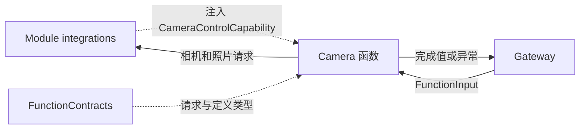
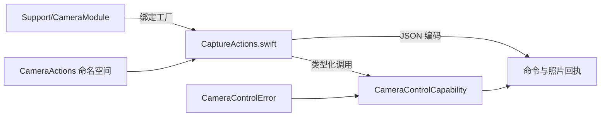

# Camera — 相机与照片业务函数

## 简介

通过 CameraControlCapability 执行相机启闭、镜头选择、重试、拍摄及照片处置。入口负责参数与结果编码，ActionBindings 端点负责原生相机、权限、媒体所有权和呈现生命周期。

## 上下游关系（一级）

Camera 不导入平台相机或 UI 实现，也不自行创建捕获租约。注入端点负责运行准入；Action/Tool 协议及开放范围由宿主决定。

## 内部模块关系

## 接口与完成语义

全部地址位于 `Camera.Capture`；模块包含七个函数。

| 函数 | 实际入口参数 | 返回与预算 |
| --- | --- | --- |
| open / close | 无 | 注入启闭完成后返回 operation/enabled；默认 30 秒 |
| flip | facing=front/back | 注入镜头切换完成后返回 operation/facing；默认 30 秒 |
| retry | 无 | 等待端点重试完成，Void/completed；默认 30 秒 |
| takePhoto | 无 | JSON：mediaID、width、height、mimeType；15 秒 |
| savePhoto | 可解析 mediaID ID | JSON：saved、mediaID、alreadySaved、可选 feedbackIssues；60 秒 |
| ignorePhoto | 可解析 mediaID ID | JSON：ignored、mediaID、alreadySaved、可选 feedbackIssues；默认 30 秒 |

每个入口拒绝未知键。ID 字符串最多 36 字节；缺省照片参数被传为 nil。open/close/flip 在调用前后检查取消；拍摄与处置在调用前检查取消，原生工作及其取消清理由端点实现。

## 数据流与失败边界

函数等待真实端点结果后编码回执，不推断模型就绪或物理效果。open/close 的 enabled 来自已完成的目标操作，flip 的 facing 来自已完成的目标选择；这些不是额外原生状态查询。照片像素和 JPEG 读取通过能力端口保留 source/session/input 所有权，不作为普通字符串参数传输。

生产端点检查前台、相机启用、操作重叠、照片身份与呈现状态。savePhoto 的相册导入、离场呈现和反馈由端点组合；已导入的照片不会因后续反馈失败被撤销。回执可携带反馈问题。重复保存明确的已保存 ID 可返回 alreadySaved。ignorePhoto 处理当前预览，不表示删除相册照片。

本域没有请求队列、缓存或常驻捕获任务。权限拒绝、忙、未启用、后台或照片不可用通过类型化错误传播；是否已经发生部分效果以端点的实际状态和回执为准。

[Actions 设计](../README.md) · [能力与回执](Support/README.md) · [相机执行生命周期](Support/README.md)

## 待实现

- savePhoto/ignorePhoto 的声明将 mediaID 标为必填，而函数体允许省略。调用者应使用实际拍摄回执中的明确 ID；声明与直接调用解析的统一仍待实现。

## Storage 依赖

✅ 存储访问使用独立的 State、Cache、Database 和 Files 接口；App 注册根实例，消费者通过构造器获得所需能力。存储容器不接管本目录的业务验证、执行和完成语义。

## 公开 State 边界

✅ CameraCoordinator 通过应用作用域的唯一写端口发布 camera 的有限公开事实；running 来自原生会话确认，不使用预览隐藏表示物理停机。CameraState.present 的同步回调只用于触发拥有者投影，照片预览引用仅在可操作时公开。发布失败记录原始错误并失效公开视图；资源、权限和执行围栏仍独立校验。

[公开 State 契约](../../Storage/State/README.md)

## Platform 根、设备接入与独立影像/姿态呈现

✅ 相机执行接收受根管理的设备、相册导入和提示音端口。捕获/保存的既有业务回执与持久化语义不变；内部 Pose 呈现验证同帧附件，页面不直接连接 AVCaptureSession。

## 相机与姿态独立输出修复

✅ CameraCoordinator 在受生命周期管理的任务中独立订阅容量为一的最新原生帧，直接提交 UI 自有图像值；YOLO 继续通过 Gateway 与 Pose Tool 更新骨架。模型启动、失败、空检测和超时不清除实时影像。图像与骨架分别按捕获时间在 750 ms 后失效；停机、换镜头和后台取消并加入两个任务，清除旧会话。骨架使用最新有效结果，沿用相同几何/镜像变换，不再要求与当前预览帧序号相同；仍验证 Tool 自带的原始帧、会话及单调序号。真实进程崩溃不在此故障隔离范围。
