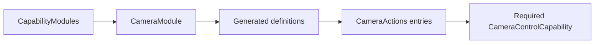

# Camera Action Support

Purpose: bind explicit entries to the host camera capability. Design goals: required typed injection, no discovery and no owned device/session state.

✅ CameraModule supplies four protocol-neutral ActionFunctions; host registration selects completion-only native feedback. CameraControlCapability exposes setEnabled, retry and flip(CameraActions.Facing) with opaque FunctionInput correlation. CameraControlError reports foreground, busy, disabled, permission and availability failures. No queue or platform dependency.

❌ No fallback camera, permission bypass, native Tool transport or device readiness claim.

✅ ADR0132: Domain validation/availability errors provide bounded FunctionContracts producer codes; generic execution and home observation preserve them without importing platform errors. ❌ Physical acceptance remains pending.

✅ ADR0151: this domain is compiled once in Actions; both ActionCall and ToolCall entries use FunctionContracts contracts. Host injection and permission/feedback behavior are unchanged.
✅ Shared execution from ADR0157 is retained; ADR0160 separates callable functions from host bindings.

✅ ADR0152: functions are classified by domain before protocol unification. Canonical namespaces use `<Domain>Actions`; production uses one pure `<Domain>Module`; host registration creates Action/Tool projections. Superseded aliases/protocol catalogs are retired.
✅ Unified definitions and compatibility retirement are implemented in ADR0157.

✅ ADR0159 — Unified invocation: all business functions, injected capabilities and registered handlers receive FunctionInput with ActionExecutionContext. Native request/result normalization stays in Runtime/Gateway; no protocol-specific implementation signature remains.

✅ ADR0160: this domain exposes ActionFunction values with canonical invocation and intrinsic constraints. Protocol availability, native scheduling and feedback belong to host-created ActionBinding; domain code consumes no Tool wire/error contracts. ❌ New feature/physical acceptance remains separate.

✅ ADR0161: standard callable inputs use FunctionInput/FunctionContracts; common execution and call protocols belong to independent Gateway targets. This directory retains its existing ownership, resource/permission and lifecycle boundaries. ❌ Remaining feature Signal/continuation and physical acceptance are separate work.

## Camera command entry

✅ Implemented: CameraInteractionWorkflow emits typed open/close/flip/retry intents through Photographer and existing Camera functions. Root presentation accepts Photographer in the dedicated camera root session or validated active voice delegation; Assistant calls delegate through the bound Gateway context. Native capture, permission, lifecycle fences and joined cleanup remain CameraCoordinator responsibilities. Retry uses a canonical callable and the native explicit settings/permission request. UI receives controls and passive camera state, not the native coordinator. One command slot rejects overlap, no replay.

✅ Interaction refinement: CameraControlCapability.flip receives CameraActions.Facing; CameraModule retains existing function registration and error/completion contracts.
