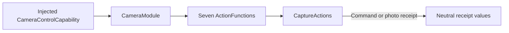

# Camera Values and Capability Catalog

## Summary

Neutral camera interfaces, errors, receipts and seven canonical function definitions.

## Ownership and boundaries

CameraModule binds required CameraControlCapability without owning native sessions, queues, permissions or UI. Host registration chooses call protocol/feedback; role grants remain outside this directory.

## External relationships and data flow

Runtime arrows show data or capability calls; dashed arrows show injection.

## Interface and result semantics

CameraControlCapability supplies setEnabled, retry, target flip, takePhoto, savePhoto/ignorePhoto and owner-scoped JPEG read with opaque FunctionInput correlation. Facing is front/back. CameraCommandReceipt carries acknowledged operation/enabled/facing, not pose readiness. CameraPhotoReceipt carries capture identity/dimensions/MIME; CameraPhotoCommandReceipt carries saved/ignored identity and duplicate-save state.

CameraControlError distinguishes foreground, busy, disabled, permission, unavailable and photoUnavailable producer failures. Unsupported isolated fixture methods throw unavailable; production assembly requires real injection. Catalog completion is value-based for command/photo operations; there is no fallback camera or permission bypass.

✅ Neutral capability, receipts and explicit camera catalog are implemented.

## Related design

[Parent design](../README.md)
