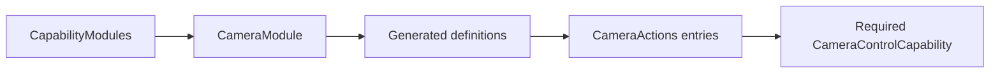

# Camera Tool Support

Purpose: bind explicit entries to the host camera capability. Design goals: required typed injection, no discovery and no owned device/session state.

✅ CameraModule defines three completion-only handlers. CameraControlCapability exposes setEnabled and flip with opaque ToolInvocation correlation. CameraControlError reports foreground, busy, disabled, permission and availability failures. No queue or platform dependency.

❌ No fallback camera, permission bypass, native Tool transport or device readiness claim.

✅ ADR0132: Domain validation/availability errors provide bounded ActionRuntime producer codes; generic execution and home observation preserve them without importing platform errors. ❌ Physical acceptance remains pending.

✅ ADR0151: this domain is compiled once in Actions; both ActionCall and ToolCall entries use ActionRuntime contracts. Host injection and permission/feedback behavior are unchanged.
❌ Unified capability definitions and protocol registration adapters remain pending.

✅ ADR0152: functions are classified by domain before protocol unification. Canonical namespaces use `<Domain>Actions`; production uses one `<Domain>Module` with Action/Tool registry projections. Legacy names are aliases or registration projections, not duplicated implementations.
❌ Unified callable definitions and migration of compatibility names remain pending.
