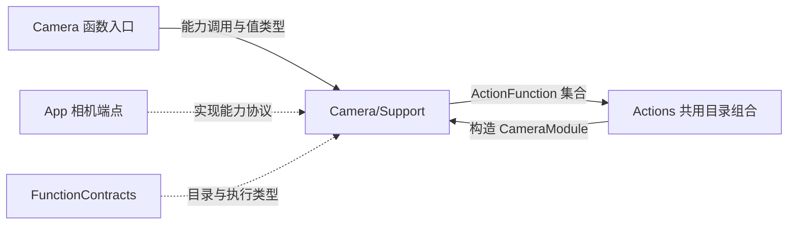
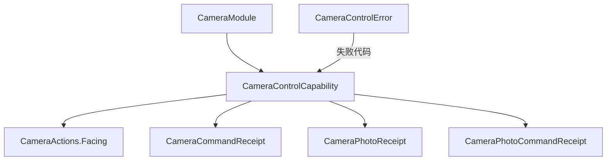

# Camera Support — 能力接口、回执与函数目录

## 简介

在 `CameraModule.swift` 中定义中立相机接口、结果类型、错误映射和七个函数的依赖绑定。此目录不持有相机、权限、媒体文件或动画任务。

## 上下游关系（一级）

## 内部模块关系

## 接口与值约束

CameraControlCapability 接受 FunctionInput，提供启闭、重试、镜头选择、拍摄、保存、忽略，以及按 photoID/source/sessionID/inputID 读取 JPEG 的接口。照片处置接收可选 UUID，由端点选择和校验实际目标。

| 值类型 | 内容与校验 |
| --- | --- |
| Facing | front/back |
| CameraCommandReceipt | operation 及可选 enabled/facing；描述命令结果，不描述模型就绪 |
| CameraPhotoReceipt | photoID、尺寸、MIME；显式构造要求尺寸为 1…4096 且 MIME 为 image/jpeg |
| CameraPhotoCommandReceipt | saved/ignored、photoID、alreadySaved（默认 false）、可选 feedbackIssues |

CameraPhotoCommandReceipt 自身不限制 feedbackIssues 的数量或字符串长度；宿主负责产生实际问题列表，通用执行结果仍受执行层大小限制。Codable 数据与显式构造校验是不同入口，调用方不能把任意解码数据视为已验证的原生回执。

## 目录绑定与失败处理

✅ `@ActionCatalog` 从 CameraModule 中的七个 definition 调用生成声明；模块持有注入 capability，工厂闭包调用 CameraActions。retry 使用 Void handler；其余六个函数产生 value completion。

CameraControlError 区分 notForeground、busy、disabled、permissionDenied、unavailable、photoUnavailable，并映射有界执行失败代码与本地化说明。协议扩展中，未实现的保存、忽略、拍摄、读取明确抛 unavailable；默认 retry 转为 `setEnabled(true)`。生产端点可覆盖这些方法。

目录没有自动替代相机、失败重试循环或请求队列；异步完成及清理由能力实现者负责。

[Camera 设计与参数](../README.md) · [共享契约](../../Support/Contracts/README.md)
