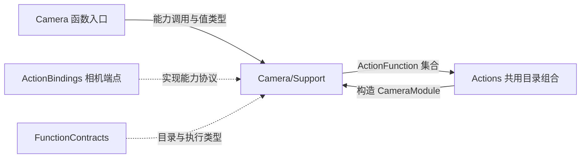
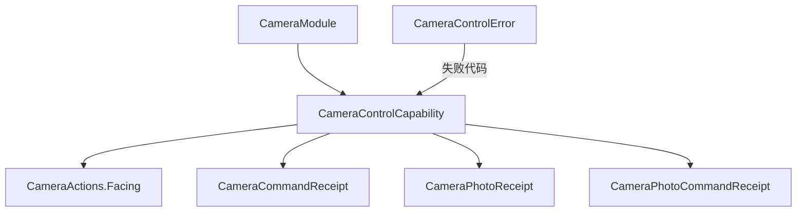

# Camera Support — 能力接口、回执与函数目录

## 简介

在 `CameraModule.swift` 中定义中立相机接口、结果类型、错误映射和七个函数的依赖绑定。此目录不持有相机、权限、媒体文件或动画任务。

## 上下游关系（一级）

## 内部模块关系

## 接口与值约束

CameraControlCapability 接受 FunctionInput，提供启闭、重试、镜头选择、拍摄、保存、忽略，以及按 mediaID/source/sessionID/inputID 读取 JPEG 的接口。照片处置接收可选 ID，由端点选择和校验实际目标。

| 值类型 | 内容与校验 |
| --- | --- |
| Facing | front/back |
| CameraCommandReceipt | operation 及可选 enabled/facing；描述命令结果，不描述模型就绪 |
| CameraPhotoReceipt | mediaID、尺寸、MIME；显式构造要求尺寸为 1…4096 且 MIME 为 image/jpeg |
| CameraPhotoCommandReceipt | saved/ignored、mediaID、alreadySaved（默认 false）、可选 feedbackIssues |

CameraPhotoCommandReceipt 自身不限制 feedbackIssues 的数量或字符串长度；宿主负责产生实际问题列表，通用执行结果仍受执行层大小限制。Codable 数据与显式构造校验是不同入口，调用方不能把任意解码数据视为已验证的原生回执。

## 目录绑定与失败处理

`@ActionCatalog` 从 CameraModule 中的七个 definition 调用生成声明；模块持有注入 capability，工厂闭包调用 CameraActions。retry 使用 Void handler；其余六个函数产生 value completion。

CameraControlError 区分 notForeground、busy、disabled、permissionDenied、unavailable、photoUnavailable，并映射有界执行失败代码与本地化说明。协议扩展中，未实现的保存、忽略、拍摄、读取明确抛 unavailable；默认 retry 转为 `setEnabled(true)`。生产端点可覆盖这些方法。

目录没有自动替代相机、失败重试循环或请求队列；异步完成及清理由能力实现者负责。

[Camera 设计与参数](../README.md) · [共享契约](../../Support/Contracts/README.md)

## 相机执行集成

ActionBindings 编译 CameraCoordinator、CameraRuntimePorts 和 CameraStorageFactory。CameraCoordinator 拥有拍摄、照片存储/处置、前台原生捕获和真实完成；CameraResourceAccess 注入租约仲裁，帧连接回调注入感知接入，两者都不带 Gateway/Agents 实现依赖。

CameraStorageFactory 选择最多 1024 张、2 GiB、evictOldest 的应用存储策略，组合根只注入仓库和根路径。PhotoDispositionWorkflow 是 Actions 核心的提交/反馈组合，不负责 Agent 决策。通用最新感知替换属于 PlatformKit/Vision。shutdown 加入命令和捕获清理，并要求确认 native camera 已停止，否则向根生命周期传播失败。

✅ CameraStorageFactory 接收延迟 MediaRepository 提供器并传入 CapturedPhotoStore，组合时不解析未启动仓库；容量/FIFO 和文件保护规则不变，不依赖 StorageSQLite。

## 待实现

- 暂无本目录独立的实现待办；跨模块及实际模型/设备验收见所属模块说明。

## Storage 依赖

✅ 存储访问使用独立的 State、Cache、Database 和 Files 接口；App 注册根实例，消费者通过构造器获得所需能力。存储容器不接管本目录的业务验证、执行和完成语义。

## 公开 State 边界

✅ CameraCoordinator 通过应用作用域的唯一写端口发布 camera 的有限公开事实；running 来自原生会话确认，不使用预览隐藏表示物理停机。CameraState.present 的同步回调只用于触发拥有者投影，照片预览引用仅在可操作时公开。发布失败记录原始错误并失效公开视图；资源、权限和执行围栏仍独立校验。

[公开 State 契约](../../../Storage/State/README.md)

## Platform 根、设备接入与独立影像/姿态呈现

✅ CameraCoordinator 只接收 App 供应的相机、照片导入、提示音和帧连接回调。Frame 连接回调不创建原生设备，所属 Agents 根管理感知角色；CameraResourceAccess 仍隔离资源租约。相机不绑定原生预览层，不依赖感知角色实现。

✅ 呈现端点核对 Vision 会话、前台与单调序号，将 Tool 的同帧附件用于验证 Pose，再更新 UI 自有骨架；没有有效附件明确失败，不影响独立影像订阅。原生事件通过注入端口交给 Gateway，同时保留即时设备失效和业务错误呈现。

## 相机与姿态独立输出修复

✅ CameraCoordinator 在受生命周期管理的任务中独立订阅容量为一的最新原生帧，直接提交 UI 自有图像值；YOLO 继续通过 Gateway 与 Pose Tool 更新骨架。模型启动、失败、空检测和超时不清除实时影像。图像与骨架分别按捕获时间在 750 ms 后失效；停机、换镜头和后台取消并加入两个任务，清除旧会话。骨架使用最新有效结果，沿用相同几何/镜像变换，不再要求与当前预览帧序号相同；仍验证 Tool 自带的原始帧、会话及单调序号。真实进程崩溃不在此故障隔离范围。

## UI 容器与相机能力注入

✅ CameraCoordinator 接收 CameraCapturing、CameraPresenting；帧/姿态到 UI 值的转换仍在本目录，无额外帧适配层。CameraIntegrationBindings 提供 Agent 资源/事件/视觉回调，App 工厂仅连接它们，保留惰性创建且无默认状态构造。
