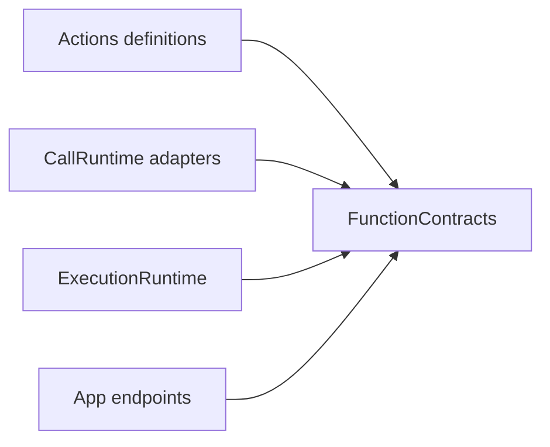

# FunctionContracts — Inputs, Outcomes and Metadata

## Summary

Independent bounded business-function interfaces and intrinsic execution constraints.

## Ownership and boundaries

The FunctionContracts target has no project dependency, Agent identity policy, call protocol, scheduler or execution implementation. Reporting and resource values are injected; contracts alone grant neither permission nor lease.

## External relationships and data flow

Runtime arrows show data or capability calls; dashed arrows show injection.

## Public interfaces

FunctionRequest owns canonical address/string arguments without Channel. FunctionInput exposes request, ActionExecutionContext, execution identity and FunctionReporting; FunctionInvocation is its neutral concrete value. Context carries opaque host-supplied task/decision identity without interpreting grants.

ActionFunction describes kind (finite/state/activity start/update/stop), completion policy, serialization key, resource resolvers and constant/dynamic budgets. CapabilityModule/Catalog validate and freeze at most 32 modules/256 entries. Request-dependent budgets are validated; sequence budgets sum and parallel budgets take the maximum.

Completion values are bounded to 64 KiB; reports to 256 entries; resources to eight. ActionReport retains leaf status/details plus executionFailure/failureDescription. ActionReport.empty is a validated empty value, not a fabricated success. Producer codes are bounded opaque identifiers. ActionArguments decodes shared string transport; domain values remain caller-owned.

✅ Independent standard inputs, bounded reports and immutable intrinsic metadata are implemented.

## Related design

[Parent design](../README.md)
