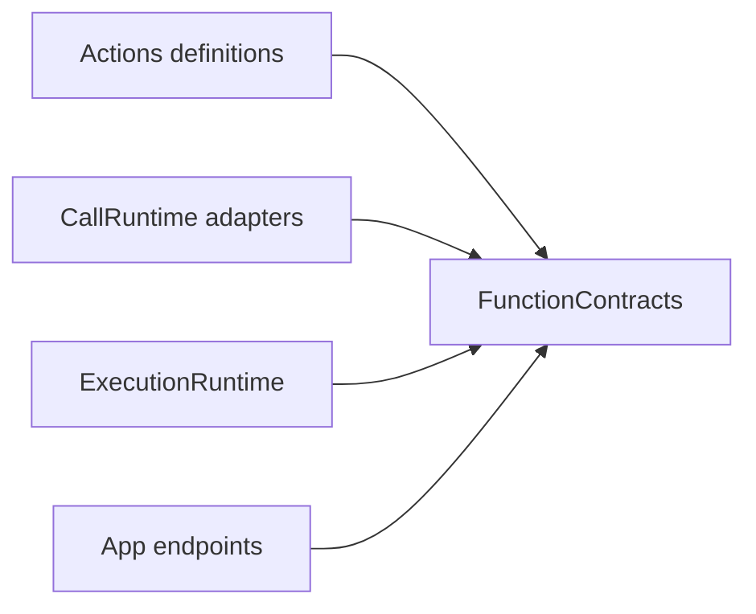

# FunctionContracts — Inputs, Outcomes and Metadata

## Summary

Independent bounded business-function interfaces and intrinsic execution constraints.

## Ownership and boundaries

The FunctionContracts target has no project dependency, Agent identity policy, call protocol, scheduler or execution implementation. Reporting and resource values are injected; contracts alone grant neither permission nor lease.

## External relationships and data flow

Runtime arrows show data or capability calls; dashed arrows show injection.

## Public interfaces

FunctionRequest owns canonical address/string arguments without Channel. FunctionInput exposes request, ActionExecutionContext, execution identity and FunctionReporting; FunctionInvocation is its neutral concrete value. Context carries opaque host-supplied task/decision identity without interpreting grants.

ActionFunction describes kind (finite/state/activity start/update/stop), completion policy, resource resolvers and constant/dynamic budgets. CapabilityModule/Catalog validate and freeze at most 32 modules/256 entries. Request-dependent budgets are validated; sequence budgets sum and parallel budgets take the maximum.

Completion values are bounded to 64 KiB; reports to 256 entries; resources to eight. ActionReport retains leaf status/details plus executionFailure/failureDescription. ActionReport.empty is a validated empty value, not a fabricated success. Producer codes are bounded opaque identifiers. ActionArguments decodes shared string transport; domain values remain caller-owned.

✅ Independent standard inputs, bounded reports and immutable intrinsic metadata are implemented.

## Related design

[Parent design](../README.md)

## Skill/task-mode contract

✅ ActionDeclaration/ActionParameter define neutral value schemas; each @Action supplies its own concrete documentation. This target bundles no per-function metadata file. TaskControlCapability is an injected neutral control port. Agents can consume this target without depending on concrete Actions.

## 泛化 Task 与独立 Skill

✅ Canonical Task control metadata declares JSON-array Skill groups and foreground/background startTask parameters. TaskControlCapability remains protocol-neutral and preserves real invocation ownership. Skills cannot rewrite schemas.
## Action-owned documentation and Skill instruction contract

✅ `ActionDeclaration` 与 `ActionParameter` 只定义中立值类型、参数说明与原生字符串 Schema，不包含业务函数清单或示例资源。每个函数通过自己的 `@Action` 提供数据；ActionFunction 持有同一声明。TaskControlCapability 仍是注入的宿主端口。

## Channel-owned Action ordering

✅ Function metadata and business attributes have no serialization key. Scheduled ordering belongs to [ChannelScheduler](../../Gateway/Output/Scheduling/README.md); resources/budgets and native capability admission remain explicit.

## Action timeout contract (2026-10-12)

✅ ActionFunction 默认静态 timeout 为 30 秒，nil 也归一到默认值；dynamicTimeout 返回 ActionExecutionBudget，executionBudget(for:) 统一解析动态优先/静态兜底并验证定义。ActionExecutionBudget.default 提供组合叶子的相同默认值；空组合预算为零预计耗时及 100 毫秒执行余量。

✅ 验证时统一ActionExecutionBudget行长格式；预算计算与执行语义保持原样。

✅ ActionReport.isCancellationOnly excludes independent real failures. hasFailures ignores cancelled execution/leaf codes; mixed real failures determine failed/partialFailure before cancellation. Typed/wrapped producer reports preserve already completed effects.
