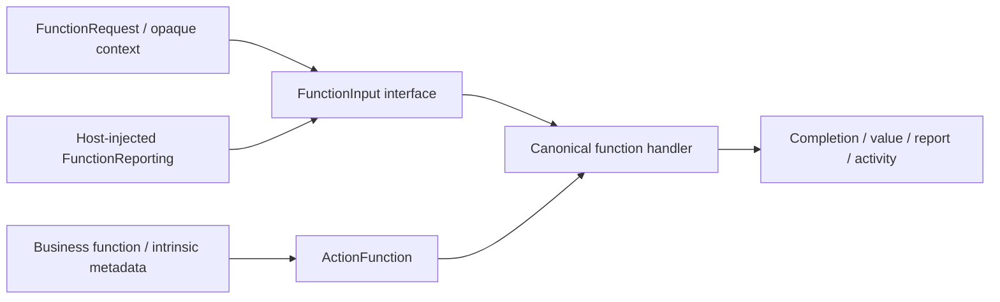

# Function Contracts

Purpose: define standard callable business input/output and intrinsic metadata. Design goals: independent FunctionContracts target, bounded values and no call protocol, execution implementation or Agent dependency.

✅ FunctionRequest contains canonical address and parameters, with no Channel. FunctionInput exposes that request, opaque ActionExecutionContext, execution identity and a FunctionReporting sink. FunctionInvocation is the ordinary concrete value; handlers use the shared interface. Reporting is injected; storage and cancellation machinery are runtime-owned.

✅ ActionFunction/@Action describe business kind/completion, resource/key requirements and constant/dynamic budgets. CapabilityModule/CapabilityCatalog contain functions only, validate metadata and freeze at most32 modules/256 entries. Arguments, outcomes and producer failures retain their bounds: values64 KiB, reports256 entries, resources8. No contract grants Agent permission, a resource lease or a hardware guarantee.

✅ Actions can import this target without seeing Gateway/Runtime, ActionInvocation/ActionRequest scheduling adapters, Tool contracts or protocol bindings. Pure function constraints cannot be weakened by a call binding.

❌ Durable replay/codecs, generic typed JSON arguments and remaining feature Signal/continuation migration are separate work. Standard function input is not a replacement for Signal.

✅ Implemented: ActionReport.empty provides an explicit empty validated value for attaching an actual worker exception without forced/fallible placeholder construction.

✅ ADR0187: ActionExecutionContext carries opaque task and decision identities supplied by the host. FunctionContracts does not interpret authorization; Gateway validates active Agent/task grants before supplying them.
