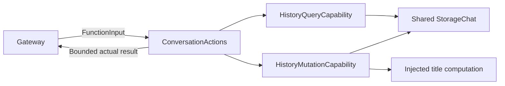

# Conversation History Functions

## Summary

Bounded history discovery/read previews and authorized archive/title/delete transactions.

## Ownership and boundaries

ConversationActions owns callable validation. Support owns query/transaction policy through shared StorageChat and injected mutation/title capability. Memory owns operation sequencing and trusted deletion confirmation; no raw response is parsed or replayed.

## External relationships and data flow

Runtime arrows show data or capability calls; dashed arrows show injection.

## Interfaces and result bounds

| History.Conversation function | Arguments | Result |
| --- | --- | --- |
| list | offset 0–64; limit 1–5 | Current first then newest archives; paged metadata |
| read | conversation UUID; offset 0–256; limit 1–2 | Oldest-first bounded turn previews |
| startNew | None | Committed archived UUID/null; empty current unchanged |
| summarize | Archived UUID | Persisted title acknowledgment or retained retry error |
| delete | Archived UUID | Deleted UUID acknowledgment; current/missing IDs fail |

String arguments are required where declared; unknown keys reject. JSON pages contain items/total and nextOffset only when more exists. Title/input previews use 40 UTF-8 bytes; read user/response previews 80/160, preserving whole characters with explicit truncated. Encoded result >1800 bytes fails resultTooLarge rather than truncating structure. Each call takes a fresh snapshot; pagination is not stable across calls.

## Transaction and failure

Cancellation before mutation prevents it; cancellation after durable commit cannot undo it. Archive precedes title inference. summarize has a 60-second function budget including preparation; title inference retains its 30-second bound. Failed title state is committed before throwing; secondary persistence failure retains both causes. Delete does not fabricate success for missing IDs or retry a write.

Memory model grants list/read only; fixed archive/delete/title permission is code-owned. Observation continuations are implemented in shared Chat; queries do not themselves start inference. Credentials, request prompts/native arguments/results and settings are excluded from previews.

✅ Bounded queries and explicit durable history mutations are implemented.

❌ Full-text search and unbounded record export through these functions are not implemented.

## Related design

[Parent design](../README.md) · [Support](Support/README.md)
