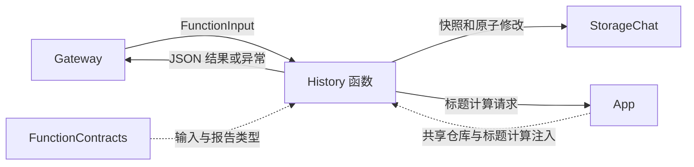
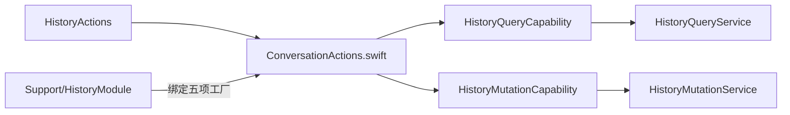

# History — 会话查询与归档事务

## 简介

为共享会话仓库提供有界分页预览及归档、标题生成和删除函数。入口负责参数与返回值，Support 服务负责投影和事务规则，StorageChat 负责权威数据与持久化。

## 上下游关系（一级）

本域不拥有另一个会话仓库、模型循环或页面状态。调用者的授权、确认和后续呈现属于上游。

## 内部模块关系

## 接口与结果

全部地址位于 `History.Conversation`，默认 timeout 为 30 秒，summarize 为 60 秒。

| 函数 | 参数 | 完成值 |
| --- | --- | --- |
| list | offset 0…64、limit 1…5 | 当前会话优先的会话元数据页 |
| read | id为list返回的ref或完整UUID、offset 0…1000000、limit 1…2 | 按仓库索引顺序排列的请求/压缩 Task 项目页 |
| startNew | 无 | archived ID 或 null |
| summarize | 已归档会话 id | 标题提交后返回 summarized ID |
| delete | 已归档会话 id | 删除提交后返回 deleted ID |

✅ 参数来自字符串传输，未知键被拒绝。list/read 结果最多 1800 UTF-8 字节，超过上限抛 resultTooLarge，不能裁掉 JSON 结构。页包含 items、total，存在更多内容时带 nextOffset；每次调用重新读取快照，不承诺跨调用分页稳定。

list 的 turnCount 是存储的输入块数量；read 的 total 是 indexedHistory 投影项数量，二者含义不同。read 项包含 kind=request/task、状态及适用的 taskID/inputID，读取已经持久化的请求片段或任务摘要，不生成摘要，也不执行历史函数。

## 生命周期与失败处理

入口在读取或修改前后检查取消；持久化完成后的取消不撤销提交。startNew 仅执行仓库归档，不自动生成标题。summarize/delete 明确拒绝当前会话和缺失的归档 ID。

标题计算由注入闭包执行，本域只声明 summarize 的 60 秒函数预算。失败或取消时先加入标题错误状态的持久化，再传播原始原因；如果记录错误本身失败，保留两个原因的报告。异常不触发这里的写入重放。

❌ 本接口没有全文搜索或完整会话导出；返回内容是显式截断的预览。

[Actions 设计](../README.md) · [查询与事务实现](Support/README.md) · [共享会话仓库](../../Storage/Chat/README.md)

## SQLite records and runtime identity

✅ Implemented: technical identities are opaque UUID strings; committed business entities use dialog/message/task/media/device SQLite IDs. Consumers use Storage repositories while preserving ownership, cancellation and independent foundation boundaries. Complete messages, including each ReACT message, persist at termination; delta fragments do not persist. The custom allocator and replaced file/index implementation are removed. See the project SQLite business-record plan.
