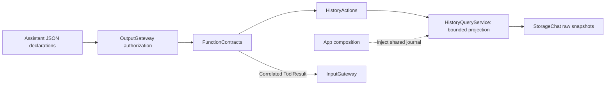

# History Actions

Purpose: expose conversation discovery, record previews and explicit archival/title operations and archive-only deletion through the existing output boundary. Design goals: shared deterministic queries, bounded results, explicit truncation and no effect replay.

| Entry | Arguments (strings) | Result |
| --- | --- | --- |
| History.Conversation.list | offset 0–64, limit 1–5 | Current conversation first, then newest archives; IDs, ISO-8601 timestamps, archive flag, summary/latest-input previews and turn counts |
| History.Conversation.startNew | None | Committed archived UUID/null; empty current is unchanged |
| History.Conversation.summarize | Archived conversation UUID | Saved title acknowledgment; inference failure/cancel retains retry error |
| History.Conversation.delete | Archived conversation UUID | Deleted UUID acknowledgment; current/missing IDs fail; fixed internal memory permission only |
| History.Conversation.read | conversation UUID, offset 0–256, limit 1–2 | Oldest-first turn previews with IDs and generation state |

List/read return JSON pages with items, total and optional nextOffset (absent at end). Preview fields contain value and truncated. List title/input previews use 40 UTF-8 bytes; read user/response previews use 80/160 bytes, preserving whole characters. These are bounded previews, not full export or semantic retrieval. Each call reads a fresh snapshot; pagination is not a stable cross-call transaction.

✅ Arguments are required, unknown keys reject, and cancellation is checked before/after query. Encoded results above 1800 bytes fail resultTooLarge; callers can request a smaller page. Missing IDs fail notFound. Credentials, request prompts, Tool arguments/results and model settings are excluded. Raw response text is data, never parsed or replayed.

✅ Actions/History depends on StorageChat for the concrete query implementation. Runtime and BehaviorAssembly retain their independent contracts; no new store, queue or Agent is added. See [Support](Support/README.md).

✅ Refresh and confirmed deletion use the memory Agent intent route. ❌ Full-text export/search and model result-driven continuation remain pending. Cloud native calls can invoke these functions through host ToolCall bindings; local chat remains text-only. Current Assistant presents escaped Tool results without continued model reasoning.

✅ History.Conversation.delete uses an injected HistoryMutationCapability. HistoryMutationService validates the archive against the shared journal and invokes its atomic transaction; Actions/History owns no UI or model effect. It returns a small JSON acknowledgment only after persistence succeeds. Cancellation before the transaction prevents the call; later cancellation cannot undo a committed write. No automatic retry or missing-ID success fallback.

❌ Assistant JSON exposes only read-only list/read; deletion is not model-callable in this stage.

✅ ADR0151: this domain is compiled once in Actions; both ActionCall and ToolCall entries use FunctionContracts contracts. Host injection and permission/feedback behavior are unchanged.
✅ Shared execution from ADR0157 is retained; ADR0160 separates callable functions from host bindings.

✅ ADR0152: functions are classified by domain before protocol unification. Canonical namespaces use `<Domain>Actions`; production uses one pure `<Domain>Module`; host registration creates Action/Tool projections. Superseded aliases/protocol catalogs are retired.
✅ Unified definitions and compatibility retirement are implemented in ADR0157.

## Cohesive module files — ADR0154

Purpose: implement directory/module-file/function ownership while preserving current protocol APIs. The domain Actions enum remains a used namespace facade; callable bodies belong exclusively to the files below. Support owns one domain catalog, values and host capabilities.

- [ConversationActions.swift](ConversationActions.swift)

✅ Implementations are split without forwarding or duplicated metadata/handlers. Generated factories and existing call paths, permissions, resources and scheduling are unchanged.
✅ Three-field addresses, Agent v6 configuration and shared definitions/results are implemented in ADR0156/0157.

✅ ADR0159 — Unified invocation: all business functions, injected capabilities and registered handlers receive FunctionInput with ActionExecutionContext. Native request/result normalization stays in Runtime/Gateway; no protocol-specific implementation signature remains.

✅ ADR0160: this domain exposes ActionFunction values with canonical invocation and intrinsic constraints. Protocol availability, native scheduling and feedback belong to host-created ActionBinding; domain code consumes no Tool wire/error contracts. ❌ New feature/physical acceptance remains separate.

✅ ADR0161: standard callable inputs use FunctionInput/FunctionContracts; common execution and call protocols belong to independent Gateway targets. This directory retains its existing ownership, resource/permission and lifecycle boundaries. ❌ Remaining feature Signal/continuation and physical acceptance are separate work.

✅ Implemented: History.Conversation.startNew validates no arguments and returns archived UUID/null; summarize validates archive UUID and invokes the title mutation capability. Preserve commit-before-inference, bounded title-only inference, archived-only validation and retryable error persistence before throwing. No output text is executed or model mutation grant added.

✅ Implemented: summarize has a60-second cooperative execution deadline (including capability preparation), retaining the title helper30-second inference limit. If recording a title failure also fails, return a bounded two-cause ActionReport rather than hiding either error.
