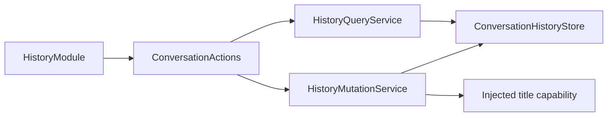

# History Query and Mutation Services

## Summary

Protocol-neutral history catalog and bounded projection/mutation policy over a shared journal.

## Ownership and boundaries

HistoryModule injects query/mutation endpoints and binds five functions. Storage owns persistence; this directory owns paging/preview/transaction meaning. App injects title computation; no implicit store/model, UI or transport policy exists.

## External relationships and data flow

Runtime arrows show data or capability calls; dashed arrows show injection.

## Reads and mutations

HistoryQueryService validates page ranges/IDs, selects a fresh shared snapshot and encodes bounded previews/JSON with explicit whole-character truncation. Reads share StorageChat's 16-waiter admission bound; no extra cache or queue is added.

HistoryMutationService validates archive-only mutation and awaits atomic journal persistence before acknowledgment. startNew retains empty-current behavior. summarize invokes only injected title computation, commits bounded failure/retry state on error/cancellation, then propagates. If recording failure also fails, return both causes. Committed data remains real after later feedback failure; no automatic retry or rollback fiction.

✅ Explicit query/mutation interfaces, five canonical definitions and shared-journal policy are implemented.

## Related design

[Parent design](../README.md)

## Action-owned documentation and Skill instruction contract

✅ 本目录 CapabilityModule 的 `@ActionCatalog` 从实际 `*Definition` 注册调用（含本类型的本地 helper）生成静态 declarations。添加已有域函数只需修改所属实现及本地依赖绑定，不再同步公共元数据列表。声明投影不捕获设备、处理器或运行会话。
