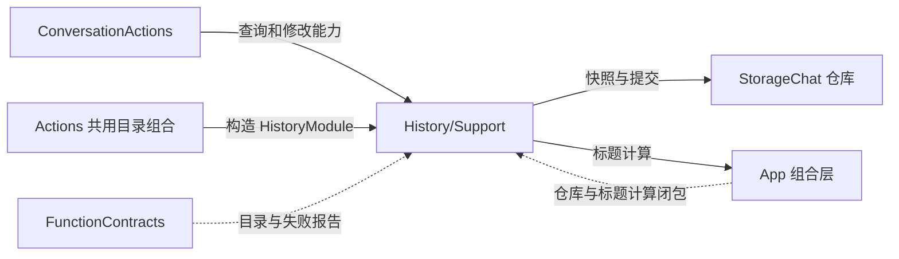
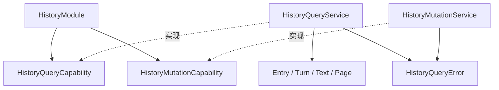

# History Support — 有界预览与共享仓库事务

## 简介

HistoryModule 定义查询/修改能力端口及五项函数绑定；HistoryQueryService 和 HistoryMutationService 基于同一个 ConversationHistoryStore 提供业务实现。

## 上下游关系（一级）

## 内部模块关系

## 查询算法与数据约束

list 使用 store.listConversations 的当前会话与归档元数据，顺序沿用按 archivedAt 排序的索引，不加载归档正文。标题和 latestUser 预览各最多 40 UTF-8 字节，turnCount 取输入块数。

read 查找当前或归档会话并调用 `indexedHistory()`，按项目分页。request 项取请求输入与 完整 response 字符串，带请求状态及输入/Task 关联；task 项取 goal 与 reportedSummary/failure 的组合，带实际终态和 Task 身份。user/response 分别限 80/160 UTF-8 字节，total 计算投影项数。

Text 按 Swift Character 逐个累计字节，保留完整字符，并明确提供 truncated。Page 使用 ISO8601 日期、排序键和无斜杠转义的 JSON；整体最多 1800 字节。服务再次验证页范围，错误编码为 missingConversation、resultTooLarge、currentConversation 对应的执行失败代码。

## 修改状态与失败处理

startNew 等待可恢复归档与新 current 创建，返回可选旧会话 ID，并提交根持有的单个标题任务；标题不阻塞新会话。deleteArchived 按ID读取会话，拒绝当前或不存在的会话，在删除前检查取消，再等待仓库原子修改。

summarizeArchived 读取并验证归档会话，执行注入的异步标题计算，检查取消后调用 setTitle。计算或提交失败时尝试保存 nil 标题与最多 1024 字符的错误状态；该记录加入结束后才抛出原始错误。若记录失败，抛 ActionReportedError，包含 title 与 retryState 两条结果，保留主要和次要失败。

✅ 服务持有共享 actor 仓库和一个根所有者可取消/加入的标题 worker。自动标题与显式重试共用单个准入槽，溢出明确记录可重试失败；不创建第二个历史仓库或自动重试。取消不能撤销已经完成的持久化；并发与仓库一致性规则由 StorageChat 负责。查询和目录本身不授予历史访问或删除确认。

[History 参数与完成](../README.md) · [StorageChat 设计](../../../Storage/Chat/README.md) · [共享契约](../../Support/Contracts/README.md)

## 会话存储性能重构 v3

✅ 已实现：查询服务调用 store.listConversations / conversation(id)，修改服务按ID操作。标题任务独立于新会话事务；保存失败显示具体原因。
