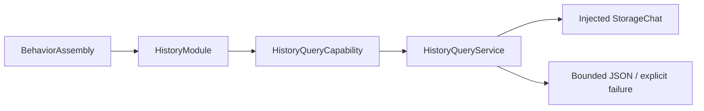

# History Tool Support

Purpose: own capability injection, registration, query projection and domain failures. Design goals: explicit host binding, explicit read/mutation separation and bounded transport values.

✅ HistoryModule binds three returning handlers with separately required query/mutation capabilities. HistoryQueryCapability permits isolated implementations; production uses HistoryQueryService with the same ConversationHistoryStore as Assistant/history UI. The service validates pagination independently, projects only requested entries and bounds encoded results. Storage owns persistence; Tools owns query/presentation-independent preview policy.

✅ No new asynchronous queue, cache, device action, inference or UI dependency. Read operations retain the existing StorageChat 16-waiter bound and overflow policy.

❌ No implicit store construction, unbounded/full record result, automatic result-size retry or stable pagination snapshot.

✅ HistoryMutationService implements archive-only deletion using the injected journal; HistoryQueryService remains read-only. Errors preserve notFound/current-ID validation codes. ❌ No UI import, new store, inference or automatic deletion retry is added.

✅ ADR0151: this domain is compiled once in Actions; both ActionCall and ToolCall entries use ActionRuntime contracts. Host injection and permission/feedback behavior are unchanged.
❌ Unified capability definitions and protocol registration adapters remain pending.

✅ ADR0152: functions are classified by domain before protocol unification. Canonical namespaces use `<Domain>Actions`; production uses one `<Domain>Module` with Action/Tool registry projections. Legacy names are aliases or registration projections, not duplicated implementations.
❌ Unified callable definitions and migration of compatibility names remain pending.
