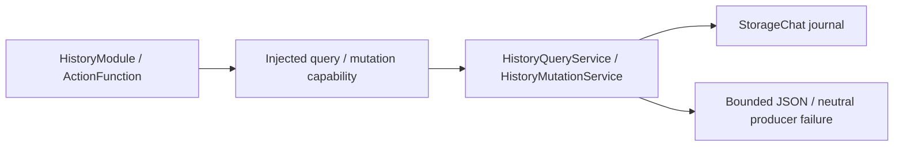

# History Action Support

Purpose: inject journal capabilities, project query results and classify domain failures. Design goals: protocol-neutral catalogs, explicit read/mutation separation and bounded data.

✅ HistoryModule binds five ActionFunctions to required HistoryQueryCapability/HistoryMutationCapability endpoints. HistoryQueryService uses the shared ConversationHistoryStore, validates pagination, projects requested entries and bounds JSON. Storage owns persistence; Actions owns query/preview policy. Host composition separately chooses native returning registration.

✅ Read operations retain the existing StorageChat16-waiter bound and overflow policy. Mutation deletes archives through the injected journal, preserving missing/current-ID failures and atomic persistence. This directory adds no queue, cache, concrete UI/model dependency or new store.

❌ No unbounded/full-record result, automatic retry, stable pagination snapshot, implicit store or permission inference.

✅ ADR0161: standard callable inputs use FunctionInput/FunctionContracts; common execution and call protocols belong to independent Gateway targets. This directory retains its existing ownership, resource/permission and lifecycle boundaries. ❌ Remaining feature Signal/continuation and physical acceptance are separate work.

✅ Implemented: expand HistoryMutationCapability/Service and HistoryModule to five functions. Service shares the journal and requires injected title computation. Title failure/cancellation records a bounded retry error before propagating; failure to save that state propagates explicitly. No fallback store/model or retry is introduced.
