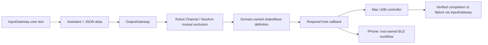

# NexArm — supervised diagnostic Action

Purpose: expose the first real NexArm behavior through the standard Action entry and domain-owned registration. Design goals: typed injection, explicit bounds, verified controller feedback and no implicit hardware activation.

✅ `NexArm.nudgeWrist(degrees:)` / `NexArmActions.nudgeWrist` is a finite Action. Required `degrees` is a nonzero integer from -2 through 2 in degrees; unknown keys fail before effects. The injected callback must enforce device availability, absolute limits and the completion contract. `NexArmActionModule` registers it explicitly through BehaviorAssembly's module-list initializer.

```mermaid
flowchart LR
    Host[Supervised diagnostic host] --> Input[InputGateway]
    Input --> Agent[Diagnostic fixture: fixed internal permission]
    Agent --> Output[OutputGateway]
    Output --> Scheduler[ChannelScheduler: Arm / NexArm exclusion]
    Scheduler --> Action[NexArm.nudgeWrist]
    Action --> Binding[Host-injected typed callback]
    Binding --> Controller[PlatformKit NexArmController]
    Controller --> USB[Mac USB serial]
    USB --> Feedback[Controller-reported joint positions]
    Feedback --> Controller
```

The wrist capability is opt-in and absent from Assistant JSON. The hardware test supplies the explicit composition binding and exercises InputGateway → OutputGateway → scheduler → Action. No business Agent is added. No Action-local queue; ordinary scheduler bounds apply. The test uses one Channel slot and one tracked input. Device owner admission is capacity one, with immediate `busy` rejection and one wrist nudge maximum per controller lifetime; bounded base sweeps can be requested again after successful completion.

Completion means three consecutive controller-reported wrist positions within six counts of the encoder target estimate and one degree of the reported roll target, with no other joint changing by more than eight counts from the stable baseline. This is device telemetry evidence, not independent visual verification or a zero-velocity measurement. The adapter currently supports only the observed ESP32/AT32 1.0.2 pair. Exact transport, cancellation and hardware limits are in [Connectivity/NexArm](../../PlatformKit/Connectivity/NexArm/README.md).

Cancellation before commitment emits no motion. After commitment the bounded device target is allowed to settle and its join is awaited before cancellation returns. No reverse movement or torque-off is used as cleanup. Uncertain completion latches the owner faulted and blocks further motion. It does not claim an emergency stop. This documented diagnostic exception is unsuitable for unattended robot use.

❌ TCP bindings, unattended autonomous operation, shared resource lease/physical-stop integration and device-side watchdog validation remain pending. No simulated success, fallback, motion retry, firmware flashing, calibration or torque enabling is supplied.

## Assistant base sweep

✅ `NexArm.shakeBase(cycles:)` / `NexArmBaseActionModule` is in the built-in catalog; `ActionModules.builtIn` requires an explicit typed callback. Assistant JSON declares alias `shakeBase`, Channel Robot and required integer cycles 1...3. Unknown keys fail. Each cycle follows +2° / -2° / origin with 1500 ms interpolation per leg. Successful return requires controller telemetry convergence for every leg and base return within six counts. See the platform README for IK and tolerance limits. No Action-local queue.

The supervised Mac test binds real USB; its model output and UI are deterministic test fixtures, not evidence of real-model selection. Cancellation joins only the committed leg and starts no further leg, including return-to-origin. Failed/uncertain legs latch the controller fault. ✅ iPhone BLE binding is implemented in the root-owned BluetoothWorkflow. ❌ Production resource leases and device stop/watchdog remain pending.

✅ iPhone composition now invokes the same typed finite Action through BluetoothWorkflow; no BLE types enter Actions. Completion/error/cancellation behavior and ±2°/1...3-cycle limits are unchanged. ❌ Near-vertical or out-of-range poses are rejected; this action never resets/repositions the arm automatically.
