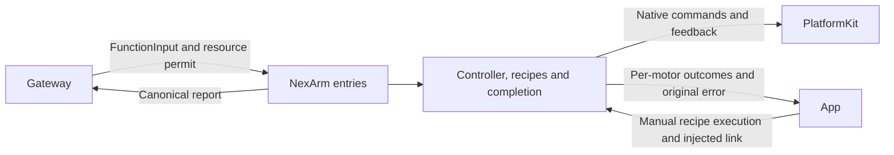

# NexArm Motion and Gesture Functions

## Summary

Finite motor/gesture entry points with per-motor completion, bounded recipes and complete failure reports.

## Ownership and boundaries

Actions owns arguments, home/gesture/motion policy and arrival/report semantics. NexArm/Support alone imports PlatformKit for native encoding/feedback; App owns connection/lifetime/resource bindings. Settings and Agent calls reuse recipes; manual native takeover is an explicit App policy.

## External relationships and data flow

Runtime arrows show data or capability calls; dashed arrows show injection.



## Entry parameters and source ownership

GestureActions.swift owns nod/shake/wave/tilt/lookAround/celebrate/dance. MotionActions.swift owns reset/shakeBase/moveMotor/resetMotor. TrackingActions.swift owns aim. NexArmActions.swift is the used namespace/value facade; Support owns domain implementation/catalogs.

| Function | Required arguments | Motor scope |
| --- | --- | --- |
| moveMotor | motor 1–6; target 0–4095 plus hardware range | Selected motor |
| resetMotor | motor 1–6 | Selected motor with configured/home policy |
| reset | None | 1–5 |
| nodHead / shakeHead | cycles 1–3 | 4 / 5 |
| shakeBase / lookAround / celebrate / dance | cycles 1–3 | 1–5 |
| waveWrist | count 1–3 | 1–5 |
| tiltWrist | direction left/right | 1–5 |

Optional speed is native 1–1400 (default 1400), acceleration 1–254 (default 30). Unknown parameters fail. Time/deceleration packet bytes remain zero; torque/mode/calibration/amplitude/pause are not movement arguments. Gestures/whole reset never command/check gripper; explicit motor 6 reset requires configured home.

## Home, plans and completion

Passive ordinary reset uses referenceHomeJoints motors 1–5 `[2048,2087,1198,1238,2048]`, without IK or feedback substitution. Tracking rest is separately `[2047,2087,1984,2045,2048]`. Explicit motor software homes take precedence. Strict pose preparation resolves home XYZ `[200,0,200]` mm with zero pitch/roll; reference counts are not measured feedback or firmware calibration. IK geometry cache permits 64 entries.

NexArmMotionPlan permits 20 groups of up to six distinct addressed motors. CMD3 targets and synchronized CMD131 groups use native encoding, never Cartesian whole-device movement that would include gripper. Parent resource union equals addressed motors and stays held through delays; children inherit the permit. Generic parallel resources must be disjoint.

Fresh post-send feedback inside tolerance completes immediately, even during motion. Motor tolerances are 16/20/56/32/16/24 counts for IDs 1–6; motor 6 is provisional. Cached samples cannot complete new work. Off-target fresh samples within a two-count anchor over the stability window produce targetNotReached; movement resets it and missing samples cannot extend it. Two-second feedback loss latches remaining plan work without new writes. Ordinary target/deadline failure continues later segments; explicit cancellation stops future writes.

```text
rampEstimate = 0.4 * sqrt(30 / acceleration)
expected = distance / speed + rampEstimate + 0.2
motionTimeout = 3 * expected + 1.2
stableOffTarget = max(0.6, 8 / speed + rampEstimate)
```

These are empirical execution estimates, not calibrated acceleration units. Unknown current position reserves greatest legal travel. Feedback observation ticks every 20 ms. Registration conservatively reserves group travel plus one-second admission per group and five-second setup/cleanup; queue time is excluded. Sequence budgets sum, simultaneous budgets take maximum; no estimate inserts a sleep.

## Resource, report and error contract

Resources are nexarm.motor.1…6. Generic composition bounds depth eight, 256 results, 32 repeats, 30-second delay and eight-resource union. Reserve report leaves plus execution-failure capacity before effects; overflow never silently truncates. Ordinary child failures retain outcomes and continue; final report preserves any later exception/timeout even after successful children.

Motor failures distinguish targetNotReached/timedOut/feedbackLost/disconnected and admission/sending/feedback stages. Pre-acceptance send admission may retry only within one second; accepted uncertain motion never replays. Call-local busy/foreground/resource/argument errors do not trigger Bluetooth recovery. Passive production streaming has no persistent failure latch; guarded diagnostic uncertainMotion requires explicit read-only recoverState.

Manual preset/jog submission is not arrival. App reports late native-worker failures separately from the original receipt. Channel advances after joined handler cleanup; no failure claims rollback, stationary hold or physical stop.

✅ Shared finite recipes, fresh motor completion, dynamic budgets and complete outcomes are implemented.

## Related design

[Parent design](../README.md) · [Support](Support/README.md)
