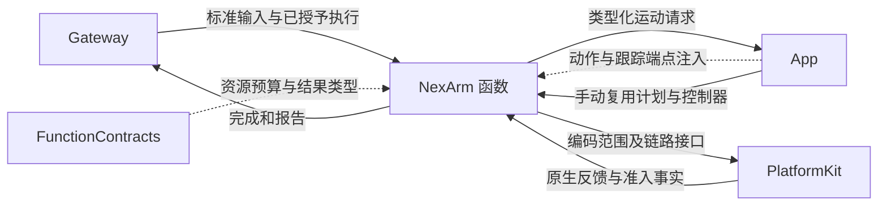
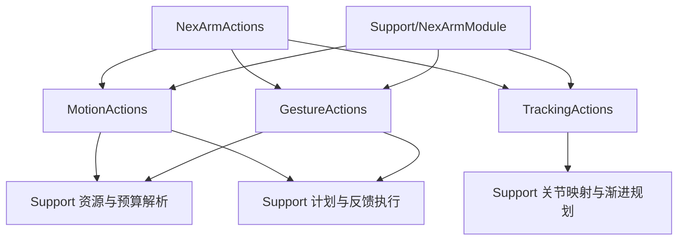

# NexArm — 电机运动、有限动作与跟踪目标

## 简介

提供单电机移动/归位、整臂归位、有限表演动作和相机跟踪目标发布。业务域负责参数、资源、预算、动作规划及反馈完成；App 负责连接、前台准入、共享资源策略和常驻跟踪 worker。

## 上下游关系（一级）

只有本域 Support 导入 PlatformKit。入口不依赖具体 Bluetooth/App 对象；机械臂安全准入与连接寿命仍由宿主负责。

## 内部模块关系

## 接口与电机范围

目录包含十一项有限运动函数及一项跟踪发布函数。

| 地址模块 | 函数与参数 | 资源声明 |
| --- | --- | --- |
| NexArm.Motion | moveMotor：motor 1…6、target 0…4095；resetMotor：motor 1…6 | 选中电机 |
| NexArm.Motion | reset：无必填参数；shakeBase：cycles 1…3 | 电机 1…5 |
| NexArm.Gesture | nodHead：cycles 1…3 | 电机 4 |
| NexArm.Gesture | shakeHead：cycles 1…3 | 电机 5 |
| NexArm.Gesture | waveWrist：count 1…3；tiltWrist：direction left/right | 电机 1…5 |
| NexArm.Gesture | lookAround/celebrate/dance：cycles 1…3 | 电机 1…5 |
| NexArm.Tracking | aim：有限 base/pitch 弧度，均为 −4π…4π | 发布函数不持有电机资源 |

有限运动可选 speed 1…1400（默认 1400）、acceleration 1…254（默认 30）；未知键拒绝。target 在执行编码时进一步受设备电机范围约束。入口不接受时间、减速度、力矩、模式或校准参数。

运动请求以 GestureRequest 或注入闭包传递。调用者实际获得的效果来自宿主绑定：有限动作的定义要求新鲜反馈判定完成；aim 只确认目标发布，常驻跟踪和资源持有属于宿主 worker。

## 资源与预算

NexArmRegistration 将资源命名为 `nexarm.motor.1` 至 `.6`。nod/shakeHead 只声明相应电机，move/resetMotor 解析指定电机，其余有限动作声明 1…5。无效单电机参数不能据空解析结果取得运动授权，函数参数校验仍会拒绝执行。

有限函数使用 dynamicTimeout。注册前按速度/加速度、最大合法行程、动作段数估算：段内电机预算取最大，段间求和，每段包括一秒发送准入余量，整体再加入五秒准备/清理余量。实际逐电机 deadline 由控制器按已获得的位置计算。预计时间不插入最低等待，预算不包含调度排队。aim 使用共享的默认 30 秒发布预算。

## 完成、状态与失败

Support 将动作转换为有界电机计划。整臂动作及归位只涉及 1…5；motor 6 只能由显式单电机路径操作，resetMotor(6) 必须配置软件 home。普通 passiveBLE 归位参考位置与跟踪 rest 是独立状态，不以发出的目标冒充测量值。

新鲜的发送后反馈进入容差即完成；稳定未到位、运动超时、反馈丢失、断连、发送/准入/反馈异常各有明确结果。普通未到位或电机超时保留结果并执行后续段；取消停止后续写入，清理观察会话。详细算法、数值与状态位于 Support。

Controller 提供 motorResults 与 revision；宿主将逐电机结果写入本次 invocation 的报告端口，并保留后续异常。单个控制器一次只接纳一个物理执行，即使上层资源集合不相交也不会自动获得控制器内并行执行。

本域没有另一套 Channel 队列或 Bluetooth 重连策略。取消加入软件清理不证明设备物理停止，已有运动不会通过隐式补偿或重发撤销；手动/跟踪操作的持续寿命与替换由宿主负责。

[NexArm 算法与状态](Support/README.md) · [Actions 设计](../README.md) · [原生协议与链路](../../PlatformKit/Connectivity/NexArm/README.md)

## 待实现

- 暂无本目录独立的实现待办；跨模块及实际模型/设备验收见所属模块说明。
