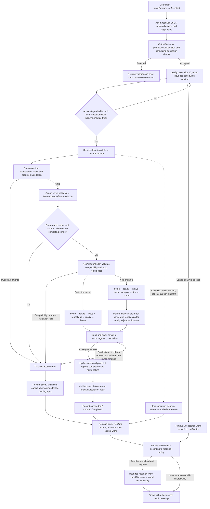
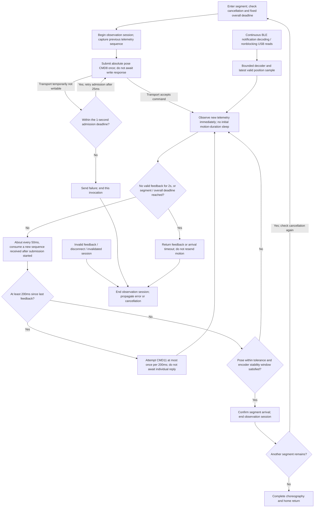
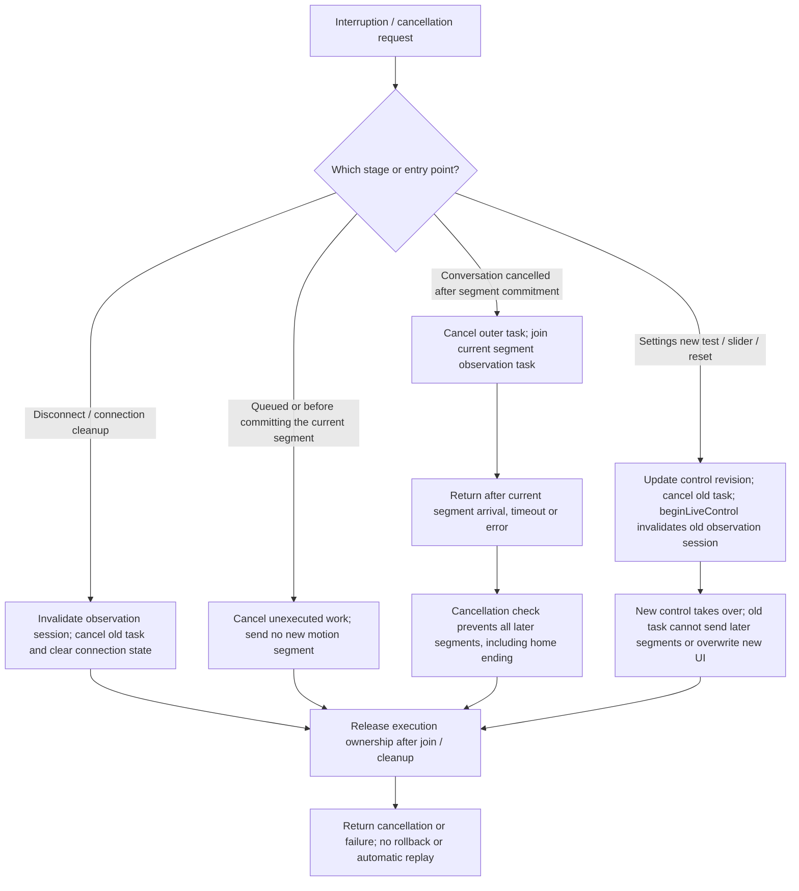
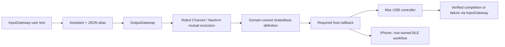
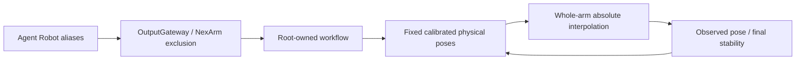

# NexArm — Robot Arm Actions and Lifecycle

Purpose: declare finite robot arm Actions, validate arguments, and execute device behavior through typed callbacks injected by App. Design goals: keep Actions independent of Bluetooth and serial implementations, await actual completion, bound queues and execution deadlines, and report failures and interruptions accurately.

The “Complete lifecycle” section defines the current production flow. The earlier USB diagnostic sections retain their separate constraints and do not describe current phone performance behavior.

## Complete lifecycle (current channel Actions)

✅ Eight model-callable entries cover nine gestures; `tiltWrist` distinguishes left and right through its direction argument. The Agent resolves aliases to `NexArm.*`; OutputGateway receives resolved calls and validates permissions and parameter names. Domain Actions then validate argument types, values, and unknown fields before any device effects.

`await` covers actual handler completion and cleanup, not model generation completion or a successful Bluetooth write. Each task-local lane preserves order; NexArm module exclusion also applies across tasks. Robot channels from all Agents are not collapsed into one global FIFO. Default scheduling limits are 64 tracked tasks and 32 unfinished Actions per channel name. Overflow rejects admission without dropping admitted Actions; see the [scheduling contract](../../Gateway/Output/Scheduling/README.md). Workflow and Controller create no additional Action queue and reject competing control as busy.

Device feedback and Action feedback serve different purposes: device packets establish observed arrival, while `ActionResult` describes the execution outcome. Gateway defaults to `failuresOnly` and enables feedback only for Agents accepting `actionResult`. Terminal results pass through InputGateway; current Agents retain them in history without automatically starting a model turn. Result messages have bounded delivery retries; **device Actions are never replayed by those retries**. Rejected admission has no execution terminal message. A running failure cancels the owning input’s remaining scheduled work; a previous unconfirmed pose does not lock out a new explicit invocation. See [result delivery](../../Gateway/Output/Results/README.md).

### Segment submission, observation and arrival detection

This diagram describes production BLE/USB observation. Protocol compatibility is checked before building the fixed choreography; validated connections reuse that result. Transport acceptance of a Bluetooth write means local submission, not physical arrival. Valid position packets contain a 24-byte CMD11 payload with pose and six encoder values. Only the latest telemetry is retained; replacing telemetry never discards an Action.

| Check or deadline | Current implementation |
| --- | --- |
| Cartesian preset sequence | At most 22 segments; initial home 3000ms, final home 1200ms, all others 800ms each |
| Head sequence | Home800ms → ready800ms → five native targets per cycle (750ms nominal each) → home1200ms; at most18 segments |
| Cartesian-to-servo handoff | Ready arrival requires a fresh sample at/after its800ms trajectory duration; telemetry and watchdogs continue during the interval |
| Head body arrival | All six encoders within16counts of measured-ready joints plus the active motor offset; same fresh stability window |
| XYZ arrival tolerance | Each axis ≤15mm for intermediate poses; ≤5mm at final home |
| Angle tolerance | Pitch ≤4° intermediate and ≤2° final; roll/claw both ≤2° |
| Stability | All six encoder values remain within 2 counts of a stable anchor; received samples span 200ms intermediate or 300ms final |
| Stability window reset | Leaving pose tolerance clears the window; leaving the encoder anchor restarts it; one packet or elapsed wall time alone cannot confirm completion |
| Feedback watchdog | No valid feedback for 2 consecutive seconds → result unknown; end the wait |
| Segment arrival deadline | Commanded segment duration + 3s; continuing feedback cannot extend it indefinitely |
| Fixed overall deadline | Sum each segment’s duration + 3s once at action start; never renew it during playback; a single 10-segment dance has a 40.6s upper bound |
| State after completion | Reuse the last observed pose for UI updates without an additional blocking query |

❌ The current firmware protocol has no action ID, device sample sequence/timestamp, or reliable completion event. Arrival is inferred from received pose and stability; this cannot prove strict command-to-response causality or detect repeated stale device samples. Host watchdogs are not a hardware emergency stop or firmware link-loss protection.

### Cancellation, manual takeover and failure cleanup

**Ordinary conversation cancellation is not an immediate physical stop.** Cancelling a Swift task does not withdraw an already committed segment; its segment and overall deadlines still apply. Cancellation does not automatically send home; reset requires a new explicit operation. Settings reset sends CMD54 without awaiting a reset-completion reply or claiming confirmed home arrival. Reconnection does not replay the original Action. Physical effects after execution failure or cancellation are conservatively reported as unknown.

### Settings tests and acceptance boundaries

✅ Settings Play invokes the Workflow test-send path directly, bypassing channel Action scheduling and completion waits: ready 400ms → body 800ms per segment → home 600ms, at most 8 frames. Only the latest test plan is retained; new operations replace unsent frames. Playback advances on cancellable frame deadlines without awaiting arrival, and UI reports submission only. Individual motor sliders and reset use the same manual takeover path. See the [device control README](../../PlatformKit/Connectivity/NexArm/README.md) for implementation details.

✅ Physical USB testing verified all seven performance presets, 50 segment arrival checks, and final home returns; see [physical acceptance](../../../docs/NexArm_Physical_Acceptance.md). This validates the controller shared with iPhone. ❌ Bluetooth transport performance, repeated-cycle endurance, and physical emergency stopping require separate acceptance.

Implementation entry points: [domain Actions](NexArmGestureActionModule.swift), [composition bindings](../../App/Composition/ApplicationRuntime.swift), [Workflow](../../App/Workflows/BluetoothWorkflow.swift), [controller](../../PlatformKit/Connectivity/NexArm/NexArmController.swift), and [arrival tracker](../../PlatformKit/Connectivity/NexArm/NexArmProtocol.swift).

## Earlier USB diagnostic: nudgeWrist

✅ `NexArm.nudgeWrist(degrees:)` / `NexArmActions.nudgeWrist` is a finite Action. Required `degrees` is a nonzero integer from -2 through 2 in degrees; unknown keys fail before effects. The injected callback must enforce device availability, absolute limits and the completion contract. `NexArmActionModule` registers it explicitly through BehaviorAssembly's module-list initializer.

```mermaid
flowchart LR
    Host[Supervised diagnostic host] --> Input[InputGateway]
    Input --> Agent[Diagnostic fixture: fixed internal permission]
    Agent --> Output[OutputGateway]
    Output --> Scheduler[ChannelScheduler: Arm / NexArm exclusion]
    Scheduler --> Action[NexArm.nudgeWrist]
    Action --> Binding[Host-injected typed callback]
    Binding --> Controller[PlatformKit NexArmController]
    Controller --> USB[Mac USB serial]
    USB --> Feedback[Controller-reported joint positions]
    Feedback --> Controller
```

The wrist capability is opt-in and absent from Assistant JSON. The hardware test supplies the explicit composition binding and exercises InputGateway → OutputGateway → scheduler → Action. No business Agent is added. No Action-local queue; ordinary scheduler bounds apply. The test uses one Channel slot and one tracked input. Device owner admission is capacity one, with immediate `busy` rejection and one wrist nudge maximum per controller lifetime; bounded base sweeps can be requested again after successful completion.

Completion means three consecutive controller-reported wrist positions within six counts of the encoder target estimate and one degree of the reported roll target, with no other joint changing by more than eight counts from the stable baseline. This is device telemetry evidence, not independent visual verification or a zero-velocity measurement. The adapter currently supports only the observed ESP32/AT32 1.0.2 pair. Exact transport, cancellation and hardware limits are in [Connectivity/NexArm](../../PlatformKit/Connectivity/NexArm/README.md).

Cancellation before commitment emits no motion. After commitment the bounded device target is allowed to settle and its join is awaited before cancellation returns. No reverse movement or torque-off is used as cleanup. Uncertain completion latches the owner faulted and blocks further motion. It does not claim an emergency stop. This documented diagnostic exception is unsuitable for unattended robot use.

❌ TCP bindings, unattended autonomous operation, shared resource lease/physical-stop integration and device-side watchdog validation remain pending. No simulated success, fallback, motion retry, firmware flashing, calibration or torque enabling is supplied.

## Earlier USB diagnostic: Assistant base sweep

✅ `NexArm.shakeBase(cycles:)` / `NexArmBaseActionModule` is in the built-in catalog; `ActionModules.builtIn` requires an explicit typed callback. Assistant JSON declares alias `shakeBase`, Channel Robot and required integer cycles 1...3. Unknown keys fail. Each cycle follows +2° / -2° / origin with 1500 ms interpolation per leg. Successful return requires controller telemetry convergence for every leg and base return within six counts. See the platform README for IK and tolerance limits. No Action-local queue.

The supervised Mac test binds real USB; its model output and UI are deterministic test fixtures, not evidence of real-model selection. Cancellation joins only the committed leg and starts no further leg, including return-to-origin. Failed/uncertain legs latch the controller fault. ✅ iPhone BLE binding is implemented in the root-owned BluetoothWorkflow. ❌ Production resource leases and device stop/watchdog remain pending.

✅ iPhone composition now invokes the same typed finite Action through BluetoothWorkflow; no BLE types enter Actions. Completion/error/cancellation behavior and ±2°/1...3-cycle limits are unchanged. ❌ Near-vertical or out-of-range poses are rejected; this action never resets/repositions the arm automatically.

## Current phone performance actions

✅ App maps base sway and the five typed entertainment entries to fixed physical home → ready → body → ready → home. Home XYZ=[200,0,200]mm; ready height240mm; pitch/claw0°. Native absolute CMD8 interpolation replaces nominal encoder targets and per-servo writes. Body segments last800ms. Parameters and Robot channel registrations remain unchanged, and all effects share NexArm module exclusion.

| Entry | Required parameter | Body around fixed pose |
| --- | --- | --- |
| shakeBase | cycles1...3 | Base yaw−30°/+30°/center |
| waveWrist | count1...3 | Yaw±12°, roll±40°, two waves |
| tiltWrist | direction left/right | Yaw12°, roll40°, keep ready height240mm |
| lookAround | cycles1...3 | Yaw−35°/+35°/center, roll±15° |
| celebrate | cycles1...3 | Yaw±20°, roll up to45°, height220...270mm |
| dance | cycles1...3 | Yaw±30°, roll±40°, height220...260mm |

✅ Device IK owns joint calibration. Host sends fixed absolute Cartesian targets; each new explicit request uses a fixed3000ms approach without requiring old motion feedback. Up to22 finite waypoints, no action-local queue. Arrival uses physical pose tolerances and time-spanning stable feedback:200ms for intermediate poses and300ms for final home, not a fixed count of three samples. Cancellation joins the committed waypoint, never automatically returns or replays; explicit reset fences remaining writes. Reset itself does not require a completion response.

Earlier ±2° base text above describes the retained USB diagnostic only and is superseded for phone UI/conversation bindings. `NexArmTypes.swift` remains the documented filename exception to avoid duplicate Swift basenames. ❌ Complete physical motion quality/clearance acceptance remains pending; prior base primitive success and simulated tests do not establish it.

✅ All seven phone performance presets passed through the same controller on USB hardware; see [physical acceptance](../../../docs/NexArm_Physical_Acceptance.md). Intermediate arrival allows15mm /4° pitch, final home5mm /2° with stable feedback. ❌ iPhone transport timing and visual quality are separate acceptance.

✅ A previous unconfirmed preset does not block the next explicit invocation; only the current invocation waits for completion. ❌ No automatic motion retry or physical stop guarantee.

✅ Argument validation failures expose localized explanations and the shared `invalidArguments` observation code. A DanceError is raised before the device callback, so an existing Bluetooth connection can remain healthy and Settings can still operate. Malformed or out-of-range repetition values remain rejected before motion; no silent clamping or retry is introduced.

## Head gestures

✅ nodHead(cycles) and shakeHead(cycles) are finite, model-callable gestures with required integer1...3, localized argument errors and cancellation propagation. Their bodies address motor4 and motor5 respectively; the controller establishes fixed home and ready poses, performs two large sweeps per cycle, centers, and observes stable home. ✅ USB acceptance passed both head sequences; ❌ iPhone BLE conversation acceptance remains pending.

## Head preparation gate correction

✅ Head preparation now uses the same intermediate arrival contract as all other presets (XYZ15mm, pitch4deg, roll/claw2deg, fresh stable feedback for200ms). Previously it incorrectly selected final-home tolerances before sending any motor4/5 body command. A stationary approach within the normal intermediate envelope could therefore time out without visible movement. Encoder-based body completion and strict final home (XYZ5mm, pitch/roll/claw2deg,300ms fresh stability) remain unchanged. Regression fixtures reproduce a Z-10mm/pitch-3deg preparation and require both gestures to execute; the same error at the ending must still fail. ❌ This fixture establishes the code-path defect, not the exact physical measurements of the reported phone run.

## Head channel handoff correction

✅ `nodHead` and `shakeHead` keep their existing Action/Channel completion contract. Their shared controller now establishes home then a distinct ready pose before native servo sweeps, and observes fresh arrival after the ready trajectory's800ms duration before switching command modes. The final home differs from the Cartesian planner's last target. USB acceptance completed both full eight-segment sequences with unchanged strict completion thresholds. ❌ The phone conversation must still be accepted on the installed build.
