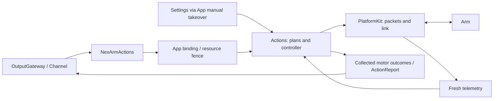
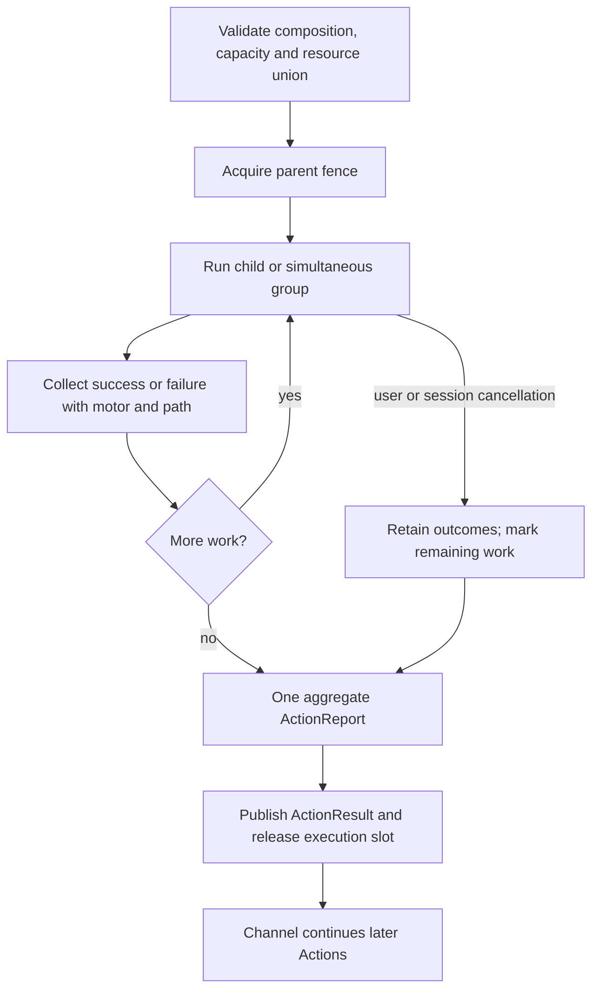
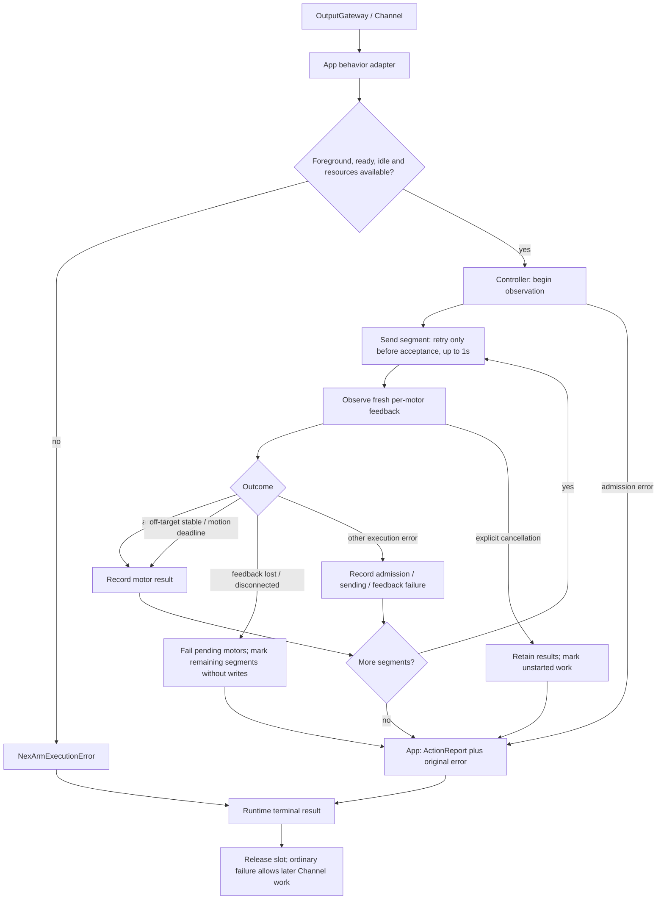

# NexArm Actions

✅ ADR0135: tracking approaches converge to the exact final encoder target within the existing 2-count/8-count-per-second settling region. The final write must be admitted before `accept` commits planner state; then the worker can become idle. This removes fractional-tail streaming without widening physical arrival tolerances or claiming a Tool's target publication means arrival. See [serial acceptance](../../../docs/NexArm_Physical_Acceptance.md) for scoped physical evidence.

## Contract and ownership

Each motor operation records its own outcome. Compositions collect outcomes and continue after child failures. Channel continues after an Action succeeds, partially fails or fails. Feedback loss and an unreachable target are ordinary leaf errors; neither implicitly cancels the composition. Explicit user/session cancellation stops remaining work.

Actions owns gesture definitions, reset/home selection, motion shaping, completion policy and result collection. [PlatformKit](../../PlatformKit/Connectivity/NexArm/README.md) owns connections, protocol/native command encoding, hardware limits and telemetry. App owns connection lifetime, resource bindings and presentation. Settings and conversation reuse the same prepared Action recipes and native command encoding. Channel execution observes physical feedback; Settings uses cancellable background segment-feedback execution and manual jog without Gateway resource admission (ADR0127).



Only NexArm/Support may import PlatformKit within Actions; PlatformKit owns its device values and has no project dependencies. Gateway/Runtime remains device-independent. Callable registration belongs to the domain modules; Agent JSON grants model access. Public helpers and diagnostic methods are not automatically model-callable.

## Source map

| Source | Responsibility |
|---|---|
| [NexArmActions.swift](NexArmActions.swift) | Gesture/reset entry points and arguments |
| [NexArmMotorActions.swift](MotionActions.swift) | Callable single-motor move/reset entries |
| [Support/NexArmTypes.swift](Support/NexArmTypes.swift) | Typed requests and entry errors |
| [Support/NexArmModule.swift](Support/NexArmModule.swift) | Explicit capability bindings to macro-generated definitions |
| [Support/NexArmSimpleActions.swift](Support/NexArmSimpleActions.swift) | Nod and shake-head sequences |
| [Support/NexArmCompositeActions.swift](Support/NexArmCompositeActions.swift) | Gesture geometry, home selection and IK plans |
| [Support/NexArmActionController.swift](Support/NexArmActionController.swift) | Shared execution and feedback observation |
| [Support/NexArmMotorExecution.swift](Support/NexArmMotorExecution.swift) | Completion policy, motor results, reset wrapper and errors |
| [Support/NexArmMotionPlan.swift](Support/NexArmMotionPlan.swift) | Shared bounded recipes, feedback tracking and feedback stability tracking |
| [Support/NexArmMotorProfiles.swift](Support/NexArmMotorProfiles.swift) | Central per-motor tolerances and empirical timing envelope |
| [Support/NexArmRegistration.swift](Support/NexArmRegistration.swift) | Parameter-dependent resources and pre-admission budget |
| [Support/NexArmJogPlanner.swift](Support/NexArmJogPlanner.swift) | Manual jog input, trajectory shaping and release policy |

## Motor operations and parameters

`NexArmActions.moveMotor` and `resetMotor` validate an `FunctionInput` and call the injected handler. The shared controller accepts motor ID, target, `NexArmMotorOptions` and `NexArmMotorCompletion`. Reset resolves that motor's software home and uses the same position encoder and completion executor as move. It never controls another motor.

All entries are finite. Unknown parameters fail validation. Optional `speed` defaults to 1400 (range 1–1400); `acceleration` defaults to 30 (range 1–254). These are native register units. The two intervening position-packet bytes remain zero; they are not exposed as time or deceleration. Torque, mode and calibration are not ordinary movement parameters.

| Action | Required arguments | Motor scope |
|---|---|---|
| `moveMotor` | `motor`: 1–6; `target`: 0–4095, also checked against hardware limits | Selected motor |
| `resetMotor` | `motor`: 1–6 | Selected motor |
| `reset` | None | 1–5 |
| `nodHead` | `cycles`: 1–3 | 4 |
| `shakeHead` | `cycles`: 1–3 | 5 |
| `shakeBase` | `cycles`: 1–3 | 1–5 |
| `waveWrist` | `count`: 1–3 | 1–5 |
| `tiltWrist` | `direction`: left/right | 1–5 |
| `lookAround`, `celebrate`, `dance` | `cycles`: 1–3 | 1–5 |

Nod and shake-head prepare, sweep and return only their own motor. Complex presets prepare and return motors 1–5. Performances and whole-arm reset neither command nor check the gripper. Explicit motor 6 operations are supported; its reset requires a configured home and reports `NexArmExecutionError.invalidArguments` when missing. No home is guessed or written into firmware calibration. `amplitude` and `pause` are not current callable parameters.

Ordinary passive-link whole-arm reset and unconfigured single-motor reset use the legacy home `[2048, 2087, 1198, 1238, 2048]` from `NexArmGesture.referenceHomeJoints` (ADR0137). Settings and Agent reset share this recipe without IK queries; neither current feedback nor cached Cartesian IK changes the reset target. Explicit single-motor software homes still take precedence. Photographer tracking rest remains `[2047, 2087, 1984, 2045, 2048]` in `NexArmJointCommand.armHome` and is not an ordinary reset target. The sixth reference value is never commanded by whole-arm reset. Strict/pose-protocol execution retains device-resolved home for XYZ `[200,0,200]`; constants are not measured feedback or firmware calibration.

Explicit preset preparation uses read-only device IK to resolve the domain's home pose, XYZ=[200,0,200]mm with zero pitch/roll, and caches at most 64 geometries. Reference encoder values are not measured feedback. Finite moves send native CMD3 targets; simultaneous groups use CMD131 addressed writes. Firmware performs the movement. Complex geometry is compiled into motor targets rather than whole-device Cartesian commands that also control the gripper.

Manual jog is separate: 30ms planning steps, 4% dead zone, squared input response, speed/acceleration/jerk ceilings of 600/1800/12000 encoder units and 60ms finite look-ahead. Only accepted proposals advance state; identical targets are not resent. Release retains the last finite target and discards future velocity, without automatic reset.

## One completion algorithm

Each motor observes only its own target. The first fresh post-send sample inside its arrival tolerance succeeds immediately, including passage through the target while moving. This contract does not promise a stationary hold. Old cached samples cannot complete a new move.

Outside the arrival region, fresh samples must remain within a 2-count anchor range for the off-target window before `targetNotReached`. Movement resets that interval. Missing samples never extend stability. Feedback silence for 2000ms produces `feedbackLost`; continuing motion past its calculated deadline produces `timedOut`. Target/timeout failures allow later segments to execute. Feedback loss ends pending motors and records remaining segments without sending; it does not cancel the surrounding composition or trigger Bluetooth recovery.

### Motor profiles and measurement limits

`NexArmMotorProfiles` is the single source of default tolerances. `NexArmMotorCompletion` can explicitly override tolerance/timeout for supervised callers; nil selects the motor profile and dynamic budget.

| Motor | Arrival tolerance (encoder counts) | Observed stationary error in these trials |
|---|---:|---:|
| 1 | 16 | up to 4 |
| 2 | 20 | up to 9 |
| 3 | 56 | 26 in small moves; 47 in raised celebration poses |
| 4 | 32 | up to 22 |
| 5 | 16 | up to 4 |
| 6 | 24, provisional | 9–49; response inconsistent, not calibrated |

2026-10-01 serial trials used ±80-count moves for motors1–5, speeds400/800/1400 and accelerations30/50, observing each target for1.6s. The recorded stable tail is the final0.5s. Motor6 used ±20 after a larger trial hit the measurement guard; it did not reliably follow small targets. Its failures remain visible instead of widening tolerance to hide them. Motor6 is excluded from gestures/reset. [Measurement data](../../../docs/measurements/nexarm-2026-10-01.csv) records retained samples, including negative first-hit times caused by pre-send cache receipts, which are not valid arrival evidence.

Final serial validation also completed nod, shake-head, celebration and dance. Celebration (5.94s,30 motor outcomes) and dance (6.98s,40 outcomes) had no failed motor results; the user reported no jitter/stalls. These remain local tests, not full-range accuracy specifications. Larger moves, load changes and other hardware need additional measurements. No torque, calibration or firmware registers were changed.

### Dynamic execution budgets

Let `d` be encoder distance, `v` the native speed and `a` native acceleration:

```text
rampEstimate = 0.4 * sqrt(30 / a) seconds
expected = d / v + rampEstimate + 0.2 seconds
motionTimeout = 3 * expected + 1.2 seconds
stableOffTarget = max(0.6, 8 / v + rampEstimate) seconds
```

This is a conservative empirical envelope, not a claimed physical acceleration conversion. It covers the measured roughly0.25–0.50s small-move arrival times; low-speed/full-range behavior is extrapolated. It avoids the previous fixed2s/3s deadlines. Unknown current position reserves the greatest legal distance to the target. Each accepted group recalculates motor deadlines from fresh available feedback and encoded options. The observation loop runs every20ms; device reports in these trials arrived roughly every200ms.

`@Action` attaches resource and timeout resolver functions to each entry. Registration before device admission conservatively reserves maximum legal travel per group, plus1s admission per group and5s setup/cleanup. Queue waiting is excluded. The actual plan can estimate from known positions: sequential budgets sum, parallel budgets take the maximum; generic compositions multiply repeats and add explicit delays. Estimates never introduce sleeps. Generic Action/composition deadlines cancel and **join** their handler before releasing resources. Whole-Action timeout is reported separately from the preserved child results. An uncooperative handler cannot be forcibly terminated safely.

## Composition and resource ownership

[ActionComposition](../../Gateway/Runtime/ActionComposition.swift) supports `sequence`, `parallel`, `repeated` and `delay`. Sequential children continue after ordinary failure. Parallel children retain separate outcomes and must use disjoint resources. Intentional rhythm belongs in `delay`, not in atomic completion.

Current presets use a bounded `NexArmMotionPlan`, not a generic composition node for every waypoint. A plan contains at most 20 groups, each with up to 6 distinct addressed motors. Simultaneous groups send one synchronized packet and check each motor independently; they must not become five sequential motor moves.

`ActionFunction.resolvingResources` computes motor resources from call parameters; entry handlers validate the full argument set. Plan validation requires the lock set to equal the union of addressed motors. The parent holds that union throughout execution, including delays; children inherit the fence instead of reacquiring it. These resource fences apply to Agent-selected execution. Settings presets/reset/jog bypass the coordinator and cancel/join old writers through App manual takeover; motor-scope metadata still validates addressed packets (ADR0127).

| Operation or illustrative composition | Resource union |
|---|---|
| Move motor 4 / nod | `{motor4}` |
| Nod + shake-head | `{motor4, motor5}` |
| Whole-arm reset | `{motor1…motor5}` |

Resources use IDs `nexarm.motor.1` through `.6`. Sequential reuse is valid; duplicate ownership within a parallel group is rejected. The controller still serializes the physical connection, so generic parallel composition does not imply independent concurrent controllers for disjoint motors.

Composition validation bounds depth to 8, reserved results to 256, repeats to 32, each delay to 30 seconds and the resource union to 8. Report-producing leaves reserve their result budget plus one execution-failure entry before execution. Overflow is an explicit error, never silent truncation.



## Execution errors and handling

Action errors describe invocation/completion, not Bluetooth health. The controller retains per-motor outcomes and the original producer error; App converts them to an invocation-owned `ActionReport`. Native faults independently follow the [SDK error flow](../../PlatformKit/Connectivity/NexArm/README.md#bluetooth-errors-and-recovery). A disconnect can affect both flows; an Action failure never initiates native recovery.



| Motor result / terminal error | Trigger | Handling |
|---|---|---|
| `targetNotReached` / `targetsNotReached(steps)` | Fresh samples stay outside target tolerance within a 2-count anchor range for the off-target window (default 600ms, enlarged by motor budget) | Record failed motor; continue later segments; aggregate failed steps |
| `timedOut` / `motionTimedOut(steps)` | Motor deadline expires without arrival | Record failure; continue later segments; never replay accepted motion |
| `feedbackLost` / `feedbackTimeout` | Position feedback gap exceeds the completion threshold (default 2000ms) | Fail pending motors; latch failure for remaining segments; no reconnect or query fallback |
| `disconnected` | SDK observation/send returns `NexArmError.disconnected` | Same plan-local latch; retain original error; SDK/App handle connection separately |
| `admissionFailed` | Observation admission fails, or unsent segment exceeds its 1s admission budget | Observation failure prevents all plan writes; segment admission timeout records that segment and permits later attempts |
| `sendingFailed` | Send stage throws another error | Record pending motors and original error; native recovery remains SDK/App-owned |
| `feedbackFailed` | Feedback retrieval/decoding or post-send processing throws another error | Record stage failure and original error; continue later segments unless cancelled/disconnected |
| `cancelled` / `CancellationError` | Explicit caller/task cancellation | Stop future writes; retain completed results; unstarted entries become `notStarted` |

| Invocation/business error | Trigger | Handling |
|---|---|---|
| `invalidArguments`; gesture `invalidRepetitions`, `invalidCycles`, `invalidDirection` | Invalid parameters, plan, completion settings or missing motor home | Reject invocation; gesture entry errors expose `ActionFailure.invalidArguments` |
| `busy`, `resourceBusy`, `resourceUnavailable(reason)` | Occupied controller/App execution slot, overlapping motors or unavailable resource fence | Reject invocation; retry after ownership is released; no device fault |
| `background`, `disconnected`, `controlNotReady` | App admission lacks foreground, connection or control readiness | Reject invocation; no synthetic Bluetooth diagnostic |
| `unsupportedFirmware`, `firmwareUnavailable` | Explicit preparation lacks required firmware information/support | Fail preparation; passive BLE connection does not run this probe |
| `moving` | Preparation/read-only recovery observes changing position | Recovery remains incomplete; no compensating motion |
| `uncertainMotion` | A possible write cannot be confirmed, or a guarded operation follows faulted state | Guarded operations require explicit read-only `recoverState()`; never replay/rollback a command |

Types: [NexArmMotorExecution.swift](Support/NexArmMotorExecution.swift), [gesture errors](Support/NexArmTypes.swift). Flow: [Controller.execute](Support/NexArmActionController.swift), [App runMotion/report](../../App/Workflows/Bluetooth/BluetoothWorkflow.swift), [behavior adapter](../../App/Adapters/NexArmBehaviorAdapter.swift).

`NexArmExecutionError` supplies top-level `ActionFailure`; `NexArmActionError` does not implement that provider. Use report entries for motor-specific classification. `admissionTimeout` maps to top-level report code `timedOut`, while its motor entry is `admissionFailed`. Settings manual execution ends the current playback on failure and accepts later intent; it does not publish execution errors as device diagnostics.

## Results and Channel behavior

`NexArmMotorResult` stores step, motor, target, last observation, failure and whether it started. App converts these to a flat `ActionReport`; composition prefixes child paths. The current result shape is:

```text
ActionResult
  status: succeeded | partialFailure | failed | cancelled
  completion: report(ActionReport)
    executionFailure?  // whole-Action deadline; does not consume child capacity
    entries[]
      path
      status: succeeded | failed | cancelled | notStarted
      code?, motor?, target?, observed?
```

There are no separate stored `children` and `issues` trees. Failed entries provide the issue list without duplicating nested errors. A successful final home does not erase an earlier missed target. Cancellation marks unstarted work explicitly; connection-unavailable entries remain failed, while `started` is retained only in the controller's motor results.

A standalone motor Action publishes its own terminal result. Nested execution contributes entries to the parent's result rather than publishing each leaf separately. The per-invocation report store preserves collected details through cancellation.

The proposed nonthrowing `ActionOutcome` API is not implemented. The controller collects motor outcomes, then may throw a terminal summary; the App adapter captures the report on that path. Composition catches child failures and continues. Validation errors before execution still throw. Swift `throw` alone does not mean “record and continue.”

For Channel, success, partial failure and failure all terminate the current execution and release its slot. `wait` waits for termination, not success; later Actions do not inherit a previous failure. Runtime converts an uncaught handler error into that Action's failed result. User cancellation and session closure use the explicit cancellation path.

Cancellation stops future writes and joins cooperative tasks while retaining prior results. It cannot retract a committed physical target or forcibly terminate an uncooperative Swift task. No rollback or torque-off is sent automatically.

## Authoring NexArm Actions: avoid these patterns

- Keep action behavior and wrappers in this directory. App adapts lifetimes/presentation; PlatformKit provides device primitives.
- Reuse the shared executor. Do not add polling loops, arbitrary settling sleeps, accepted-command replay or hidden full-arm preparation.
- Declare the complete child resource union and keep gripper control explicit.
- Collect every failed leaf; never treat successful final home as complete success after earlier failures.
- Await effects and cleanup. Do not detach work and release ownership before it ends.
- Add callable registrations and Agent permissions explicitly; internal helpers do not imply model access.

## Status

✅ Motor-scoped move/reset, shared completion, bounded gesture plans, result aggregation, generic composition, parameter-based resources and Channel failure continuation are implemented and covered by automated tests. Settings and conversation share the controller. Connection indication is removed; connection completion sends no business motion. Retired query-driven wrist/base diagnostics live only in `Tests/IntegrationTests/NexArmLegacyDiagnosticController.swift`; production has one feedback-driven motion executor.

❌ A nonthrowing `ActionOutcome` API, physical emergency stopping and persistent result delivery remain unimplemented; automated tests do not establish physical motion quality.

Decisions: [ADR0094](../../../docs/adr/0094-arrival-profiles-and-behavior-macros.md), [ADR0091](../../../docs/adr/0091-nexarm-motor-scoped-feedback.md), [ADR0092](../../../docs/adr/0092-atomic-actions-and-composed-results.md), [ADR0093](../../../docs/adr/0093-nexarm-platform-action-boundary.md). This document describes current code, not superseded implementations or unimplemented proposal interfaces.

✅ Registration uses ActionRequest, ActionResource and ActionExecutionBudget from Actions/Contracts. Motor profiles, movement and completion algorithms are unchanged by the contract migration.

✅ ADR0098: Execution values and services are imported from independent FunctionContracts; concrete Action domains and macro declarations remain in Actions. Published paths, parameters, bounds and completion behavior are unchanged.

✅ Support/NexArmJointCommand maps tracking radians to five motor targets on the 2026-10-03 rest `[2047, 2087, 1984, 2045, 2048]`: shoulder lift extends with wrist pitch above 0.25 rad down to `reachLiftMinimum`, and the elbow levels the forearm (`forearmLevelSum` 4071) with a 40 count lead only while extending (`NexArmForearmLeveler`). `NexArmJogPlanner.approach` moves one of those counts with the manual-jog jerk limit, caps aim speed at 200 counts/s (100 for lift and elbow), and holds position for one step before reversing. Production tracking streams that step on the live Bluetooth loop and does not wait for arrival. ❌ Physical tracking acceptance with the phone mounted remains pending.

✅ Tracking target publication returns before physical arrival; App streams accepted planner proposals under motors1–5 ownership. Direct controller aim has capacity-one admission and requires read-only recovery after an uncertain write. Mapping belongs to Support/NexArmJointCommand.swift; native encoding remains PlatformKit.

✅ Incremental tracking retains its speed/motion state in the Action controller; gestures, reset, arrival checks and five-motor/gripper boundaries keep their existing contracts.

## BLE admission under shared transport pacing

✅ BLE proposal admission now shares the PlatformKit connection-wide 30 ms write budget (ADR0123). The existing Actions planner filters identical targets, caps elapsed integration at 60 ms and advances command state only after admission; finite execution retains its unsent step until admitted or its existing deadline/cancellation fails explicitly. Round-robin latest-intent streaming does not promise every motor receives a packet each planning tick. USB behavior is unchanged.

❌ Streaming multi-motor packing with negotiated MTU validation and real-device calibration remain outstanding. Fixed presets, home selection and completion policy stay in Actions; neither Gateway nor UI owns BLE transport throttling.

## Manual background execution — ADR0128

✅ `manualPlan` builds the shared recipe without resource admission; passive BLE simple gestures use configured/measured joint references, while reset uses the configured/reference home without queries. Cartesian presets resolve only their missing requested poses plus home. App submits immediately to one cancellable background child; `performPlan` uses the same feedback-driven per-motor completion executor as Channel. Every segment, including final home, receives fresh feedback. Frame duration metadata never introduces a sleep. New preset/reset/jog cancels and joins software cleanup without waiting for the old target to arrive. Settings bypasses Gateway resources while retaining readiness, native limits, pacing and feedback failure policy.

❌ Physical motion rhythm and takeover acceptance remain pending; cancellation cannot retract an accepted target.

## Passive BLE connection — ADR0130

✅ Native connection/subscription completion makes Settings controls available immediately. App performs no connection pose/version/IK probe, stationary validation or indication movement. It listens to unsolicited position packets and publishes measured state; refresh reads the latest received packet only. Feedback silence remains visible but does not disable manual commands, disconnect or start recovery. Native write/connection failures remain explicit. Actions uses passive BLE compatibility for this App connection; recipe IK resolution is deferred to an explicit preset request, not connection verification. Manual jog can start from the existing configured reference when no sample has arrived; that reference is not measured telemetry. Segment arrival observation and cancellable replacement remain in Actions/App.

❌ Physical feedback cadence, preset IK availability and sustained manual takeover require real-device acceptance. Passive connection does not establish physical clearance or target arrival.

✅ Execution errors, invocation-owned reports and native Bluetooth faults follow the independent flows above (ADR0129–ADR0132). Passive nod/shake-head and resets need no IK table; Cartesian presets resolve only requested frames plus home and cache repeated poses. Explicit `prepareArmControl` retains full-catalog diagnostics (ADR0133).

❌ Sustained physical-device motion/IK/takeover acceptance and durable execution history remain pending.

✅ ADR0151: this domain is compiled once in Actions; both ActionCall and ToolCall entries use FunctionContracts contracts. Host injection and permission/feedback behavior are unchanged.
✅ Shared execution from ADR0157 is retained; ADR0160 separates callable functions from host bindings.

✅ ADR0152: functions are classified by domain before protocol unification. Canonical namespaces use `<Domain>Actions`; production uses one pure `<Domain>Module`; host registration creates Action/Tool projections. Superseded aliases/protocol catalogs are retired.
✅ Unified definitions and compatibility retirement are implemented in ADR0157.

## Cohesive module files — ADR0154

Purpose: implement directory/module-file/function ownership while preserving current protocol APIs. The domain Actions enum remains a used namespace facade; callable bodies belong exclusively to the files below. Support owns one domain catalog, values and host capabilities.

- [MotionActions.swift](MotionActions.swift)
- [GestureActions.swift](GestureActions.swift)
- [TrackingActions.swift](TrackingActions.swift)

✅ Implementations are split without forwarding or duplicated metadata/handlers. Generated factories and existing call paths, permissions, resources and scheduling are unchanged.
✅ Three-field addresses, Agent v6 configuration and shared definitions/results are implemented in ADR0156/0157.

✅ Motion and Gesture Action definitions explicitly use serializationKey NexArm, preserving process-wide exclusion across Channels independently of future three-level addresses. Tracking functions retain their resource constraints; host bindings select the native protocol.


✅ ADR0156: canonical execution addresses use domain/module/function; Agent v6 bindings resolve native names separately. Existing serialization/resource and output permissions are preserved.


✅ ADR0157: canonical executable definitions and shared outcomes replace duplicate protocol metadata; consumers import Actions/FunctionContracts. Protocol request views remain adapters, and production permission/resource boundaries are preserved.

❌ Physical acceptance and additional business capability exposure are not established by this migration.

✅ ADR0159 — Unified invocation: all business functions, injected capabilities and registered handlers receive FunctionInput with ActionExecutionContext. Native request/result normalization stays in Runtime/Gateway; no protocol-specific implementation signature remains.

✅ ADR0160: this domain exposes ActionFunction values with canonical invocation and intrinsic constraints. Protocol availability, native scheduling and feedback belong to host-created ActionBinding; domain code consumes no Tool wire/error contracts. ❌ New feature/physical acceptance remains separate.

✅ ADR0161: standard callable inputs use FunctionInput/FunctionContracts; common execution and call protocols belong to independent Gateway targets. This directory retains its existing ownership, resource/permission and lifecycle boundaries. ❌ Remaining feature Signal/continuation and physical acceptance are separate work.

✅ Arrival thresholds, stable feedback checks, movement budgets and per-motor failure aggregation remain business policy in NexArm. The ADR0162 feedback repair changes Gateway normalization only. Against b5888f8, controller, composite actions, jog planner, motion plan, motor profiles and simple action bodies are unchanged apart from imports.
