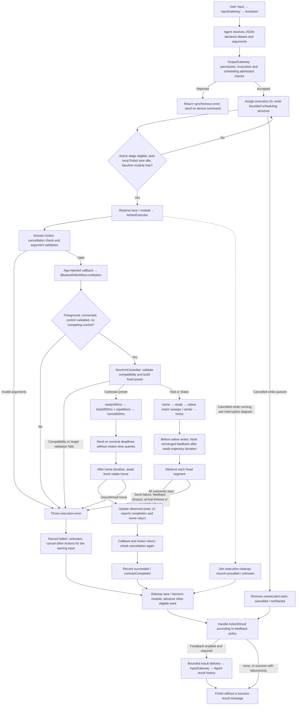
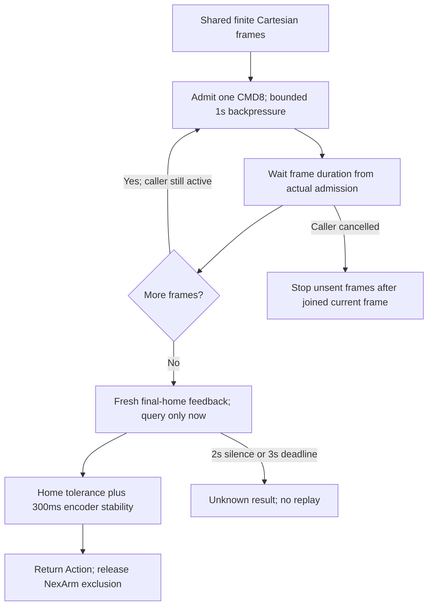
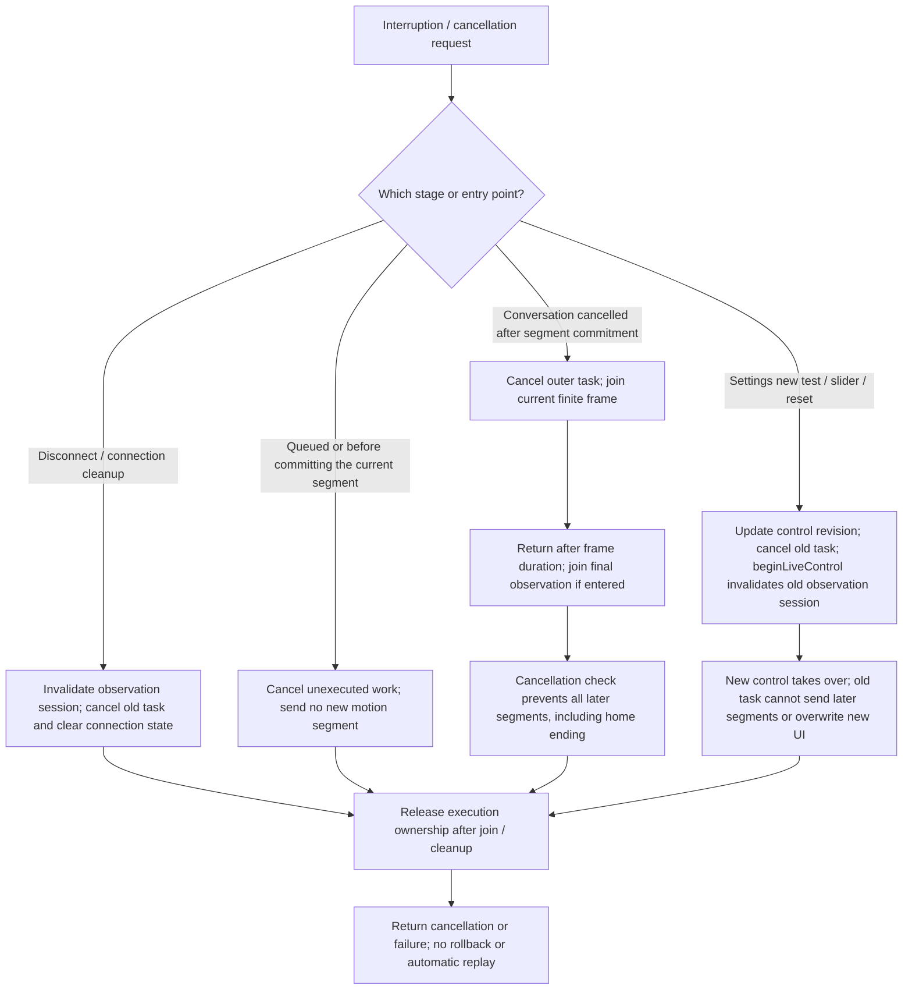
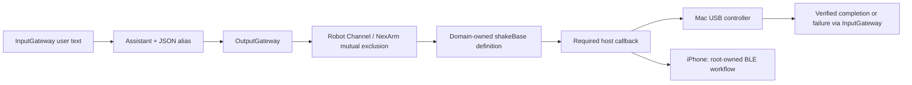

# NexArm — Robot Arm Actions and Lifecycle

> Current outbound contract (ADR0090): all arm actions and home write only explicitly listed motors1–5. Older CMD8/CMD54 descriptions below are historical; geometry intents must be compiled before transport. The gripper is excluded from both commands and completion.

Purpose: declare finite robot arm Actions, validate arguments, and execute device behavior through typed callbacks injected by App. Design goals: keep Actions independent of Bluetooth and serial implementations, await actual completion, bound queues and execution deadlines, and report failures and interruptions accurately.

The “Complete lifecycle” section defines the current production flow. The earlier USB diagnostic sections retain their separate constraints and do not describe current phone performance behavior.

## Complete lifecycle (current channel Actions)

✅ Eight model-callable entries cover nine gestures; `tiltWrist` distinguishes left and right through its direction argument. The Agent resolves aliases to `NexArm.*`; OutputGateway receives resolved calls and validates permissions and parameter names. Domain Actions then validate argument types, values, and unknown fields before any device effects.

`await` covers actual handler completion and cleanup, not model generation completion or a successful Bluetooth write. Each task-local lane preserves order; NexArm module exclusion also applies across tasks. Robot channels from all Agents are not collapsed into one global FIFO. Default scheduling limits are 64 tracked tasks and 32 unfinished Actions per channel name. Overflow rejects admission without dropping admitted Actions; see the [scheduling contract](../../Gateway/Output/Scheduling/README.md). Workflow and Controller create no additional Action queue and reject competing control as busy.

Device feedback and Action feedback serve different purposes: device packets establish observed arrival, while `ActionResult` describes the execution outcome. Gateway defaults to `failuresOnly` and enables feedback only for Agents accepting `actionResult`. Terminal results pass through InputGateway; current Agents retain them in history without automatically starting a model turn. Result messages have bounded delivery retries; **device Actions are never replayed by those retries**. Rejected admission has no execution terminal message. A running failure cancels the owning input’s remaining scheduled work; a previous unconfirmed pose does not lock out a new explicit invocation. See [result delivery](../../Gateway/Output/Results/README.md).

### Cartesian playback and final arrival

Cartesian presets and Settings share one frame factory: ready400ms → body800ms × repetitions → home600ms. Single-cycle packets are byte-identical. Only Settings replaces unsent plans on a new click; Channel preserves admitted Actions and holds NexArm exclusion until playback, final observation and cleanup finish.

Capacity is one active controller operation and one immutable plan of at most20 frames (three dance cycles); competing calls reject busy. Each admitted packet is sent once. Transport backpressure retries only an unadmitted packet, every25ms for at most1s. Next-frame timing starts at actual admission; late wakeups never emit catch-up bursts. No per-frame position queries, error compensation or intermediate-arrival waits occur. The final nominal duration is joined before starting observation; older telemetry cannot establish final completion. Push feedback gets200ms before query fallback (at most5Hz). Final XYZ tolerance is5mm and pitch/roll2°, with arm encoders1–5 stable within2counts for300ms; claw completion is excluded. Silence2s and final observation3s are independent limits; a fixed total deadline sums nominal durations,1s admission per frame and3s final observation. Legacy links retain their own bounded write/exchange delay.

✅ Completion means the finite plan was submitted and final home was observed, **not** proof that every intermediate waypoint was reached. Cancellation joins the current finite frame (and final observation if already entered), then prevents later frames without sending a rollback. Takeover/disconnect invalidates the observation token. UI receives the final measured pose, without an extra query.

Head gestures retain calibrated home/ready preparation, native motor4/5 trajectories and per-segment observation. Their Cartesian-to-servo handoff still requires fresh arrival after nominal duration; the independent watchdogs and final-home tolerance remain. See the [controller contract](../../PlatformKit/Connectivity/NexArm/README.md#settings-matched-cartesian-channel-playback-current).

✅ The user reports the installed phone repair eliminated the symptom. Supervised USB dance comparisons reproduced jitter and timeout with intermediate stability waits alone, but not with queries or extra frames alone; see [physical evidence](../../../docs/NexArm_Physical_Acceptance.md#motor2-jitter-supervised-single-factor-usb-comparison). ❌ Underlying servo holding-loop causes, isolated celebration, endurance, intermediate trajectory tracking and device-side stop/watchdog remain unverified.

### Authoring NexArm Actions: avoid these patterns

The jitter repair belongs primarily to **PlatformKit**, in `NexArmController.performCartesianPlayback` and the shared Cartesian frame factory. `NexArmActions` owns typed argument validation and awaits the injected whole-gesture callback. `Support/NexArmActionModules` declares the completion contract; App binds the callback to its long-lived Workflow. Gateway retains whole-Action Channel ordering and NexArm exclusion. Do not move device timing or transport access into the Action handler.

| Avoid | Required approach / reason |
| --- | --- |
| Loop over Cartesian waypoints in an Action and await stable pose after each one | Submit one typed gesture to the device owner. Continuous presets advance on nominal durations; only final home is verified. Holding a hunting intermediate pose can prolong jitter until the stability gate times out. |
| Treat `try await perform(...)` as the source of the jitter and remove it | Keep this whole-operation await through final observation and cleanup. Returning early would release exclusion while the device is still active. |
| Use unjoined `Task`/`Task.detached`, an Action-local command queue, or split the gesture into independently scheduled waypoint Actions | Keep one finite operation and one device owner. Gateway owns Action scheduling; the controller owns the bounded frame plan. |
| Add arbitrary settling sleeps, replay a sent packet on missing feedback, or burst overdue frames to catch up | Reuse the controller's bounded admission and deadlines. Only a packet not yet admitted may retry; uncertainty must propagate without automatic motion replay. |
| Copy Settings' latest-request replacement into Channel execution, or return success immediately after a write | Channel preserves admitted Actions and awaits fresh stable final home. Settings has a separate manual takeover/submission-only contract. |
| Remove all observation gates, including native head preparation/handoff | Nod/shake require measured calibration and Cartesian-to-servo handoff. The continuous Cartesian fix is not a blanket rule for all robot operations. |
| Assume posture queries caused the jitter, or independently poll the transport from an Action | Queries alone did not reproduce this USB symptom. Passive feedback and bounded query fallback belong to PlatformKit; current Cartesian playback queries only during final observation. This is not proof that arbitrary query rates are harmless. |

✅ Preserve cancellation checks around the awaited callback, propagate errors, and keep completion metadata honest: submitted Cartesian frames plus observed final home do not prove every intermediate waypoint was reached. Regression tests must cover shared Settings packets/cadence, fresh final feedback, exclusion across Channels and no automatic motion replay. ❌ Simulated tests cannot establish physical smoothness; new trajectories or completion-policy changes require separate supervised hardware acceptance.

### Cancellation, manual takeover and failure cleanup

**Ordinary conversation cancellation is not an immediate physical stop.** Cancelling a Swift task does not withdraw an already committed segment; its segment and overall deadlines still apply. Cancellation does not automatically send home; reset requires a new explicit operation. Settings reset sends an arm-only synchronous home target without awaiting a completion reply or claiming confirmed home arrival. Reconnection does not replay the original Action. Physical effects after execution failure or cancellation are conservatively reported as unknown.

### Settings tests and acceptance boundaries

✅ Settings Play invokes the Workflow test-send path directly, bypassing channel Action scheduling and completion waits: ready 400ms → body 800ms per segment → home 600ms, at most 8 frames. Only the latest test plan is retained; new operations replace unsent frames. Playback advances on cancellable frame deadlines without awaiting arrival, and UI reports submission only. Individual motor sliders and reset use the same manual takeover path. See the [device control README](../../PlatformKit/Connectivity/NexArm/README.md) for implementation details.

✅ Physical USB testing verified all seven performance presets, 50 segment arrival checks, and final home returns; see [physical acceptance](../../../docs/NexArm_Physical_Acceptance.md). This validates the controller shared with iPhone. ❌ Bluetooth transport performance, repeated-cycle endurance, and physical emergency stopping require separate acceptance.

Implementation entry points: [domain Actions](NexArmActions.swift), [composition bindings](../../App/Composition/ApplicationRuntime.swift), [Workflow](../../App/Workflows/BluetoothWorkflow.swift), [controller](../../PlatformKit/Connectivity/NexArm/NexArmController.swift), and [arrival tracker](../../PlatformKit/Connectivity/NexArm/NexArmProtocol.swift).

## USB diagnostic ownership

✅ No production Agent uses the former nudgeWrist Action. Its Action entry, registration, error type and test-only Agent were removed. Supervised wrist diagnostics call PlatformKit's controller directly from root tests; production Actions contain only the eight Agent-used entries. See [controller diagnostics](../../PlatformKit/Connectivity/NexArm/README.md).

## Earlier USB diagnostic: Assistant base sweep

✅ `NexArm.shakeBase(cycles:)` / `NexArmBaseActionModule` is in the built-in catalog; `ActionModules.builtIn` requires an explicit typed callback. Assistant JSON declares alias `shakeBase`, Channel Robot and required integer cycles 1...3. Unknown keys fail. Each cycle follows +2° / -2° / origin with 1500 ms interpolation per leg. Successful return requires controller telemetry convergence for every leg and base return within six counts. See the platform README for IK and tolerance limits. No Action-local queue.

The supervised Mac test binds real USB; its model output and UI are deterministic test fixtures, not evidence of real-model selection. Cancellation joins only the committed leg and starts no further leg, including return-to-origin. Failed/uncertain legs latch the controller fault. ✅ iPhone BLE binding is implemented in the root-owned BluetoothWorkflow. ❌ Production resource leases and device stop/watchdog remain pending.

✅ iPhone composition now invokes the same typed finite Action through BluetoothWorkflow; no BLE types enter Actions. Completion/error/cancellation behavior and ±2°/1...3-cycle limits are unchanged. ❌ Near-vertical or out-of-range poses are rejected; this action never resets/repositions the arm automatically.

## Current phone performance actions

✅ App maps base sway and the five typed entertainment entries to the shared Settings Cartesian frame plan: ready → body → home. Home XYZ=[200,0,200]mm; ready height240mm; pitch/claw0°. Native absolute CMD8 interpolation replaces nominal encoder targets and per-servo writes. Body segments last800ms. Parameters and Robot channel registrations remain unchanged, and all effects share NexArm module exclusion.

| Entry | Required parameter | Body around fixed pose |
| --- | --- | --- |
| shakeBase | cycles1...3 | Base yaw−30°/+30°/center |
| waveWrist | count1...3 | Yaw±12°, roll±40°, two waves |
| tiltWrist | direction left/right | Yaw12°, roll40°, keep ready height240mm |
| lookAround | cycles1...3 | Yaw−35°/+35°/center, roll±15° |
| celebrate | cycles1...3 | Yaw±20°, roll up to45°, height220...270mm |
| dance | cycles1...3 | Yaw±30°, roll±40°, height220...260mm |

✅ Device IK owns joint calibration. Cartesian presets use the shared400/800/600ms plan and final-home observation described above; no initial3000ms home command, extra ending-ready pose or per-waypoint arrival gate remains. Head gestures keep their separate calibrated transition. See [ADR 0088](../../../docs/adr/0088-nexarm-settings-matched-playback.md).

Earlier ±2° base text above describes the retained USB diagnostic only and is superseded for phone UI/conversation bindings. `Support/NexArmTypes.swift` uses a domain-qualified name to avoid duplicate Swift basenames. ❌ Complete physical motion quality/clearance acceptance remains pending; prior base primitive success and simulated tests do not establish it.

✅ All seven phone performance presets passed through the same controller on USB hardware; see [physical acceptance](../../../docs/NexArm_Physical_Acceptance.md). Intermediate arrival allows15mm /4° pitch, final home5mm /2° with stable feedback. ❌ iPhone transport timing and visual quality are separate acceptance.

✅ A previous unconfirmed preset does not block the next explicit invocation; only the current invocation waits for completion. ❌ No automatic motion retry or physical stop guarantee.

✅ Argument validation failures expose localized explanations and the shared `invalidArguments` observation code. A DanceError is raised before the device callback, so an existing Bluetooth connection can remain healthy and Settings can still operate. Malformed or out-of-range repetition values remain rejected before motion; no silent clamping or retry is introduced.

## Head gestures

✅ nodHead(cycles) and shakeHead(cycles) are finite, model-callable gestures with required integer1...3, localized argument errors and cancellation propagation. Their bodies address motor4 and motor5 respectively; the controller establishes fixed home and ready poses, performs two large sweeps per cycle, centers, and observes stable home. ✅ USB acceptance passed both head sequences; ❌ iPhone BLE conversation acceptance remains pending.

## Head preparation gate correction

✅ Head preparation now uses the same intermediate arrival contract as all other presets (XYZ15mm, pitch4deg, roll/claw2deg, fresh stable feedback for200ms). Previously it incorrectly selected final-home tolerances before sending any motor4/5 body command. A stationary approach within the normal intermediate envelope could therefore time out without visible movement. Encoder-based body completion and strict final home (XYZ5mm, pitch/roll/claw2deg,300ms fresh stability) remain unchanged. Regression fixtures reproduce a Z-10mm/pitch-3deg preparation and require both gestures to execute; the same error at the ending must still fail. ❌ This fixture establishes the code-path defect, not the exact physical measurements of the reported phone run.

## Head channel handoff correction

✅ `nodHead` and `shakeHead` keep their existing Action/Channel completion contract. Their shared controller now establishes home then a distinct ready pose before native servo sweeps, and observes fresh arrival after the ready trajectory's800ms duration before switching command modes. The final home differs from the Cartesian planner's last target. USB acceptance completed both full eight-segment sequences with unchanged strict completion thresholds. ❌ The phone conversation must still be accepted on the installed build.

## Source organization

| File | Responsibility |
| --- | --- |
| NexArmActions.swift | Eight production entry points, grouped in one stateless namespace |
| Support/NexArmTypes.swift | Requests, gestures, directions and complete nested error contracts |
| Support/NexArmActionModules.swift | Gesture and base registration types |

✅ Production NexArmActions names and both production module types remain unchanged. The unused NexArmActionModule diagnostic registration and NudgeError were removed; no Agent declarations or built-in registrations needed changing.

❌ No new trajectory, validation default, queue or physical completion guarantee is added by source consolidation.

✅ Action display names are declared in Support registrations and copied into scheduler snapshots. Adding a registered operation requires no corresponding ActionActivityWorkflow mapping. Completion and device behavior remain unchanged.

## Arm completion scope (2026-10-01)

✅ Performance gestures verify XYZ, pitch, roll and stability of motors1–5. Claw angle and motor6 stability are excluded from both Cartesian final-home and head preparation/native/final gates: these Actions do not promise gripper completion. Existing packets (including their claw field), timing, arm tolerances, fresh-feedback requirements, cancellation and deadlines are unchanged. A dedicated gripper Action must declare its own completion scope; do not copy this exclusion into gripper operations. This supersedes references above to all-six-encoder performance completion. ❌ This does not repair or calibrate a gripper, verify grasping, or establish physical emergency stopping. See [ADR0089](../../../docs/adr/0089-nexarm-arm-completion-scope.md).

## Gripper exclusion for every arm action and home

✅ All performance Actions and return-home operations control only motors1–5. PlatformKit now compiles pose geometry using read-only device IK into explicitly addressed arm-only packets; merely excluding the claw from arrival checks is insufficient. Action authors must use the injected whole-operation callback, must not send six-axis CMD8/CMD50/CMD54, and must not copy the current claw angle into an arm action. Explicit manual gripper control remains separate. Settings and Channel share the compiler, with no intermediate Cartesian stability waits. See [ADR0090](../../../docs/adr/0090-nexarm-arm-only-motion-packets.md).

❌ A dedicated grasp Action with its own completion contract is not implemented.
