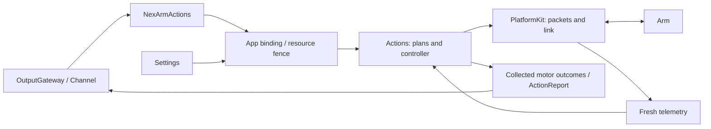
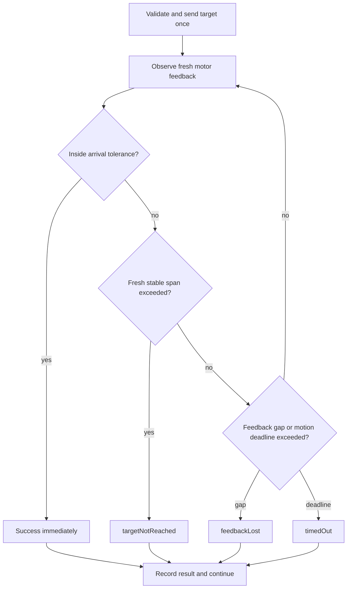
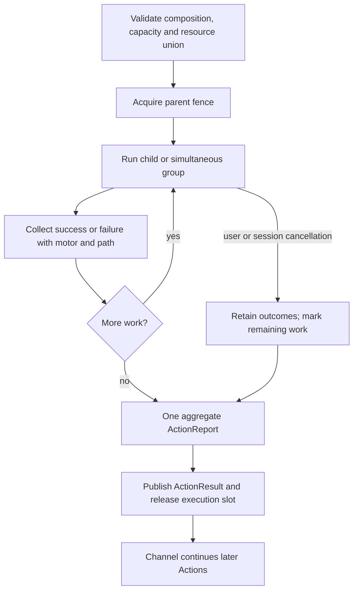

# NexArm Actions

## Contract and ownership

Each motor operation records its own outcome. Compositions collect outcomes and continue after child failures. Channel continues after an Action succeeds, partially fails or fails. Feedback loss and an unreachable target are ordinary leaf errors; neither implicitly cancels the composition. Explicit user/session cancellation stops remaining work.

Actions owns gesture definitions, reset/home selection, motion shaping, completion policy and result collection. [PlatformKit](../../PlatformKit/Connectivity/NexArm/README.md) owns connections, protocol/native command encoding, hardware limits and telemetry. App owns connection lifetime, resource bindings and presentation. Settings and conversation use the same Action controller.



Only NexArm/Support may import PlatformKit within Actions; PlatformKit depends only on shared Types values. Actions/Runtime remains device-independent. Callable registration belongs to the domain modules; Agent JSON grants model access. Public helpers and diagnostic methods are not automatically model-callable.

## Source map

| Source | Responsibility |
|---|---|
| [NexArmActions.swift](NexArmActions.swift) | Gesture/reset entry points and arguments |
| [NexArmMotorActions.swift](NexArmMotorActions.swift) | Callable single-motor move/reset entries |
| [Support/NexArmTypes.swift](Support/NexArmTypes.swift) | Typed requests and entry errors |
| [Support/NexArmActionModules.swift](Support/NexArmActionModules.swift) | Explicit capability bindings to macro-generated definitions |
| [Support/NexArmSimpleActions.swift](Support/NexArmSimpleActions.swift) | Nod and shake-head sequences |
| [Support/NexArmCompositeActions.swift](Support/NexArmCompositeActions.swift) | Gesture geometry, home selection and IK plans |
| [Support/NexArmActionController.swift](Support/NexArmActionController.swift) | Shared execution and feedback observation |
| [Support/NexArmMotorExecution.swift](Support/NexArmMotorExecution.swift) | Completion policy, motor results, reset wrapper and errors |
| [Support/NexArmMotionPlan.swift](Support/NexArmMotionPlan.swift) | Bounded groups, motor scope and stability tracking |
| [Support/NexArmMotorProfiles.swift](Support/NexArmMotorProfiles.swift) | Central per-motor tolerances and empirical timing envelope |
| [Support/NexArmRegistration.swift](Support/NexArmRegistration.swift) | Parameter-dependent resources and pre-admission budget |
| [Support/NexArmJogPlanner.swift](Support/NexArmJogPlanner.swift) | Manual jog input, trajectory shaping and release policy |

## Motor operations and parameters

`NexArmActions.moveMotor` and `resetMotor` validate an `ActionInvocation` and call the injected handler. The shared controller accepts motor ID, target, `NexArmMotorOptions` and `NexArmMotorCompletion`. Reset resolves that motor's software home and uses the same position encoder and completion executor as move. It never controls another motor.

All entries are finite. Unknown parameters fail validation. Optional `speed` defaults to 1400 (range 1–1400); `acceleration` defaults to 30 (range 1–254). These are native register units. The two intervening position-packet bytes remain zero; they are not exposed as time or deceleration. Torque, mode and calibration are not ordinary movement parameters.

| Action | Required arguments | Motor scope |
|---|---|---|
| `moveMotor` | `motor`: 1–6; `target`: 0–4095, also checked against hardware limits | Selected motor |
| `resetMotor` | `motor`: 1–6 | Selected motor |
| `reset` | None | 1–5 |
| `nodHead` | `cycles`: 1–3 | 4 |
| `shakeHead` | `cycles`: 1–3 | 5 |
| `shakeBase` | `cycles`: 1–3 | 1–5 |
| `waveWrist` | `count`: 1–3 | 1–5 |
| `tiltWrist` | `direction`: left/right | 1–5 |
| `lookAround`, `celebrate`, `dance` | `cycles`: 1–3 | 1–5 |

Nod and shake-head prepare, sweep and return only their own motor. Complex presets prepare and return motors 1–5. Performances and whole-arm reset neither command nor check the gripper. Explicit motor 6 operations are supported; its reset requires a configured home and currently reports `invalidMotion` when missing. No home is guessed or written into firmware calibration. `amplitude` and `pause` are not current callable parameters.

Connection preparation uses read-only device IK to resolve the domain's home pose, XYZ=[200,0,200]mm with zero pitch/roll, and caches at most 64 geometries. Reference encoder values are not measured feedback. Finite moves send native CMD3 targets; simultaneous groups use CMD131 addressed writes. Firmware performs the movement. Complex geometry is compiled into motor targets rather than whole-device Cartesian commands that also control the gripper.

Manual jog is separate: 30ms planning steps, 4% dead zone, squared input response, speed/acceleration/jerk ceilings of 600/1800/12000 encoder units and 60ms finite look-ahead. Only accepted proposals advance state; identical targets are not resent. Release retains the last finite target and discards future velocity, without automatic reset.

## One completion algorithm

Each motor observes only its own target. The first fresh post-send sample inside its arrival tolerance succeeds immediately, including passage through the target while moving. This contract does not promise a stationary hold. Old cached samples cannot complete a new move.

Outside the arrival region, fresh samples must remain within a 2-count anchor range for the off-target window before `targetNotReached`. Movement resets that interval. Missing samples never extend stability. Feedback silence for 2000ms produces `feedbackLost`; continuing motion past its calculated deadline produces `timedOut`. These are peer leaf failures and do not cancel subsequent children.



### Motor profiles and measurement limits

`NexArmMotorProfiles` is the single source of default tolerances. `NexArmMotorCompletion` can explicitly override tolerance/timeout for supervised callers; nil selects the motor profile and dynamic budget.

| Motor | Arrival tolerance (encoder counts) | Observed stationary error in these trials |
|---|---:|---:|
| 1 | 16 | up to 4 |
| 2 | 20 | up to 9 |
| 3 | 56 | 26 in small moves; 47 in raised celebration poses |
| 4 | 32 | up to 22 |
| 5 | 16 | up to 4 |
| 6 | 24, provisional | 9–49; response inconsistent, not calibrated |

2026-10-01 serial trials used ±80-count moves for motors1–5, speeds400/800/1400 and accelerations30/50, observing each target for1.6s. The recorded stable tail is the final0.5s. Motor6 used ±20 after a larger trial hit the measurement guard; it did not reliably follow small targets. Its failures remain visible instead of widening tolerance to hide them. Motor6 is excluded from gestures/reset. [Measurement data](../../../docs/measurements/nexarm-2026-10-01.csv) records retained samples, including negative first-hit times caused by pre-send cache receipts, which are not valid arrival evidence.

Final serial validation also completed nod, shake-head, celebration and dance. Celebration (5.94s,30 motor outcomes) and dance (6.98s,40 outcomes) had no failed motor results; the user reported no jitter/stalls. These remain local tests, not full-range accuracy specifications. Larger moves, load changes and other hardware need additional measurements. No torque, calibration or firmware registers were changed.

### Dynamic execution budgets

Let `d` be encoder distance, `v` the native speed and `a` native acceleration:

```text
rampEstimate = 0.4 * sqrt(30 / a) seconds
expected = d / v + rampEstimate + 0.2 seconds
motionTimeout = 3 * expected + 1.2 seconds
stableOffTarget = max(0.6, 8 / v + rampEstimate) seconds
```

This is a conservative empirical envelope, not a claimed physical acceleration conversion. It covers the measured roughly0.25–0.50s small-move arrival times; low-speed/full-range behavior is extrapolated. It avoids the previous fixed2s/3s deadlines. Unknown current position reserves the greatest legal distance to the target. Each accepted group recalculates motor deadlines from fresh available feedback and encoded options. The observation loop runs every20ms; device reports in these trials arrived roughly every200ms.

`@Action` attaches resource and timeout resolver functions to each entry. Registration before device admission conservatively reserves maximum legal travel per group, plus1s admission per group and5s setup/cleanup. Queue waiting is excluded. The actual plan can estimate from known positions: sequential budgets sum, parallel budgets take the maximum; generic compositions multiply repeats and add explicit delays. Estimates never introduce sleeps. Generic Action/composition deadlines cancel and **join** their handler before releasing resources. Whole-Action timeout is reported separately from the preserved child results. An uncooperative handler cannot be forcibly terminated safely.

Transport refusal before acceptance can be retried within a one-second admission budget; accepted motion is never replayed. A target failure allows the next target to overwrite it. Feedback loss/disconnection ends the affected pending leaves and latches connection failure for the remaining plan: later steps are recorded without blind writes, repeated feedback deadlines, reconnects or query fallback. Preparation and explicit read-only diagnostics may still query.

## Composition and resource ownership

[ActionComposition](../Runtime/ActionComposition.swift) supports `sequence`, `parallel`, `repeated` and `delay`. Sequential children continue after ordinary failure. Parallel children retain separate outcomes and must use disjoint resources. Intentional rhythm belongs in `delay`, not in atomic completion.

Current presets use a bounded `NexArmMotionPlan`, not a generic composition node for every waypoint. A plan contains at most 20 groups, each with up to 6 distinct addressed motors. Simultaneous groups send one synchronized packet and check each motor independently; they must not become five sequential motor moves.

`ActionDefinition.resolvingResources` computes motor resources from call parameters; entry handlers validate the full argument set. Plan validation requires the lock set to equal the union of addressed motors. The parent holds that union throughout execution, including delays; children inherit the fence instead of reacquiring it. Settings uses the same coordinator. Manual streaming reserves all six motors because its input can change during the session.

| Operation or illustrative composition | Resource union |
|---|---|
| Move motor 4 / nod | `{motor4}` |
| Nod + shake-head | `{motor4, motor5}` |
| Whole-arm reset | `{motor1…motor5}` |

Resources use IDs `nexarm.motor.1` through `.6`. Sequential reuse is valid; duplicate ownership within a parallel group is rejected. The controller still serializes the physical connection, so generic parallel composition does not imply independent concurrent controllers for disjoint motors.

Composition validation bounds depth to 8, reserved results to 256, repeats to 32, each delay to 30 seconds and the resource union to 8. Report-producing leaves reserve their result budget plus one execution-failure entry before execution. Overflow is an explicit error, never silent truncation.



## Results and Channel behavior

`NexArmMotorResult` stores step, motor, target, last observation, failure and whether it started. App converts these to a flat `ActionReport`; composition prefixes child paths. The current result shape is:

```text
ActionResult
  status: succeeded | partialFailure | failed | cancelled
  completion: report(ActionReport)
    executionFailure?  // whole-Action deadline; does not consume child capacity
    entries[]
      path
      status: succeeded | failed | cancelled | notStarted
      code?, motor?, target?, observed?
```

There are no separate stored `children` and `issues` trees. Failed entries provide the issue list without duplicating nested errors. A successful final home does not erase an earlier missed target. Cancellation marks unstarted work explicitly; connection-unavailable entries remain failed, while `started` is retained only in the controller's motor results.

A standalone motor Action publishes its own terminal result. Nested execution contributes entries to the parent's result rather than publishing each leaf separately. The per-invocation report store preserves collected details through cancellation.

The proposed nonthrowing `ActionOutcome` API is not implemented. The controller collects motor outcomes, then may throw a terminal summary; the App adapter captures the report on that path. Composition catches child failures and continues. Validation errors before execution still throw. Swift `throw` alone does not mean “record and continue.”

For Channel, success, partial failure and failure all terminate the current execution and release its slot. `wait` waits for termination, not success; later Actions do not inherit a previous failure. Runtime converts an uncaught handler error into that Action's failed result. User cancellation and session closure use the explicit cancellation path.

Cancellation stops future writes and joins cooperative tasks while retaining prior results. It cannot retract a committed physical target or forcibly terminate an uncooperative Swift task. No rollback or torque-off is sent automatically.

## Authoring NexArm Actions: avoid these patterns

- Keep action behavior and wrappers in this directory. App adapts lifetimes/presentation; PlatformKit provides device primitives.
- Reuse the shared executor. Do not add polling loops, arbitrary settling sleeps, accepted-command replay or hidden full-arm preparation.
- Declare the complete child resource union and keep gripper control explicit.
- Collect every failed leaf; never treat successful final home as complete success after earlier failures.
- Await effects and cleanup. Do not detach work and release ownership before it ends.
- Add callable registrations and Agent permissions explicitly; internal helpers do not imply model access.

## Status

✅ Motor-scoped move/reset, shared completion, bounded gesture plans, result aggregation, generic composition, parameter-based resources and Channel failure continuation are implemented and covered by automated tests. Settings and conversation share the controller. Connection indication remains an Action-side helper. Retired query-driven wrist/base diagnostics live only in `Tests/IntegrationTests/NexArmLegacyDiagnosticController.swift`; production has one feedback-driven motion executor.

❌ The API and composition gaps noted above remain open. Physical emergency stopping and persistent result delivery are also unimplemented; automated tests do not establish physical motion quality.

Decisions: [ADR0094](../../../docs/adr/0094-arrival-profiles-and-behavior-macros.md), [ADR0091](../../../docs/adr/0091-nexarm-motor-scoped-feedback.md), [ADR0092](../../../docs/adr/0092-atomic-actions-and-composed-results.md), [ADR0093](../../../docs/adr/0093-nexarm-platform-action-boundary.md). This document describes current code, not superseded implementations or unimplemented proposal interfaces.

✅ Registration uses ActionRequest, ActionResource and ActionExecutionBudget from Actions/Runtime/Contracts. Motor profiles, movement and completion algorithms are unchanged by the contract migration.

✅ ADR0098: Execution values and services are imported from independent ActionRuntime; concrete Action domains and macro declarations remain in Actions. Published paths, parameters, bounds and completion behavior are unchanged.

✅ Support/NexArmJointCommand maps tracking radians to five motor targets. NexArmActionController.aim requires a verified connection and returns on transport acceptance; it does not wait for arrival. ❌ Physical tracking acceptance remains pending.

✅ Tracking aim is an immediate target write, with capacity-one controller admission and motors1–5 ownership. A failed possible write requires explicit read-only recovery. Its target mapping is Support/NexArmJointCommand.swift; native encoding remains PlatformKit. ❌ Tracking arrival remains unmeasured.
