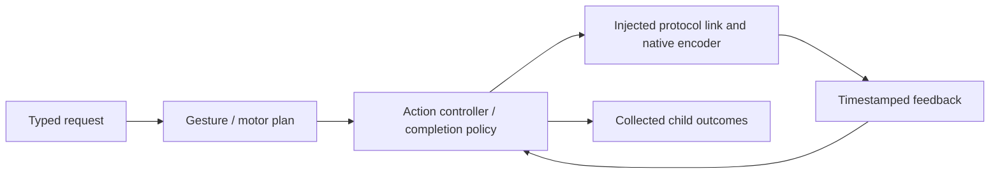
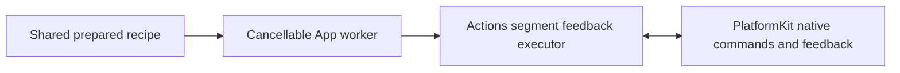

# NexArm Action support

✅ ADR0135: `NexArmJogPlanner.approach` finishes the last 1–2 counts once the existing near-target/low-speed condition holds. The final exact-count proposal remains pending until native admission and `accept`; a deferred write cannot advance the target. Reaching the planner target ends streaming, not physical arrival. All speed, scope and feedback-result boundaries remain separately owned.

Purpose: implement the NexArm action domain below its stateless callable entry points. Design goals: shared Settings/Channel recipes with explicit submission versus feedback-completion boundaries, validated motor scope, bounded work and complete Channel child outcomes.

✅ This directory owns gesture metadata, simple/complex recipes, IK plan preparation, the Action controller, completion policy/results, reset wrappers and manual jog shaping. It imports the foundational PlatformKit SDK through injected links; concrete connection lifetime belongs to App. Public helpers do not grant model permission.

✅ Registration and parameter-dependent resources remain explicit. The actor owns a finite device-operation lifetime, not another Channel queue. The [domain README](../README.md) is the authoritative current technical design, source map, algorithms, diagrams and authoring rules.

❌ No automatic registration, hidden model permissions, physical emergency-stop guarantee or independent concurrent controller per motor. Historical causal and polling diagnostics live in root Tests, not this production implementation. The controller exposes no retired nudge/base diagnostic API or duplicate motor packet encoder.

✅ `NexArmMotorProfiles` centrally maintains measured arrival tolerances and a parameter-dependent empirical timing envelope. `NexArmRegistration` supplies macro-bound resource and conservative admission-budget resolvers. Arrival does not wait for stability; off-target stability only advances with fresh samples.

✅ Resource and budget resolvers consume Actions-owned contracts; domain failures use ActionFailure. No AgentCore import is needed.

✅ ADR0098: Execution values and services are imported from independent FunctionContracts; concrete Action domains and macro declarations remain in Actions. Published paths, parameters, bounds and completion behavior are unchanged.

✅ NexArmJointCommand owns tracking rest/angle and speed policy; aim shares controller admission and motor ownership. Native encoding remains in PlatformKit. ❌ Tracking arrival is not measured.

✅ The direct single-packet aim diagnostic rejects uncertain controllers until explicit read-only recoverState; it never replays a write. Production App BLE streaming uses the jog planner and native connection sessions instead; finite/manual execution failure does not leave a persistent admission latch.

✅ ADR0137: Ordinary passive-link reset uses `NexArmGesture.referenceHomeJoints` for motors1–5 (`[2048,2087,1198,1238,2048]`), independently of tracking/current feedback/prepared IK. Manual and Agent reset share this target without queries; explicit single-motor software homes remain honored. ❌ Restored phone posture has not been physically revalidated.

✅ Tracking rest and reach: `NexArmJointCommand.armHome` is `[2047, 2087, 1984, 2045, 2048]`; `reachLift` maps wrist pitch to shoulder lift, and `NexArmForearmLeveler` adds the measured 40 count elbow lead only while extending. ✅ Production tracking steps through `NexArmJogPlanner.approach`. Speed follows the remaining count and stays at 200 counts/s (100 for lift and elbow). A direction change holds the current count for one step before reversing. The five-axis packet builder still sizes its test speed from the previous target. The diagnostic single-packet path retains explicit read-only recovery; App streaming does not use that path. Native encoding remains in PlatformKit.

✅ ADR0122: Runtime resource values contain no camera constants. ActionFailure and ActionReport.Entry.Code are bounded opaque identifiers (1–64 UTF-8 bytes); Runtime provides generic execution codes only. NexArm owns its result vocabulary, Actions-owned NexArmExecutionError owns its execution failure-to-report mapping, and Gateway preserves producer identifiers. Existing device failure/report identifiers and presentation are unchanged.

❌ Runtime must not classify pose, foreground, control-readiness or device-feedback failures. Producers provide actionReportCode through ActionExecutionFailureProviding; the generic default handles invalid arguments/resource unavailability and otherwise reports handlerFailed. CancellationError remains cancellation.

✅ Manual requests build the same prepared recipe through `manualPlan` and run `performPlan` on App's cancellable child task. The shared executor uses fresh feedback for every segment, including the final home; there is no nominal-frame sleep. Caller submission remains immediate, and replacement joins software cleanup without requiring physical arrival. No duplicate motion executor or packet encoder is introduced.

## Passive BLE connection — ADR0130

✅ Native connection/subscription completion makes Settings controls available immediately. App performs no connection pose/version/IK probe, stationary validation or indication movement. It listens to unsolicited position packets and publishes measured state; refresh reads the latest received packet only. Feedback silence remains visible but does not disable manual commands, disconnect or start recovery. Native write/connection failures remain explicit. Actions uses passive BLE compatibility for this App connection; recipe IK resolution is deferred to an explicit preset request, not connection verification. Manual jog can start from the existing configured reference when no sample has arrived; that reference is not measured telemetry. Segment arrival observation and cancellable replacement remain in Actions/App.

❌ Physical feedback cadence, preset IK availability and sustained manual takeover require real-device acceptance. Passive connection does not establish physical clearance or target arrival.

✅ ADR0129: observation-session invalidation reports disconnected motor outcomes and throws a device error. Only explicit caller cancellation creates cancelled outcomes; reconnect policy never selects or cancels Action tasks.

✅ ADR0131: NexArmExecutionError owns invocation/admission failures here, separate from SDK Bluetooth diagnostics. The motion executor retains per-motor outcomes while propagating the original caught dependency error. ❌ Physical motion/firmware acceptance remains pending.

✅ Motor report revision distinguishes execution outcomes from a pre-execution rejection; the App never attaches a preceding call's motor results to a new validation failure. ❌ Physical validation remains pending.

✅ Retired connection-indication motion/API is removed. Missing Action feedback throws NexArmExecutionError.feedbackTimeout; PlatformKit contains no unused feedbackLost error. Observation admission distinguishes cancellation, actual disconnection and generic dependency failure rather than reporting every rejection as disconnected. ❌ Physical motion acceptance remains pending.

✅ ADR0132: Actions now owns invalidArguments, busy, firmware policy and admissionTimeout errors. Motor outcomes distinguish observation admission, native sending and feedback processing; the original dependency Error remains separate. Platform SDK hardware-encoding errors remain SDK-owned.

❌ Sustained physical-device acceptance and durable error history remain pending.

✅ ADR0133: Passive BLE nod/shake-head, whole-arm reset and per-motor reset no longer require an IK table, including after partial Cartesian preparation. Cartesian presets incrementally resolve only the requested frames plus home before sending; repeated poses reuse the connection-local cache. Explicit diagnostic `prepareArmControl` retains full-catalog preparation. Manual and Channel requests reuse the same Actions recipes and feedback executor. ❌ Physical motion/IK firmware acceptance remains pending.

✅ ADR0151: this domain is compiled once in Actions; both ActionCall and ToolCall entries use FunctionContracts contracts. Host injection and permission/feedback behavior are unchanged.
✅ Shared execution from ADR0157 is retained; ADR0160 separates callable functions from host bindings.

✅ ADR0152: functions are classified by domain before protocol unification. Canonical namespaces use `<Domain>Actions`; production uses one pure `<Domain>Module`; host registration creates Action/Tool projections. Superseded aliases/protocol catalogs are retired.
✅ Unified definitions and compatibility retirement are implemented in ADR0157.

✅ ADR0159 — Unified invocation: all business functions, injected capabilities and registered handlers receive FunctionInput with ActionExecutionContext. Native request/result normalization stays in Runtime/Gateway; no protocol-specific implementation signature remains.

✅ ADR0160: this domain exposes ActionFunction values with canonical invocation and intrinsic constraints. Protocol availability, native scheduling and feedback belong to host-created ActionBinding; domain code consumes no Tool wire/error contracts. ❌ New feature/physical acceptance remains separate.

✅ NexArmCapabilityModules.swift provides pure gesture/base/tracking catalogs that reuse NexArmModule function lists.

✅ ADR0161: standard callable inputs use FunctionInput/FunctionContracts; common execution and call protocols belong to independent Gateway targets. This directory retains its existing ownership, resource/permission and lifecycle boundaries. ❌ Remaining feature Signal/continuation and physical acceptance are separate work.
