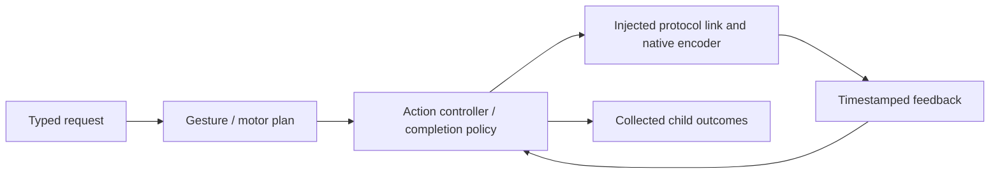

# NexArm Action support

Purpose: implement the NexArm action domain below its stateless callable entry points. Design goals: one shared Settings/Channel executor, explicit motor scope, bounded work and complete child outcomes.

✅ This directory owns gesture metadata, simple/complex recipes, IK plan preparation, the Action controller, completion policy/results, reset wrappers and manual jog shaping. It imports the foundational PlatformKit SDK through injected links; concrete connection lifetime belongs to App. Public helpers do not grant model permission.

✅ Registration and parameter-dependent resources remain explicit. The actor owns a finite device-operation lifetime, not another Channel queue. The [domain README](../README.md) is the authoritative current technical design, source map, algorithms, diagrams and authoring rules.

❌ No automatic registration, hidden model permissions, physical emergency-stop guarantee or independent concurrent controller per motor. Historical causal and polling diagnostics live in root Tests, not this production implementation. The controller exposes no retired nudge/base diagnostic API or duplicate motor packet encoder.

✅ `NexArmMotorProfiles` centrally maintains measured arrival tolerances and a parameter-dependent empirical timing envelope. `NexArmRegistration` supplies macro-bound resource and conservative admission-budget resolvers. Arrival does not wait for stability; off-target stability only advances with fresh samples.
