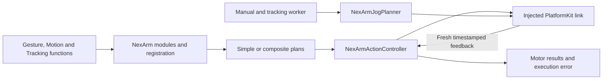

# NexArm Planning and Feedback Execution

## Summary

Owns bounded gesture plans, native-link controller, motor completion and jog/tracking shaping below stateless entries.

## Ownership and boundaries

PlatformKit supplies packet encoding/hardware bounds/transport facts. App supplies link/foreground/connection lifetime and shared resource policy. Helpers and diagnostics do not grant model permission or create another Channel queue.

## External relationships and data flow

Runtime arrows show data or capability calls; dashed arrows show injection.

## Internal implementation

| Source group | Responsibility |
| --- | --- |
| NexArmTypes / AimTypes / CapabilityModules / Module | Typed values, errors and explicit catalogs |
| SimpleActions / CompositeActions | Motor-only head gestures, arm geometry/home and bounded IK preparation |
| ActionController / MotionPlan / MotorExecution | Native admission, shared segment feedback/stability and motor outcomes |
| MotorProfiles / Registration | Tolerance, empirical timeout and parameter-dependent resource/budget resolvers |
| JogPlanner / JointCommand | Manual trajectories, tracking rest/reach and native packet construction through SDK |

Domain entry parameters, arrival formulas and report vocabulary are specified in the parent design. One controller serializes physical operations even for disjoint motor composition. Passive BLE compatibility starts from native subscription state without unsolicited probes; missing IK is resolved only for an explicit preset. Finite production failures release their slot without a permanent admission latch.

## Jog and tracking state

Jog period is 30 ms, dead zone 4%, squared input and speed/acceleration/jerk ceilings 600/1800/12000 counts-based units; finite look-ahead 60 ms. Identical proposals do not resend. State advances only on native accept. Release discards future velocity and retains last finite target, without reset.

Tracking approach uses 200 counts/s, 100 for lift/elbow, and holds a count for one step on direction reversal. Near-target low-speed final 1–2 counts remain pending until accepted; planner completion is not physical arrival. JointCommand keeps ordinary home distinct from tracking rest; ForearmLeveler uses 40-count extension lead and six-count hysteresis. Native encoding/hardware limits remain SDK-owned.

## Failure and cleanup

Manual recipes use the same performPlan segment executor as scheduled functions; App's cancellable child owns replacement/join. ActionFunction resource union and inherited permit fence composed Agent writes. Report sinks are invocation-private; original error and child outcomes survive. No duplicate encoder/executor, compensating move or accepted-write replay exists.

✅ Bounded planning, shared feedback execution and acceptance-fenced jog state are implemented.

## Related design

[Parent design](../README.md)

## Action-owned documentation and Skill instruction contract

✅ 本目录 CapabilityModule 的 `@ActionCatalog` 从实际 `*Definition` 注册调用（含本类型的本地 helper）生成静态 declarations。添加已有域函数只需修改所属实现及本地依赖绑定，不再同步公共元数据列表。声明投影不捕获设备、处理器或运行会话。

## Action timeout contract (2026-10-12)

✅ NexArmRegistration 使用共享预算组合算法和动作帧数，避免单独维护段数公式；MotorProfiles 的未接入 plan 预算方法删除，实际电机 deadline 仍由 ActionController 逐段用实时位置计算。
