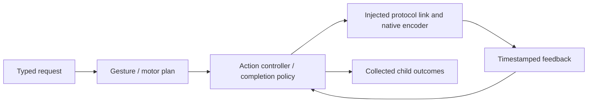
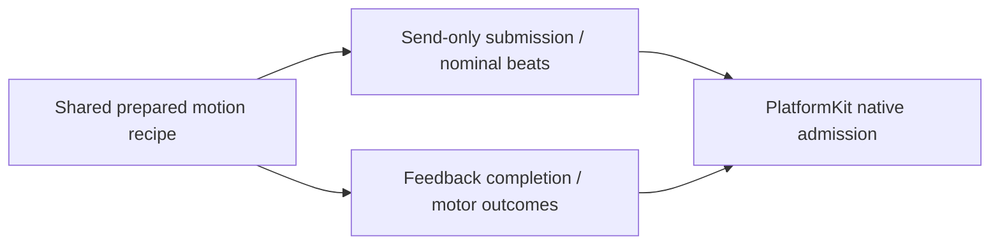

# NexArm Action support

Purpose: implement the NexArm action domain below its stateless callable entry points. Design goals: shared Settings/Channel recipes with explicit submission versus feedback-completion boundaries, validated motor scope, bounded work and complete Channel child outcomes.

✅ This directory owns gesture metadata, simple/complex recipes, IK plan preparation, the Action controller, completion policy/results, reset wrappers and manual jog shaping. It imports the foundational PlatformKit SDK through injected links; concrete connection lifetime belongs to App. Public helpers do not grant model permission.

✅ Registration and parameter-dependent resources remain explicit. The actor owns a finite device-operation lifetime, not another Channel queue. The [domain README](../README.md) is the authoritative current technical design, source map, algorithms, diagrams and authoring rules.

❌ No automatic registration, hidden model permissions, physical emergency-stop guarantee or independent concurrent controller per motor. Historical causal and polling diagnostics live in root Tests, not this production implementation. The controller exposes no retired nudge/base diagnostic API or duplicate motor packet encoder.

✅ `NexArmMotorProfiles` centrally maintains measured arrival tolerances and a parameter-dependent empirical timing envelope. `NexArmRegistration` supplies macro-bound resource and conservative admission-budget resolvers. Arrival does not wait for stability; off-target stability only advances with fresh samples.

✅ Resource and budget resolvers consume Actions-owned contracts; domain failures use ActionFailure. No AgentCore import is needed.

✅ ADR0098: Execution values and services are imported from independent ActionRuntime; concrete Action domains and macro declarations remain in Actions. Published paths, parameters, bounds and completion behavior are unchanged.

✅ NexArmJointCommand owns tracking rest/angle and speed policy; aim shares controller admission and motor ownership. Native encoding remains in PlatformKit. ❌ Tracking arrival is not measured.

✅ Tracking writes reject faulted controllers. Any failed/cancelled write that may have committed latches uncertainty; explicit recoverState verifies stationary feedback and never replays a command.

✅ Tracking rest and reach: `NexArmJointCommand.armHome` is `[2047, 2087, 1984, 2045, 2048]`; `reachLift` maps wrist pitch to shoulder lift, and `NexArmForearmLeveler` adds the measured 40 count elbow lead only while extending. ✅ Production tracking steps through `NexArmJogPlanner.approach`. Speed follows the remaining count and stays at 200 counts/s (100 for lift and elbow). A direction change holds the current count for one step before reversing. The five-axis packet builder still sizes its test speed from the previous target. Faulted writes still require explicit read-only recovery and are never replayed. Native encoding remains in PlatformKit.

✅ ADR0122: Runtime resource values contain no camera constants. ActionFailure and ActionReport.Entry.Code are bounded opaque identifiers (1–64 UTF-8 bytes); Runtime provides generic execution codes only. NexArm owns its result vocabulary, BluetoothWorkflowError owns its failure-to-report mapping, and Gateway preserves producer identifiers. Existing device failure/report identifiers and presentation are unchanged.

❌ Runtime must not classify pose, foreground, control-readiness or device-feedback failures. Producers provide actionReportCode through ActionExecutionFailureProviding; the generic default handles invalid arguments/resource unavailability and otherwise reports handlerFailed. CancellationError remains cancellation.

✅ ADR0127: `NexArmActionController.manualPlan` builds the same prepared geometry/options used by Channel gestures/reset without I/O or lock admission. `NexArmMotionPlan.submit` owns bounded cancellable choreography and send admission, while the existing controller owns feedback arrival. App supplies one live session and cancels prior writers; no second geometry catalog or packet encoder is introduced.

