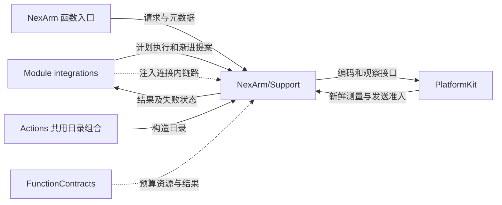
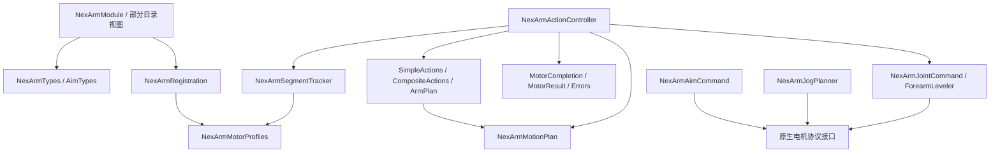

# NexArm Support — 计划、反馈执行与渐进运动规划

## 简介

拥有有限动作几何、连接内 IK 表、电机执行状态、反馈完成算法、资源/预算元数据，以及手动和跟踪目标整形。原生编码、硬件范围和链路接口由 PlatformKit 提供。

## 上下游关系（一级）



## 内部模块关系



JogPlanner 提供手动渐进提案，JointCommand 保留关节几何与诊断控制器路径；ForearmLeveler 保留公开的诊断几何接口及其回归，不参与实时 worker。NexArmAimCommand 接收映射后的 base/pitch count，生成首包肩/肘准备及后续电机 1/4 同步包，以 command/accept 分离目标提议与实际准入；宿主保留资源与生命周期所有权。

## 目录、值与连接所有权

NexArmModule 绑定 gesture、base、tracking 三组工厂；NexArmGestureModule、NexArmBaseModule、NexArmTrackingModule 是复用同一工厂的部分目录视图。NexArmTypes 定义 GestureRequest、业务参数错误和报告代码，AimTypes 定义跟踪参数错误。

NexArmActionController 是每条连接的 actor：保存 busy、lockedMotors、IK 缓存、软件 motorHomes、实测 cachedJoints/cachedPose、逐电机结果及 revision、兼容状态和失败状态。不在控制器内排队；忙时明确拒绝。连接终止时宿主应释放该控制器。receivePassiveFeedback 只解码测量，不发探测或运动。

兼容策略有三种：passiveBLE 直接使用已建立的原生协议；strictFirmware 校验指定固件回包，仅对特定内部版本读取空结果最多读四次；nexArmBLEProtocol 校验两次姿态/关节样本及稳定性。这些读取不能证明物理运动空间安全。

## 几何、归位与计划约束

| 源码 | 算法与边界 |
| --- | --- |
| NexArmSimpleActions | nod 电机 4、shakeHead 电机 5；中心帧加每轮五个扫动帧，振幅分别 380/500 count |
| NexArmCompositeActions | 有限 XYZ/姿态配方，前后包含 home；NexArmArmPlan 把几何经设备 IK 编译为只含电机 1…5 的写入 |
| NexArmMotionPlan | 1…20 步，锁定集合非空且位于 1…6；每步目标在集合内，全部目标并集必须等于锁定集合 |
| NexArmMotorProfiles | 电机容差和基于原生速度/加速度值的经验预算 |
| NexArmRegistration | 调用前资源集合和整体动态预算解析 |
| NexArmJogPlanner / JointCommand | 手动速度整形及关节目标映射 |
| NexArmAimCommand | 单包跟踪、死区、有限前视和准入后提交 |

普通 passiveBLE 整臂归位使用参考 count `[2048,2087,1198,1238,2048]`；显式软件 motorHomes 用于单电机 reset。其它归位路径可由设备 IK 的 home `[200,0,200,0,0,0]` 解析。跟踪 rest 独立为 `[2047,2087,1984,2045,2048]`，不等同于普通 home。

IK 表最多 64 个几何键，检查回包地址/命令/长度、请求姿态及五个关节范围。几何 CMD8 只是待编译意图；实际运动发送使用单电机 CMD3 或同时电机组 CMD131，不将夹爪带入整臂配方。计划 frame.milliseconds 限 1…10000，作为帧信息保留；反馈执行器不以名义帧时间强制等待到位。

## 逐电机反馈完成算法

execute 为一个有限计划持有观察 session 和 lockedMotors，逐段发送并跟踪每个电机。发送前可读取已有最新反馈作为预算起点，但只有 sample 时间不早于本次发送起点、且 sequence/time 更新的反馈能完成新运动。

默认电机 1…6 容差依次为 16/20/56/32/16/24 count。NexArmSegmentTracker 优先判定截止时间内的到位样本；未到位时，以稳定锚点、两 count 默认偏差、至少两个新鲜样本和稳定时间判定 unreached。移动重新建立锚点，静默不能累计稳定区间。

```text
ramp = 0.4 * sqrt(30 / acceleration)
expected = distance / speed + ramp + 0.2
motionTimeout = 3 * expected + 1.2
stableOffTarget = max(0.6, 8 / speed + ramp)
```

distance 来自已取得的位置；未知时取目标到合法区间两端的最大距离。时间单位为秒，转换为毫秒时向上取整。这是实现中的经验预算，不将寄存器加速度解释成已标定的物理单位。

观察/未准入重试间隔为 20 毫秒，单段发送准入上限一秒。默认反馈缺口上限两秒，丢失或断连后将后续段标为未启动并禁止继续写入。普通目标未到位或电机 deadline 到期不丢掉结果，继续后续段。NexArmMotorCompletion 可指定合法容差、稳定/反馈时间和 timeout，实际稳定窗口取策略与估计的较大值。

## 状态、失败与清理

NexArmMotorResult 保存 step/motor/target/observed/failure/started；最多 20 步乘六电机的结果量由计划边界推导。控制器保留最早真实执行异常，并加入观察会话关闭后返回；cancelled 停止后续发送，剩余叶子记为未启动取消。

失败分为 targetNotReached、timedOut、feedbackLost、disconnected、sendingFailed、admissionFailed、feedbackFailed、cancelled。发送返回未准入时可在一秒窗口内重新提议，已经接纳的运动不自动重放。unreachedSegments、lastFailure、motionFailure 保留诊断分类；它们不是自动重连指令。

有限 execute 开始时重置 faulted，不把旧失败永久封锁为新的运动准入。独立 aim/readState/verifyCompatibility 路径对 faulted 有限制；recoverState 是只读测量恢复，加入稳定样本检查后清除该状态，不重发运动。

## 手动渐进规划与跟踪目标

JogPlanner 保存六个位置/速度/加速度/最后已提交 count。周期 30 毫秒，输入死区 4%，死区外平方映射；上限为 600 count/s、1800 count/s²、12000 count/s³。单次积分 dt 最多 60 毫秒，有限目标采用 60 毫秒前视，相同目标不重复发送。提案由 accept 提交；stop 保留最后有限目标并清零后续速度，不生成回零动作。

approach 保留有限 count 渐进规划接口和对应回归，不用于实时跟踪：仅允许电机 1…5，默认上限 200 count/s，aimReachSpeed 为 100。反向且仍有明显速度时先提议保持当前位置并清零速度；最后 1…2 count 只有在 accept 后才视为完成，避免未准入目标被误认为已经提交。

NexArmAimCommand.command/accept(Command) 先把肩/肘置于跟踪 rest（2087/1984，速度 400、加速度 30），这一包仍是位置指令。随后按固定顺序为电机 1、电机 4 各发扭矩关、模式 1、速度 0、扭矩开。速度模式建立后，每次新的 base/pitch 位置按实际采样间隔换成两轴速度，打进同一帧；正速度值朝编码器减小的方向，最高位置 1 则相反。幅值为 `|count差| / dt × 2.2`，限制 0…600，间隔限制在 0.02…0.5 秒。幅值为 0 时写一次速度 0，相同速度不重复发送。未准入不推进阶段；新目标只替换尚未发出的速度帧。reset 清除阶段、水平位和速度状态。releasePackets 在已开始模式切换后给出速度 0、模式 0、扭矩开，以及停在最后目标的位置包。腕滚转和夹爪不寻址。

状态只保留初始两轴参考、上次准入的逻辑目标/goal、最近提议样本、一个 pending 包和肩/肘是否已准入的布尔标记。未准入时重复提议同一包；新目标替换 pending，携带已被替换云台提案的 Command 不会被 accept 提交。仅含水平位的 Command 由宿主在当前 session 发送准入后接纳；宿主不得向已 reset 的控制周期提交旧 Command。reset 清除参考、前视历史和未准入包；宿主在取消/失败、连接清理或手动接管后调用。起点来自最新六轴反馈，否则显式使用跟踪 rest；发出的 goal 是规划估计，不能冒充实测位置。

JointCommand 将 base/pitch 按 `4096/(2π)` 映射到跟踪 rest。pitch 超过 0.25 弧度开始伸出，至 0.7 达到 shoulder_lift 最小 1150；elbow 用固定肩肘和保持前臂水平。ForearmLeveler 用 40 count lead 与六 count 滞回补偿伸出方向，目标受电机范围夹取。五轴包保留于诊断控制器接口，不用于实时跟踪；速度由相邻目标距离及 200 毫秒名义值选取，上限 700；该名义值不是到位等待。

这些组件只提供有限计划、提案与接纳状态。长期跟踪 worker、资源接管、写入公平性、连接恢复及手动替换/加入清理由领域执行服务负责，不能用 planner 完成替代真实到位。

[入口、资源与完成](../README.md) · [原生链路接口](../../../PlatformKit/Connectivity/NexArm/README.md) · [共享契约](../../Support/Contracts/README.md)

## 连接、执行与 UI 适配的分离

ActionBindings 编译 NexArmControlService、NexArmConnectionState、BluetoothRecovery/Presentation、BluetoothWorkflow 和 NexArmBehaviorAdapter。NexArmControlService 的状态不含 UI 类型，拥有连接内执行器、恢复策略及有界手动/跟踪工作；NexArmConnectionState 是唯一连接/控制事实来源。BluetoothWorkflow 实现 UI 控制接口，只转换完整 BluetoothViewSnapshot，UI 草稿/错误字段不能授权原生动作。

独立持续执行失败先保留 invocation 私有报告，再通过注入的结果投递能力回到真实 Gateway；报告转换在 AgentBindings 完成，不反向导入 Gateway。资源验证保留 inherited permit；连接恢复不取消其他 Agent 队列，不自动重放动作。shutdown 加入已有清理并核对真实 link.status 的 disconnected；未确认则明确失败，不宣称物理电机已经到位或停止。


## 待实现

- 暂无本目录独立的实现待办；跨模块及实际模型/设备验收见所属模块说明。
