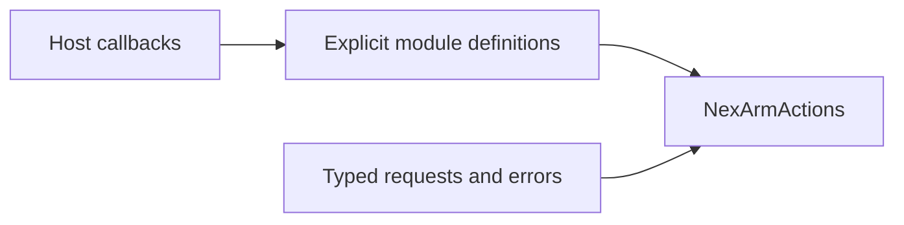

# NexArm Action Support

Purpose: keep non-callable implementation support separate from registered entry points. Design goals: cohesive definitions, explicit typed injection, stable public names and no hidden registration.

NexArmActionModules supplies explicit gesture/base catalogs; NexArmTypes owns typed requests and complete domain errors.

✅ Sources compile once in Actions. Public visibility exists where App/test composition requires it; it does not grant model access. Definitions remain explicit, and Agent declarations remain the permission source. See the [domain contract](../README.md) for completion, lifetime, cancellation and limits.

✅ This directory adds no queue or scheduler. Definitions and typed values introduce no background work, buffering or mutable runtime owner.

❌ No automatic discovery, generic action factory or new runtime behavior.

✅ Registrations own each operation's required displayName alongside its handler and completion contract. Execution records carry this value; no App or UI switch enumerates domain actions. ❌ This is human-readable metadata, not model permission or a SwiftUI dependency.

✅ Cartesian Action completion metadata now describes Settings-matched timed playback and fresh final-home observation. Head entries retain calibrated per-segment completion. ❌ Final home does not prove intermediate waypoint arrival.

✅ Performance completion metadata now explicitly describes arm-only arrival, excluding claw angle/motor6. Cartesian and native head completion still await the owning controller. ❌ No gripper-completion or grasp-success guarantee is added.

✅ Performance completion metadata now states arm-only output: gripper commands and gripper convergence are excluded from every gesture. ❌ Dedicated grasp completion remains a separate future capability.
