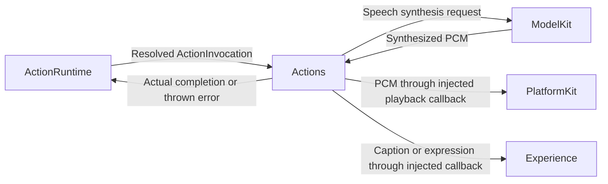

# Actions — Executable Behavior Library

Actions implements behaviors that affect presentation or the external world, as described in architecture section 28. Implementations consume resolved invocations and use injected capabilities or platform callbacks; they do not make Agent decisions or manage scheduling.

This README is the development standard for all current and future Action modules, for both developers and AI coding tools. Follow it alongside the [technical architecture](../README.md) and [Agent configuration standard](../Agents/README.md).

## Direct relationships

The current audio and presentation connections use callbacks supplied by App. These edges describe logical data flow rather than direct imports of PlatformKit or Experience.



## Implementation status

- ✅ [Speech](Speech/README.md): `Speak.swift` / `SpeechActions.speak` synthesizes speech and awaits actual playback completion.
- ✅ [UI](UI/README.md): `Print.swift` and `Express.swift` / `UIActions` present captions and expressions.
- ✅ Each function owns its parameter validation and output handling; speak and print independently validate text without a shared TextAction helper.
- ✅ ActionRuntime owns path registration and execution; Gateway owns Channel queues and resource exclusion.
- ❌ Camera, Media, Device, Robot, `UI.show`, and `Speech.stopSpeak` implementations. [Robot](Robot/README.md) has a design-only contract for `RobotActions.aim`; see [ADR 0035](../../docs/adr/0035-tracking-agent-and-robot-actions.md).
- ❌ General action metadata for execution policies and resource requirements; the current resource exclusion unit is the action module.

Agent JSON configuration maps the model alias `say` to `Speech.speak`, and `print`/`express` to `UI.print`/`UI.express`. Default Channels remain `Speech` and `Display`; a Channel name need not equal its action module. Handlers must await real completion, propagate errors, and cooperate with cancellation.

## 1. Directory and naming conventions

```text
Actions/
├── README.md                 # Shared development standard
└── <Module>/                 # Speech, UI, Camera, Media, Device, Robot
    ├── README.md             # Module purpose, action contracts and status
    ├── <Verb>.swift          # One independently callable action per file
    └── <AnotherVerb>.swift
```

- Use PascalCase for module directories and Swift filenames, and lowerCamelCase verbs for functions. Current examples are `Speech/Speak.swift` and `UI/Print.swift`.
- Group related behaviors under `<Module>Actions`, such as `SpeechActions` or `UIActions`. Declare the namespace once in an action file; use extensions in sibling files. Do not add an empty namespace file solely for symmetry.
- Use `ActionPath(module: "Speech", function: "speak")` as the implementation key. Model aliases, such as `say`, belong to Agent configuration and need not match Swift names.
- Add only modules and functions with an actual implementation and use case. Do not create placeholder actions or unrelated helper actions at the Actions root.
- Current scheduling excludes concurrent execution within the same action module, even across Channels. Consider that resource boundary when choosing a module; do not rename modules merely to bypass hardware serialization.

## 2. Function interface and dependencies

The current runtime handler contract is `@Sendable (ActionInvocation) async throws -> Void`. Concrete functions use `public static func`, accept `invocation: ActionInvocation`, and receive the capabilities or callbacks they need explicitly. App binds those dependencies when registering the handler.

- Read resolved parameters from `invocation.call.parameters`. Retain the envelope's input/session association for model requests and callbacks.
- Inject capability protocols and Sendable callbacks. Do not construct concrete models, read global service registries, or locate the App singleton inside an action.
- Do not import concrete Agents, Gateway, App, Experience or SwiftUI. UI work crosses an injected callback whose implementation provides MainActor isolation; model and device adapters own their respective isolation and permissions.
- Keep mutable operation state local to the invocation, or in an explicitly injected actor-owned service. Do not add mutable static state shared by unrelated calls.
- Actions do not parse XML, resolve model aliases, route Agent inputs, register themselves, or create Channel schedulers. Those responsibilities remain with AgentCore, App and Gateway.
- A function's own dependencies must be sufficient to execute it. Do not require another action to have run first unless an explicit, documented external resource state is part of its contract.

## 3. Function cohesion and parameter validation

Each function owns parameter extraction, validation, execution, output checks, cleanup and any explicitly supported fallback. Small duplicated checks across functions are allowed and preferred to coupling unrelated functions through a shared validator such as the removed TextAction helper.

- Validate required parameters and action-specific constraints before the first side effect. Agent/Gateway capability and structural checks do not replace function-local validation for direct callers.
- For each parameter, document its name, meaning, required/optional status, default, units, accepted values and size/range bounds. Distinguish an omitted optional value from an invalid supplied value.
- Parse numeric values safely, reject non-finite values where applicable, and check domain limits. Avoid forced unwraps, `try!`, and silent replacement of invalid input with a default.
- State whether length limits count UTF-8 bytes, characters, samples or another unit. Preserve valid input unless normalization is explicitly part of the action's contract.
- Keep defaults, output handling and fallback rules with the function they govern. Private helpers in the same file are appropriate for a complex implementation; shared model/device algorithms belong in their capability or platform modules.
- Do not force all actions to accept the same parameters or use the same validation limits merely to reduce repeated code.

Currently, speak and print independently reject missing, whitespace-only or over-2000-byte UTF-8 text. Both preserve accepted text, including surrounding whitespace. express requires a supported emotion string and owns the corresponding emoji. Agent configuration rejects undeclared parameters before dispatch; this is distinct from each function's semantic checks.

## 4. Execution, output and fallback

- Successful return means the promised operation actually completed. Await playback, presentation or the relevant device acknowledgment according to the documented contract; do not return merely because work was queued.
- Validate output that the action depends on: completion markers, payload format, finite values, nonempty required results and explicit payload budgets where applicable. Availability checks are snapshots; execution can still fail.
- Propagate synthesis, presentation, device and cleanup-related failures appropriately. Never fabricate a successful result or substitute unrelated output to hide failure.
- Fallback is optional, not a required feature. If implemented, keep it inside the action and document the trigger, permitted substitute, limits, observable outcome and errors that still propagate. It must preserve caller intent and permission boundaries.
- Never treat cancellation as a fallback trigger. Retries need an explicit bound and must not duplicate non-idempotent side effects; do not automatically retry physical movement, capture, payment-like operations or other externally visible work.
- Streaming execution may have emitted visible output before a later failure. Document this partial-effect behavior rather than promising rollback.

Current speak owns TTS completion checks, the 8 MiB audio budget, playback completion and session cleanup. print and express propagate presentation failures. None of the current actions implements silent output fallback. Standard ActionResult feedback is not implemented; do not claim it exists or directly submit results to Agents as a workaround.

## 5. Cancellation, resources and errors

- Check cancellation before side effects and after awaited work; check during long-running loops or streams.
- Propagate cancellation to any model session or device operation started by the function. Release resources on success, failure and cancellation using defer and cancellation handlers as appropriate.
- Do not create detached or untracked work that outlives the invocation. A function must not finish while its owned operation can still produce stale side effects.
- Bound buffers, generated output and any necessary internal work queue. Define overflow behavior explicitly; never silently discard device actions. Gateway already owns action admission and Channel ordering, so do not duplicate its queues.
- Reuse an existing error only when its meaning matches. New action-specific failures may use a clearly named error type alongside the action. Keep scheduler errors and business failures distinct; do not convert every error into invalidText.
- Validate device capabilities and permissions through the responsible adapter. Robot limits, emergency-stop and disconnect protection must not depend on iOS background execution.
- Diagnostic logging must not expose user text, media or credentials. Do not introduce ad hoc user-facing status messages into a reusable function; return errors through the existing execution boundary.

## 6. Registration and Agent exposure

Implementation registration and Agent permission declarations are separate steps:

1. Implement the function in its Actions module and document its contract.
2. Bind its explicit ActionPath to a concrete handler in App's composition root, currently AgentBootstrap. Inject required services there.
3. For each Agent allowed to use it, add an entry to that Agent's versioned `<AgentName>.agent.json`, following the Agents README. Declare alias, implementation path, defaultChannel, doc, hidden, parameters and XML examples. Required/optional parameter sets are derived from the parameter entries.
4. Add it to textActions only when natural text should invoke it and it accepts the text-mapping contract. Do not implicitly expose every registered action to every Agent.
5. Keep parameter names and implementation paths consistent across the function, handler registration, configuration, prompt context and tests.

Do not create a second action registry or an Actions-specific configuration format. Current JSON configuration describes parameter names, intended types, usage constraints, function-derived doc, visibility and XML examples; it is not a full executable value-validation schema or resource policy. Function-local constraints remain authoritative for execution. Channels are selected before execution; `main` is an ordinary Channel, not a global barrier.

## 7. Module documentation and validation

Each module README must document its purpose, resource boundary, dependencies and ✅/❌ implementation status. For every action, record:

| Contract item | Required content |
| --- | --- |
| Identity | Source file, Swift function and registered ActionPath |
| Parameters | Names, defaults, units, validation and limits |
| Dependencies | Required capability protocols and callbacks |
| Side effects | What changes and when successful return occurs |
| Output and failure | Output checks, partial effects, errors, fallback or explicitly no fallback |
| Cancellation | Owned resources, cleanup and cancellation limitations |
| Validation | Automated coverage and any remaining device acceptance |

Tests should exercise the function directly, independently of Agent/Gateway validation. Cover relevant invalid-input boundaries before side effects, successful input preservation, dependency failures, invalid or missing output, cancellation and resource cleanup. If fallback exists, test both its trigger and prohibited cases. Use capability/callback doubles under Tests; do not add production flags for fixed replies or pretend hardware success.

Reuse existing coverage rather than adding tests that mirror implementation details. Add registration or Agent-configuration integration coverage when the exposed contract changes. Distinguish unit tests, build success and actual device acceptance.

## 8. Delivery checklist

- Place the implementation and README in the correct module; update existing documentation when behavior changes.
- Keep each function cohesive even when that repeats small checks from another action.
- Update App registration and Agent configuration only where exposure is intended.
- Synchronize Package.swift and Xcode references when files, resources or dependencies change. Do not duplicate sources or add a third-party dependency without a concrete need.
- Run `./scripts/check.sh` and, when full Xcode is available, `./scripts/build-ios.sh`; report unavailable checks. Verify the device target when changing device-specific composition.
- Update architecture decisions and Roadmap for runtime-contract changes. Describe unimplemented behavior honestly; do not advertise a fallback, permission check or device capability that has no implementation.

## Maintenance

Keep this README synchronized with changes to responsibilities, files, interfaces, and implementation status. ✅ means implemented; ❌ means planned or incomplete. Do not create unused placeholder modules. The [technical architecture](../README.md) defines the target; the [layout audit](../../docs/Repository-Structure.md) records implementation exceptions.

Action documentation must describe the actual function. Combine usage guidance in doc; do not invent a return-value section for Void functions. Use XML/natural-text example strings. Mark automatic text-mapping actions hidden when they should not be shown as explicit LLM commands.

✅ UI.express adds seven validated facial expressions through one injected presentation callback; smile is an emotion value. Expressions update the orb independently of captions.
