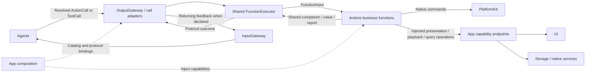
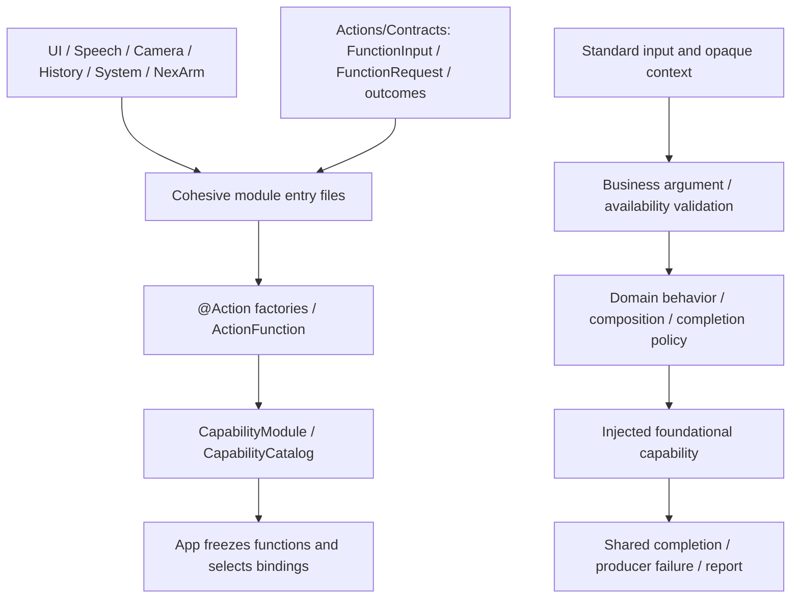

# Actions — Protocol-Neutral Business Functions

Actions implements callable business operations, queries and composition. Agents choose what to do; Gateway controls how calls are authorized and executed. Each function receives standard input and returns a shared outcome without knowing whether it was invoked through ActionCall or ToolCall.

Design goals: cohesive directory/module/function ownership, injected capabilities, intrinsic resource/budget constraints and independence from calling protocols.

## Upstream and downstream

Arrows show runtime execution; dashed arrows show assembly or injection, not imports. Agent calls always cross OutputGateway.

Endpoint completion means the function's declared acceptance or completion, not necessarily animation, inference or physical arrival. Completion-only native calls do not manufacture ToolResult feedback.

## Internal structure

Solid arrows below show catalog construction and function processing. Contracts is independently compiled as FunctionContracts; business sources cannot import execution or calling SDKs.

## Design principles and core mechanisms

**One implementation, explicit exposure.** A canonical `Domain.Module.function` identifies business behavior, not a scheduling lane or model alias. `@Action` generates ActionFunction metadata; it neither registers a call protocol nor grants permission. App freezes the catalog and selects bindings; Agents expose permitted aliases separately. This lets human and model entry points share implementation, validation and outcomes.

**Constraints belong to the function.** Resource requirements, serialization keys, completion kind and budget are intrinsic metadata. Both protocol views resolve the canonical function from the same FunctionRegistry, so a binding cannot replace its handler or weaken its resource/budget constraints. Channel/wait policy stays outside FunctionRequest.

| Standard contract | Function responsibility |
| --- | --- |
| FunctionRequest | Canonical address and string parameters; ActionArguments validates keys, required values, ranges and sizes |
| FunctionInput | Request, execution ID, opaque correlation context and injected FunctionReporting sink; no protocol branching |
| ActionCompletion | Finite completion/value/report, state acceptance or explicit activity start/stop identity, matching the declared kind |
| Producer failure | Neutral code/message from the owning domain; protocol conversion and user-facing wording belong to consumers |

A composed function retains leaf outcomes rather than hiding partial failure in a summary. The shared executor prefers an explicit returned report; for finite functions, a stored report takes precedence over an ordinary value and can retain failure evidence. Dynamic execution budget overrides constant timeout and runtime fallback; queue time is separate. Functions cooperate with cancellation, while the executor joins cleanup. A completed durable mutation cannot be rolled back merely because later presentation or feedback fails.

## Ownership and boundaries

- `Contracts/`: standard input/output, callable metadata, argument validation and neutral producer failures; no Channel or protocol discriminator.
- `UI/`, `Speech/`, `Camera/`, `History/`, `System/`, `NexArm/`: functions and domain catalogs, with canonical addresses `Domain.Module.function`.
- `@Action` declares intrinsic constraints only. App owns protocol profiles; Agent JSON/code owns grants. One function can be explicitly bound to either or both protocols.
- `Actions` depends on FunctionContracts, PlatformKit, StorageChat, Storage and the compile-time BehaviorDefinitions plugin. It cannot import Gateway, AgentCore, ExecutionRuntime or CallRuntime.
- Shared execution lives in [Gateway/Runtime](../Gateway/Runtime/README.md); registration and adapters live in [Gateway/Output](../Gateway/Output/README.md). Actions owns recipes, gestures, motion shaping and completion policy.

## Implementation status

✅ Six canonical domain catalogs, protocol-neutral factories/handlers and shared outcomes. Actions/Runtime, @Tool and business Tool aliases are removed; source/dependency checks enforce the boundary.

❌ Additional application capabilities, complete feature Signal routing and physical acceptance remain separate work. `System.Runtime.runtimeInfo` returns fixed information, not live diagnostics.

See [Contracts](Contracts/README.md), [Agent-driven architecture](../README.md) and [host profiles](../App/Composition/Behaviors/README.md).

✅ Every function preserves its business completion policy independently of call protocol. On invocation failure, preserve bounded child outcomes and producer causes; Gateway normalizes and dispatches the common result without stopping unrelated work. Explicit cancellation still joins cleanup.

✅ Implemented: History adds pure startNew/summarize functions, using injected journal mutation and Agent-owned title-computation capabilities. Functions remain unaware of call protocols.

✅ Implemented: System.ModelResources functions provide download admission, explicit cancel and removal through a required injected capability; call protocol details remain Gateway-owned.

✅ ADR0167: System.ModelResources.configureSpeech strictly validates standard boolean arguments and invokes an injected capability. Actions remains unaware of ToolCall/ActionCall and concrete model configuration.

✅ ADR0168: Actions explicitly depends on Storage for the resource preference service. That service owns durable values, source validation, legacy migration and installed prerequisites; call conventions remain Gateway-owned.

✅ ADR0169: snapshotResources is a standard callable query with an injected neutral-fact capability. Actions owns bounded inventory encoding, progress/eligibility data and the prerequisite rules shared with preference transactions.

✅ ADR0170: UI adds two pure resource presentation functions. Shared inventory read/validation is reused by query and presentation; no call protocol, UI or Agent imports.

✅ ADR0172: UI.ResourcePresentation adds pure showResourceOperationFailure(message) with required injected endpoint, bounded arguments and awaited result. Call conventions remain Gateway-owned.

✅ ADR0173: Resource preference producers expose domain failure codes through the existing neutral execution interface. UI adds a pure preference-failure function and a neutral four-reason endpoint; no calling protocol ownership.

## Provider discovery

✅ Provider discovery: System.Provider.discoverModels is a pure callable taking only requestID. System/Support owns secret-bearing neutral configuration values and a bounded session-bound one-use request store, injected SDK capability and model-list validation. No calling protocol, UI value, Agent or concrete SDK dependency is added.

## Provider configuration transactions

✅ Implemented: System.Provider adds restoreSettings/saveSettings with protocol-neutral requestID input and requestID acknowledgment. System/Support owns configuration transactions, private request/result slots and document/credential-reference policy. Injected native capabilities remain outside Actions; no SDK/UI/Agent imports.

## Completion batch — provider presentation and capability policy

✅ Implemented: provider discovery model-family eligibility belongs to Actions ProviderModelList; ModelKit validates/decodes raw IDs only. Preserve filtering/dedup/order and bounds at the app boundary. SettingsState becomes a passive editable snapshot, with no tasks or injected execution; SettingsInteractionWorkflow in the existing Settings directory owns bounded form admission, revision and page-independent saves. UI forwards edits/discovery/cancellation/save through SettingsControlling.

✅ Implemented: presentation-enabled provider intents select a second registered UI.ResourcePresentation.showProviderResult call after the business call, on success or failure. Headless requests retain one call. Private result lookup and revision/session fences prevent credentials in protocol payloads and stale form updates. One attempt only, no recursive presentation/replay; producer and presentation failure chains remain distinct. App injects the native UI endpoint; business functions remain independent of UI and call protocols.

## Typed device, navigation and environment entry points

✅ Implemented: app.interaction/1 maps explicit device commands and navigation destinations to fixed registered functions through ApplicationControl and the shared root transport. This Agent now coordinates native resource interactions as well as model resources; it performs no native I/O. UI controls emit typed intent through a root-owned BluetoothInteractionWorkflow; native BluetoothWorkflow remains the injected connection/recovery/manual worker host. Existing arrival tolerance, timeouts, pacing and takeover algorithms stay unchanged.

✅ Implemented: System.Device.control validates bounded string arguments and invokes neutral DeviceControlCapability; successful submission reports acceptance, not physical arrival. Read-only status and selected connection commands are explicitly model-granted. UI.Navigation.open commits native route state; manual taps and model requests share that function. A bounded latest motor-intent worker sends only changed values, with reset/stop priority and explicit failure display. No queued motion replay.

✅ Implemented: app.environment/1 stores latest sequenced scene/device/capability facts in the root Agent, with finite categories and bounded data. App still performs synchronous background/native safety fencing before reporting facts; physical safety cannot wait on Agent admission or iOS background execution. Native back navigation remains platform-owned and reports a fact, rather than replaying navigation effects. Photo-library creation and physical acceptance are feature/acceptance boundaries, not implied by navigation support.
