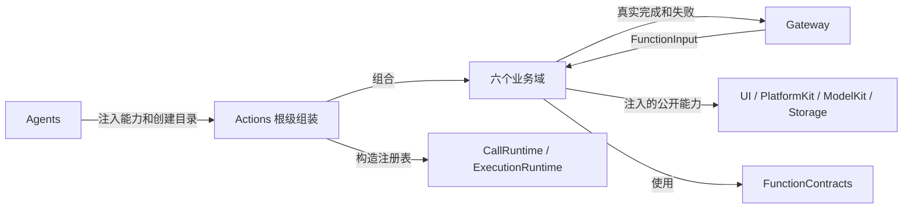

# Actions — 业务函数集合与执行服务

## 职责与边界

Actions 拥有可调用的业务操作、查询及其真实执行：参数验证、资源需求、预算、完成与失败，以及注入基础能力后的原生效果和呈现。Agents 拥有策略和受保护调用；Gateway 拥有身份授权、Channel、资源仲裁、取消与反馈；App 创建唯一基础根并连接公开生命周期。Actions 不导入 Agents、Gateway 实现或 App。

业务函数只依赖标准 FunctionInput 和注入能力，不因 Action 或 Tool 调用而复制实现。注册不授予角色或 Skill 权限；编译／注册存在不等于设备就绪或业务效果已经完成。

## 源码组织与编译

目录按业务能力聚合，文件按一致职责聚合：函数入口、能力契约、目录绑定、执行服务各有明确所有者。Support 只维护当前范围内跨能力共享的契约、算法与核心机制；域专用实现位于业务目录。同一业务入口不散落到 Module 或执行服务文件。

| 目录／根文件 | 责任 |
| --- | --- |
| [Camera](Camera/README.md) | 相机控制、采集／预览与独立照片操作会话 |
| [History](History/README.md) | 预览／完整查询、归档修改、请求结果槽和历史呈现 |
| [NexArm](NexArm/README.md) | 连接恢复、有限运动、手动及跟踪执行 |
| [Speech](Speech/README.md) | 播放、聆听、音频检测与原生会话 |
| [System](System/README.md) | 资源、Provider、设备、Task 和显式诊断 |
| [UI](UI/README.md) | 表情、会话、反馈、骨架、导航与业务事实呈现 |
| [Support](Support/README.md) | 公共函数契约、作者宏和通用清理错误 |
| [CapabilityModules.swift](CapabilityModules.swift) | 静态声明汇总与显式能力绑定的生产目录 |
| [BehaviorProtocolBindings.swift](BehaviorProtocolBindings.swift) | 具体函数的协议、执行和返回策略 |
| [BehaviorAssembly.swift](BehaviorAssembly.swift) | 校验并构造共享函数表和 Action／Tool 注册表 |
| [ActionEndpoints.swift](ActionEndpoints.swift) | 实例级窄端点组合与语音端点原子绑定，不实现业务能力 |

Support/Contracts 独立编译为 FunctionContracts；其余源码统一编译为 Actions，没有按目录隐式获得依赖的机制或第二套绑定目标。Actions 通过公开接口消费 UI、PlatformKit、ModelKit、Storage 和必要的中立执行／调用契约；基础模块无反向业务依赖。

## 直接模块关系

Speech 使用 UI 的反馈／会话呈现接口，UI 资源呈现使用 System 资源值；NexArm 实现 System 的中立设备控制端口。这些是同一编译目标内部的显式关系，不要求基础模块知道业务身份。各域 README 维护具体接口和内部状态。

## 目录组装与调用流

1. @Action 生成函数声明和工厂，域目录显式注入端点并绑定同一业务实现。
2. CapabilityModules.declarations 保存完整静态声明；builtIn 根据本次显式能力构造可调用目录。可选能力缺失时明确失败；Task 控制端口缺失时不注册 Task 目录。
3. BehaviorAssembly 依次校验 CapabilityCatalog 和 ActionBindingCatalog，再以同一组函数构造 FunctionRegistry、ActionRegistry、ToolRegistry 和组装时 Tool 地址集合。重复地址、无效定义和容量超限直接抛出。
4. Agents/AgentRuntime 将 Action 注册表交 ChannelScheduler、Tool 注册表交 OutputGateway，并校验角色能力覆盖。调用最终到达所属域端点，返回实际完成、业务值或失败报告。

具体协议策略集中于 BehaviorProtocolBindings；Action 和 Tool 共用业务元数据、资源与预算。协议开放范围和角色授权分别维护，不能以注册推导权限。

## 实例端点与生命周期

ActionEndpoints 显式组合 UI RuntimePresentation、SpeechExecutionEndpoint、CameraExecutionEndpoint、TaskControlEndpoint。UI 端点只呈现；相机端点验证角色／会话并直接传递类型化回执；语音端点弱绑定实际会话并验证聆听／检测准入；Task 端点转发给上游实际任务所有者。能力不从无关 presentation 或 playback 端口向下转换探测。

语音执行与呈现绑定必须同时成功，失败回滚本次绑定；旧所有者解绑不能清除替换后的绑定。原生会话和长任务由根作用域拥有，页面生命周期不负责停止实际设备。取消先关闭准入，再取消并加入工作和清理；所有队列／槽的容量及拒绝策略由所属目录明确维护。

完成语义由业务定义：状态接纳、动画恢复、音频排空、下载准入和电机到位具有不同边界。已经提交的业务效果不会因后续取消或反馈失败自动撤销。ActionReport 保留逐叶结果和执行失败，NativeCleanupFailure 保留并存的原始错误。

[整体技术设计](../README.md) · [函数契约](Support/Contracts/README.md) · [Gateway 执行](../Gateway/Output/README.md)

## 基础相册实施契约

✅ Camera 拥有相册内部操作及真实完成，采用请求私有类型化附件传递文件和结果，不加入模型公开Skill。

## Container 上下文

✅ 业务事实留在所属 Camera／NexArm 实例内存；contextSnapshot 显式提取有限公开值，ContainerContextSource 在上层适配并序列化。Action 调用类型化能力接口，不修改基础模块公开字段。
