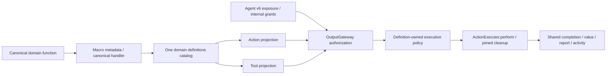

# Actions — Executable Capabilities

Purpose: own business operations, including queries, with one implementation per function. Design goals: cohesive directory/module/function ownership, explicit injected capabilities, shared execution metadata and protocol-independent permissions.

## Layout and ownership

Six domains: UI, Speech, Camera, History, System and NexArm. Each domain has a README, a used namespace facade, cohesive `<Module>Actions.swift` entries and Support values/catalogs. Canonical paths are Domain.Module.function. `CapabilityModules` collects six domain catalogs; each CapabilityModule exposes one ActionDefinition collection.

Runtime is an independently compiled ActionRuntime target with Foundation-only contracts. Actions owns concrete functions and compile-time macro declarations; App binds injected capabilities and Gateway validates permissions/coverage. PlatformKit remains a device SDK and owns no business wrappers.

## One definition, two call protocols

✅ ActionDefinition owns one handler, address, completion, serialization key, resources, deadlines, explicit protocol availability and direct/scheduled execution policy. ToolDefinition and ToolResource are aliases of the same canonical definition/resource; they own no implementation store. `@Action` and `@Tool` factories adapt existing typed entry signatures into that common handler. Related functions remain in the same module files.

✅ `module.actions` and `module.tools` are filtered registry projections. `definition.exposed(as: [.action, .tool])` enables both implementation adapters; Agent configuration/code must independently grant the corresponding permission. Production retains its existing protocol grants.

✅ Scheduled native Tool calls use the same Gateway ChannelScheduler/resource guards as Action calls, outside XML wait membership. Direct calls still require Gateway resource coordination. Low-level SDK executors do not acquire leases or grant permission.

✅ UI/Speech/NexArm scheduled definitions explicitly preserve their serialization keys. Model aliases are resolved inside Agents. Sources compile once; Tools/ToolRuntime import shims and old namespace aliases are removed. NexArm partial catalog adapters support existing isolated hosts without duplicating definition lists.

❌ General model continuation, new navigation/device capabilities and physical acceptance are outside this consolidation. Full JSON Schema, runtime discovery and durable replay are not provided.
