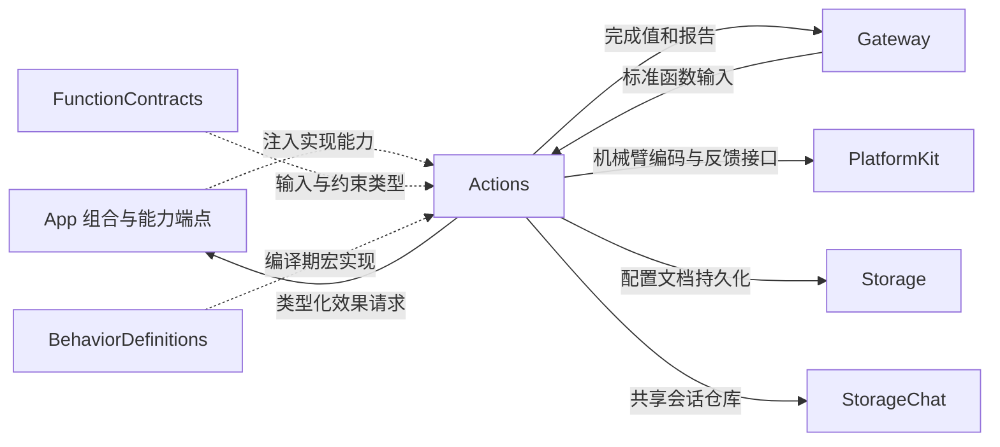
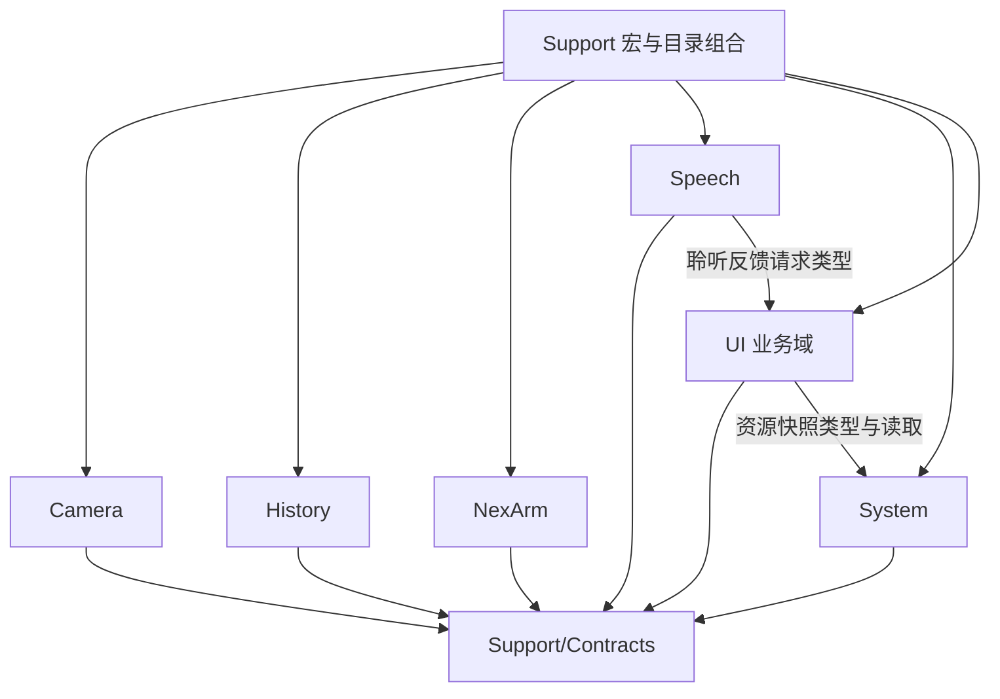

# Actions — 协议中立的业务函数

## 简介

Actions 定义应用的业务操作与查询：参数校验、函数说明、资源需求、执行预算和完成语义。每个业务函数通过注入能力执行真实效果，同一实现可供宿主的 Action Call、Tool Call 或可信业务组合使用。

## 职责与边界

✅ 六个业务域和共享 Support 构成当前实现。业务域入口使用 `FunctionInput`，不读取 Channel、Agent 权限或调用协议。Gateway 负责授权、调度、资源仲裁与结果传递；App 负责注入能力、原生服务及其生命周期。

`Package.swift` 将 `Support/Contracts` 单独编译为无项目依赖的 FunctionContracts；其余 Swift 源码编译为 Actions。Actions 的项目依赖为 FunctionContracts、PlatformKit、BehaviorDefinitions、Storage、StorageChat。PlatformKit 导入限于 NexArm/Support，StorageChat 导入限于 History，Storage 导入限于 System 的持久化服务。Actions 不导入 Agents、Gateway、UI 或 App 的实现。

## 上下游关系（一级）

图中实线表示直接调用或结果流，虚线表示注入或声明使用；它们不等同于编译依赖。

## 内部模块关系

| 目录 | 责任 | 主要实现 |
| --- | --- | --- |
| [Support](Support/README.md) | 共用协议、作者接口与生产目录组合 | `@Action`、`@ActionCatalog`、CapabilityModules |
| [Camera](Camera/README.md) | 相机命令、拍摄与照片处置 | CameraControlCapability |
| [History](History/README.md) | 会话分页预览、归档、标题与删除 | 查询/修改服务与 StorageChat |
| [NexArm](NexArm/README.md) | 单电机、有限动作与跟踪目标 | 计划、反馈执行器与运动规划 |
| [Speech](Speech/README.md) | 已生成音频播放、聆听策略应用 | 播放/聆听能力 |
| [System](System/README.md) | 资源、云服务、设备与 Task 控制 | 私有请求暂存与持久化事务 |
| [UI](UI/README.md) | 表情、文字、状态、反馈与呈现请求 | 类型化呈现能力与中立数据 |

每个业务域的入口文件承载函数体；域内 Support 承载值类型、能力协议、目录与算法。六个域处于同一个 Actions 编译目标，Speech 使用 UI 的反馈类型，UI 使用 System 的资源数据；这些是当前源码内部关系。

## 定义、组合与执行数据流

1. `@Action` 从入口函数生成声明和 definition 工厂。地址为 `Domain.Module.function`；函数名来自 Swift 方法，title 是显示名。
2. 域目录将 definition 工厂与能力端点绑定。`@ActionCatalog` 从本类型内的工厂调用生成静态 declarations。
3. `CapabilityModules` 组合域目录。宿主通过 `CapabilityCatalog` 校验、冻结函数集合，再选择调用协议与开放范围。
4. 执行方传入 `FunctionInput`。入口解析字符串参数，调用注入能力，返回实际完成值，或向报告端口记录子结果。

函数声明不授予权限，也不保证某个 Skill 开放该函数。标准输入只携带解析后的地址、参数、关联上下文、executionID 与报告端口。宿主注册和业务效果使用同一份函数资源及预算定义。

## 关键技术

✅ History read-reference contract: History owns stable short references derived from conversation UUIDs, validates them into a typed query value and resolves exact unique matches through StorageChat metadata. It does not guess, rewrite stored IDs or map missing references to another conversation.

- 参数的传输值统一为字符串；整数、有限数值、布尔、枚举、UUID 和 JSON 的业务约束由入口或注入端口解析。大多数入口拒绝未知键；个别入口的实际差异见所属域文档。
- `ActionFunction` 的动态预算优先于静态 timeout；缺省静态预算为 30 秒。资源解析器最多返回八个资源。执行与清理机制位于 Gateway，估计耗时不构成最低等待时间。
- 完成语义由业务定义：状态接纳、动画恢复、音频排空、命令准入和电机到位分别属于不同边界。定义存在不等于发生了效果。
- `ActionReport` 保留逐叶结果和独立执行失败；纯取消与真实失败区分，混合失败不能被取消掩盖。记录的成功效果不会因后续异常而自动撤销。

## 生命周期与约束

本模块没有统一的请求队列或应用会话所有者。普通入口依赖调用者的任务生命周期；NexArm 控制器和配置服务拥有各自明确的状态及准入规则。长期播放、捕获、跟踪、页面状态和连接寿命属于注入宿主。

直接调用函数体不自动获得 Gateway 的权限、Channel 排序、资源租约或超时机制。需要这些机制的调用方必须通过对应执行接口；端点仍独立验证其运行所有权。

[整体技术设计](../README.md) · [函数协议](Support/Contracts/README.md) · [Gateway 执行](../Gateway/Runtime/README.md)
