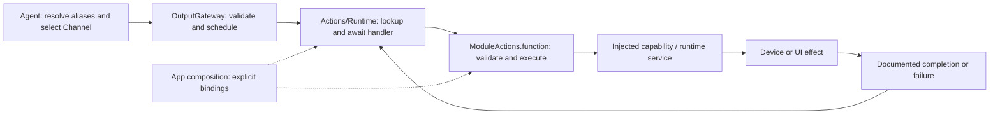
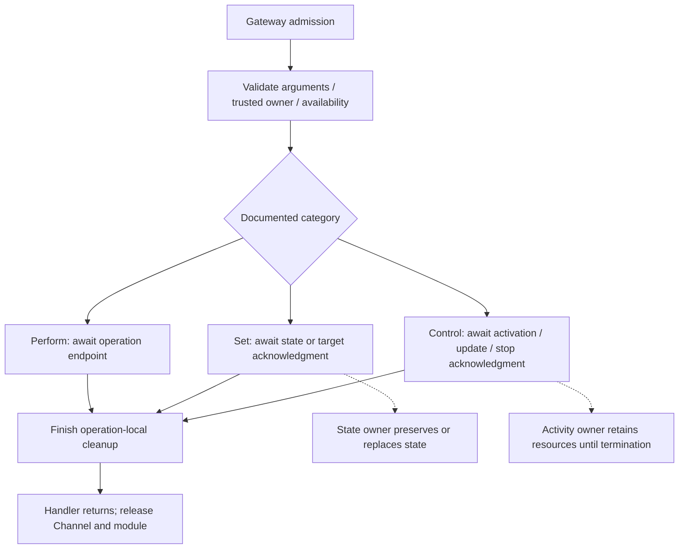
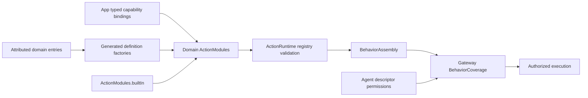

# Actions — Module and Action Authoring Standard

Purpose: implement Agent-selected behavior with explicit completion, ordering and lifetime contracts. Design goals: consistent Swift entry points, cohesive modules, typed dependency injection, bounded execution and understandable ownership of effects.

This document defines Action entry, registration and lifetime contracts. Domain READMEs own exact parameters, operational limits and device algorithms. The runtime contracts compile independently as ActionRuntime; concrete behavior and macro declarations compile as Actions.

## 1. Vocabulary and boundaries

| Term | Definition | Example / boundary |
| --- | --- | --- |
| Action | One permission-checked, scheduled behavior identified by `ActionIdentifier(module:function:)`. It validates input, performs an effect and returns at its documented completion point. | `Speech.speak`, `UI.express`; an Action is not an Agent, thread, animation or Swift class. |
| Action module | A cohesive behavior domain and stable path namespace, normally one directory under Actions. Today its name is also the scheduler's process-wide mutual-exclusion key. | `Speech`, `UI`; do not invent another module name to bypass exclusion. |
| Swift target/module | A compilation and dependency boundary. | `Actions` contains Speech, UI and NexArm behavior; `ActionRuntime` compiles Runtime and its Contracts separately. An Action module does not require a new Swift target. |
| Channel | An ordering lane selected by the Agent declaration or an allowed scope override. | `Display` is a Channel; `UI` is an Action module. Same-named Channels in different tasks do not share FIFO. |
| Alias | An Agent-local model-visible name resolved inside Agents. | `express` resolves to `UI.express`; Runtime never resolves model aliases. |
| Runtime service | An injected owner of mutable state, resources or ongoing work; it is not itself a model-callable Action. | `AppSpeechPlayback.SpeechPlayback` owns playback/cache handling. Service methods are not implicitly registered. |
| Effect lifetime | How long the resulting state, resource or activity exists after a command returns. | A facial expression may remain after its Action completes. |

Actions differ from Tools by execution and feedback contracts, not by read/write or fast/slow behavior. A quick state setter can still be an Action when it needs Channel ordering. Tools bypass Action scheduling and must not become an alternate route around device ownership checks.

Agents emit resolved calls through OutputGateway. Domain modules own explicit handlers; App binds typed capabilities. Actions receives capability protocols or Sendable callbacks; it imports neither AgentCore, App, concrete Agents, Gateway nor the Swift UI target. NexArm/Support additionally consumes the foundational PlatformKit protocol SDK, with no reverse dependency. ActionRuntime depends only on system libraries. Actions depends on ActionRuntime, PlatformKit and the build-time macro plugin; direct Storage access is not required. Model inference belongs to the appropriate Agent/capability flow, not to hidden synthesis inside a playback Action.



## 2. Action categories and completion

Two command semantics are distinguished: **Perform** waits for a finite operation to finish; **Set** waits for a target/state to be accepted or established at a precisely named boundary. Ongoing activities additionally need **Start / Update / Stop** lifecycle commands. These labels are represented by implementation-side `ActionDefinition.Kind` metadata and completion descriptions. They do not select different dispatch algorithms and are not JSON v5 fields.

| Standard category | Intent and completion | Effect after return | Example |
| --- | --- | --- | --- |
| Finite operation — Perform | Perform one bounded operation; return after its promised endpoint and operation-local cleanup. Duration need not be known in advance. | May disappear or remain; persistent consequences do not turn an operation into a setter. | Play supplied audio to drain; nod once; take one photo; move until physically settled. |
| State setting — Set | Validate and commit a state, or have the responsible controller confirm ownership of a target. State exactly which acknowledgment is promised. | Persists until replacement, clear, expiry or documented owner/session teardown. | Set an expression; set a gaze target; set a controller's target angle. |
| Activity control — Start / Update / Stop | Establish, modify or stop an independently owned ongoing activity. Start returns after confirmed activation; Stop returns after termination and promised finalization. | The activity outlives Start and remains owned until stopped, failed or torn down. | Start recording; update tracking parameters; stop recording and finalize the file. |

Every category has admission, execution and terminal success/failure/cancellation. A setter is not zero-time or inherently resource-free. Every handler occupies its Channel and module until it returns; it does not occupy a thread while suspended with `await`.

### Finite operations

**Await the whole operation, not an invented completion gate for every internal step.** Actions validate arguments and `try await` the injected capability through its documented completion and cleanup. PlatformKit owns transport sampling, packet encoding and control-mode fences. NexArm/Support owns gesture sequences and one shared per-motor completion policy. Do not duplicate stability loops, add arbitrary settling sleeps or replay failed commands in entry handlers. Do not start an unjoined Task and return before its effect finishes. Explicit rhythm pauses belong in Action composition; nominal durations do not prove completion. See [NexArm authoring pitfalls](NexArm/README.md#authoring-nexarm-actions-avoid-these-patterns) before adding robot Actions.

- Await the actual promised endpoint: speaker drain, gesture completion, saved photo, or device-reported arrival within documented tolerance. Enqueuing work or closing an XML tag is not completion.
- Keep retries, waits and buffers bounded. A duration estimate or `Task.sleep` is not evidence of physical/animation completion; await the owning capability's acknowledgment.
- Cancellation stops owned work and joins cleanup before releasing execution resources. Already visible/physical effects are not automatically rolled back.
- A one-shot gesture may temporarily override a base state. Define composition and conflict policy. If restoring the base, restore the **current** base under an ownership/version check, never blindly write a snapshot that can overwrite a newer command.

### State setting

- Prefer `setExpression`, `setTarget`, `clearExpression` names for new APIs. Existing `UI.express` retains its published name; immediate `UI.moveEyes` belongs to Tools.
- Return after the documented state/target acknowledgment. Do not wait until a persistent state is removed; do not promise visible interpolation or physical arrival unless actually acknowledged.
- A committed state belongs to its state owner after return. Define replacement, reset, lifetime and repeated-setting semantics. Repeated same-value Set should be idempotent unless a documented reason requires another behavior; `toggle` is not equivalent to `setEnabled(true)`.
- Distinguish requested target from observed state. `setTarget(90)` must not claim the arm has reached 90 degrees. Use a finite `moveTo(90)` or an explicit arrival observation/barrier for subsequent operations that require arrival.
- Cancel before commit: make no new effect where possible. Cancel/fail after commit: do not assume rollback; report the error and retain or reconcile state according to the documented owner policy.

### Activity control

- The ongoing activity must have an explicit actor/lifecycle owner retained independently of an Action call or UI page. App assembles this owner and its capabilities. A handler may delegate activation to that owner; it must not create an unowned `Task` and return success.
- Document activity identity (including host ownership/session), states, resource ownership, capacity, repeat-start/update/stop policy and who may stop it. If only one activity per session is supported, say so and reject conflicting starts. Do not silently coalesce device commands.
- Start awaits activation and cleans up partial activation on failure/cancellation before ownership handoff. After handoff, cancellation of the completed call is not an implicit Stop. Session teardown must explicitly stop and join its activities.
- Stop awaits termination and required cleanup/finalization. “Stop requested” must be named and documented as a weaker contract if a future API intentionally provides it. A file is not ready merely because capture stopped.
- Release the command lane after Start; never wait there for the whole activity, which could prevent a queued Stop on the same lane from running. Persistent resource ownership is separate from this lane.
- Later failures require bounded, correlated observations through InputGateway, rather than retroactively failing an already completed Start. Agent-originated messages still go through OutputGateway → InputGateway. Gateway provides terminal ActionResult and a direct ActivityEvent route; generic activity registry/event outbox supervision is not implemented.



`<wait>` joins handler completion only. It does not upgrade a setter into “wait for animation/arrival,” and it does not wait for a started activity to end. Current module exclusion ends with the handler; persistent resource leases and group takeover are implemented in Gateway/Output/Resources. Each device must still integrate real stop acknowledgment and activity supervision before these examples can control hardware. Actor isolation alone does not guarantee ordering across suspension points.

## 3. Types, class policy and canonical signatures

Use a **caseless enum `<Module>Actions`** as the stateless namespace. Declare it exactly once in `<Module>Actions.swift` and implement related short Actions together. Use an extension file only for a cohesive separate concern, such as a separate family of Agent behaviors; a function does not require its own file. Do not use a singleton, base Action class, one class per function, or an actor merely to namespace functions.

| Responsibility | Swift form | Rule |
| --- | --- | --- |
| Callable Action entry | `public static func` in `<Module>Actions` | One entry per Action; validate and await its declared effect. |
| Arguments, identifiers, results internal to a capability | Immutable `Sendable` struct / enum | Use typed values beyond the string-transport boundary; add `Equatable` when comparisons are useful. |
| Dependencies without mutable runtime state | `Sendable` protocol, callback or immutable struct | Inject explicitly; avoid service lookup and global mutable state. |
| Shared mutable runtime/resource state | Actor with a named responsibility | App creates/retains it; do not add a second scheduling queue without a concrete need and documented bounds. |
| SwiftUI presentation state | MainActor-owned type in the separate UI target | App adapts Action values to UI values; Actions does not import SwiftUI. |
| Reference identity required by an adapter | `final class` with justified isolation | Use only for an actual platform/reference constraint; no inheritance framework or unchecked Sendable shortcut. |

The Void adapter boundary for finite/state/update handlers is:

```swift
public typealias ActionHandler = @Sendable (ActionInvocation) async throws -> Void
```

The stored registry handler is `ActionCompletionHandler`, returning `ActionCompletion`; activity start/stop use the typed `completing:` initializer.

The standard Action-entry shape is:

```swift
// Signature template: replace placeholders with module-specific types.
public static func verb(
    invocation: ActionInvocation,
    using perform: @escaping @Sendable (Arguments, ActionInvocation) async throws -> Void
) async throws
```

For a parameterless Action, the callback is `@Sendable (ActionInvocation) async throws -> Void`. For a cohesive multi-operation dependency, use `using capability: any <Domain>Capability` instead; define the smallest Sendable protocol needed by real Actions. Do not create both a protocol and an equivalent closure wrapper without a need. Use `using` consistently; give the local name a concrete meaning such as `play`, `apply`, `start` or `stop`.

`ActionInvocation` carries an ActionRequest, opaque host context and a report store. Gateway retains Agent identity validation and scheduling leases. Do not add caller IDs, permissions, Channel names or service references to model parameters. A callback receives typed arguments and this context so the bound implementation can validate session/turn ownership. Finite/state/update helpers may return `Void`, adapted by the registry to `.completed`. Activity start/stop helpers return `ActionCompletion` carrying the activity ID through the typed terminal result; arbitrary capability values do not become an undeclared return channel.

Entry order is consistent:

1. Check cancellation; parse parameters and validate all names, types, ranges, sizes, units and relationships before effects.
2. Convert transport strings into typed values. Reject unknown parameters for new Actions; declare every permitted optional default. Never silently clamp, reinterpret or fall back after malformed input.
3. Invoke the injected dependency. The owner must validate current permission/session/availability and commit atomically enough for its resource; an earlier gateway check does not freeze platform state.
4. Await the documented acknowledgment, including cleanup required by the contract. Then check cancellation again and return. A post-effect cancellation error does not prove that no effect occurred.

Prefer shared `ActionArguments` readers for transport validation; map decoding errors to domain errors before calling dependencies. Use scoped, meaningful error enums (for example `NodError.invalidCount`) conforming to `Error` and `Sendable`; use `Equatable` when tests compare them. Preserve dependency errors and `CancellationError`. No `try!`, success-producing `try?`, retry without a bound, detached execution, or guessed success. Best-effort cleanup must have an explicit policy that retains the primary error and exposes cleanup failure; uncertain physical cleanup must not be treated as a free device.

## 4. Modules, files and formatting

A module groups related effects and a coherent control domain; it is not a category folder such as `Instant` or `Blocking`. Different Action categories may share a module. Module names are UpperCamelCase (established acronyms such as `UI` remain); function names are lowerCamelCase verbs. A path's function matches its Swift entry name; filenames describe cohesive responsibilities rather than individual verbs. Aliases may differ but resolve only inside Agents.

Implemented module layout (create only files with real responsibilities):

```text
Actions/
├── README.md
├── ActionMacro.swift              # Build-time metadata declarations
├── ActionModules.swift            # Explicit concrete domain catalog
├── Runtime/                       # Independent ActionRuntime target
│   ├── Contracts/                 # Calls, context, metadata and results
│   └── README.md
└── <Module>/
    ├── README.md                  # Per-Action contracts and file inventory
    ├── <Module>Actions.swift       # Namespace plus related callable entries
    └── Support/
        ├── README.md
        ├── <Module>ActionModule.swift  # Definitions and consumed capability protocols
        ├── <Module>Types.swift         # Real domain values and complete error definitions
        └── <Owner>.swift               # Only for an actual runtime/resource service
```

- Domain roots make callable behavior easy to discover. `Support` owns non-callable registration, capability interfaces, types and resource services. Shared cross-domain infrastructure belongs to `Runtime`; never create a miscellaneous global helpers directory.
- Group related short entries; split when a distinct responsibility, dependency or lifecycle makes navigation clearer, not after an arbitrary line count. NexArm uses `NexArmActionModules.swift` for its two production registration types. Do not expose a device diagnostic as an Action solely to exercise the harness; direct diagnostic tests belong with the device capability.
- Use domain-qualified type filenames, such as `NexArmTypes.swift` and `UIActionTypes.swift`, because all domains compile into one Actions target. Preserve public nested type names; directory placement does not determine Swift access control or model permissions.
- Keep each error's cases, localized description and failure classification together. Do not split an error declaration from its presentation conformance across files. Add helpers only for actual shared logic; do not replace explicit entries with generic factories or reflection.
- Keep stateful services separate from stateless entry validation, inside the owning domain's Support. Device engines/adapters remain in PlatformKit; rendering remains in UI; Gateway alone owns Channel/wait scheduling.
- Keep imports explicit and minimal, declarations on separate lines, and types before methods. Run the repository Swift formatter. Use the same entry signature and cancellation/validation order regardless of file grouping.
- An Action may use internal helpers or capability operations to implement one declared effect. It must not directly invoke another registered Action to bypass that Action's permissions, Channel or module exclusion. Agent-level sequences are separate resolved calls through OutputGateway.
- Keep tests under root `Tests/` in the existing appropriate target. Root Package.swift maps shared source files; do not duplicate sources or recreate Packages/HarnessKit/Sources.
- Update every touched directory's README. Tooling/runtime queues require design descriptions and Mermaid diagrams, with producer/consumer, capacity, overflow, ordering, finish and cancellation behavior.

## 5. Metadata and domain registration

`@Action(module:title:kind:completion:resources:timeout:)` generates explicit definition factories. Module/function identify the behavior; title supplies the human-readable displayName. Kind and completion describe the handler's contract rather than changing permissions or dispatch strategy. Optional request-dependent resource/deadline resolvers run within the execution contract; cancellation joins cleanup and preserves reports.

Each domain owns an ActionModule with explicit factories/handlers. ActionModules.builtIn is the concrete catalog. ActionRegistry flattens and validates definitions with bounds and duplicate rejection. BehaviorAssembly combines the domain modules without importing AgentCore; Gateway.BehaviorCoverage checks Agent permission coverage before producers start.



Model-callable Actions are declared in Agent JSON v5; fixed internal permissions belong to Agent code. The registry binds implementations and does not grant permissions. New entries belong to their domain catalog; new domains extend ActionModules. A new native primitive or changed lifetime requires a typed capability/host adapter binding.

DisplayName is nonblank and bounded to 256 UTF-8 bytes. Scheduler snapshots carry it from admission; UI owns generic phase wording, symbols and layout. Display metadata does not duplicate aliases, Agent permissions or Channel selection. No reflection, implicit registration or string/Any effect dispatch is used.

## 6. Domain contract

Each domain README describes these fields for every callable entry:

| Field | Contract |
| --- | --- |
| Identity | Stable module/function, displayName, Swift entry and model/internal exposure. |
| Category | Finite, state or activity start/update/stop. |
| Parameters | Required/optional keys, types, units, bounds, defaults and unknown-key handling. |
| Dependencies | Injected capability, resource/state owner, isolation and platform availability. |
| Completion | Promised endpoint and distinction from rendering/physical completion. |
| Lifetime | Remaining state/activity, reset or teardown owner and trigger. |
| Conflicts | Channel/module serialization, resources, ownership and replacement policy. |
| Cancellation/failure | Partial effects, deadline, cleanup/join and error/report propagation. |
| Repetition/feedback | Idempotency, retry policy and correlated observations. |

## 7. Implemented domains and limits

| Domain | Registered behavior | Ownership and completion |
| --- | --- | --- |
| [Speech](Speech/README.md) | Speech.speak(audioID) | Typed playback capability; completes after playback drains and the single-use audio is released. |
| [UI](UI/README.md) | UI.express(emotion) | Typed presentation capability; accepts the expression target without joining animation. |
| [NexArm](NexArm/README.md) | Motor move/reset, arm reset, base sweep and gestures | Domain Support owns business shaping/composition/completion; PlatformKit owns native protocol, limits and feedback. |

✅ SpeechActionModule, UIActionModule, NexArmBaseActionModule and NexArmGestureActionModule are explicitly registered. Concrete entries use immutable arguments and owner-backed capabilities. NexArm domains share one module exclusion key. Fixed captions, transcript state, gaze and pose belong to Tools/UI.

Finite/state handlers can use the Void adapter to ActionCompletion.completed; activity start/stop handlers return the owner service's activity ID. Gateway correlates terminal feedback through InputGateway and shares resource leases/fences across declared Action, Tool and host paths. Handler completion and persistent effect lifetime are separate.

❌ Camera recording Actions, generic activity supervision and audio resource-lease integration are not implemented. Current expressions acknowledge state acceptance; activity metadata alone does not create a supervised activity. Already executed effects are not rolled back.

See [Runtime](Runtime/README.md) for registry/executor limits, [Results](../Gateway/Output/Results/README.md) for feedback and [Resources](../Gateway/Output/Resources/README.md) for lease/fence policy.

✅ NexArm owns tracking aim rest mapping, speed policy and controller admission; the completion-only Robot.aim Tool reaches this behavior through the App sender.
