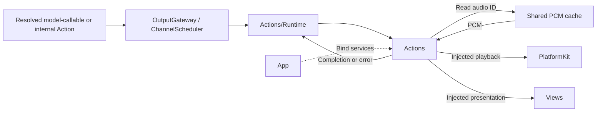
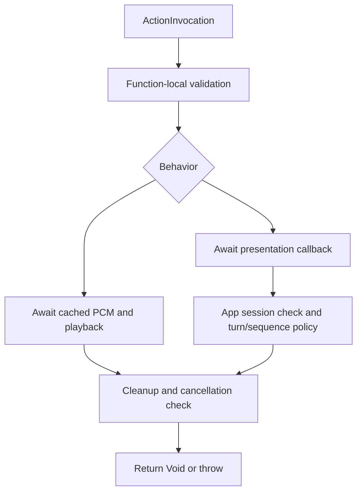

# Actions — Scheduled Behaviors

Implements speech and presentation behaviors selected by Agents. The goal is cohesive functions with explicit validation, completion and cancellation. The unified Actions target contains Runtime, Speech and UI; it depends on AgentCore and the shared StorageAudio cache; App injects device and UI callbacks.

## Directory structure

```text
Actions/
├── Runtime/                       # Registry, invocation and awaited execution
├── Speech/
│   └── SpeechPlayback.swift        # Validate audio IDs and await playback
├── UI/
│   ├── Print.swift                 # Append reply captions
│   ├── MoveEyes.swift              # Validate normalized gaze targets
│   ├── Express.swift               # Validate semantic emotion
│   ├── SetTranscript.swift         # Replace recognition caption
│   ├── FinishTranscript.swift      # Close and clear recognition caption
│   ├── BeginReplyTurn.swift        # Begin reply presentation once per turn
│   ├── SetVoiceState.swift         # Set recognition presentation phase
│   └── ConversationPresentation.swift # Bounded turn/sequence acceptance policy
└── README.md                       # Shared Action development rules
```

## Upstream and downstream

Arrows show runtime flow through App-injected handlers; Actions imports neither PlatformKit nor App/Views.



## Internal flow



Speech completion includes playback; UI completion means state accepted the update, not animation finished. Earlier visible effects cannot be rolled back on later failure. Actions adds no scheduling queue. Gateway owns Channel FIFO and module exclusion, including UI Actions on different Channels.

## Development rules

- Add actual behaviors under a domain such as Speech or UI, with one callable verb per file and a `<Domain>Actions` namespace. Do not create placeholder domains.
- Accept resolved invocations and explicit capability protocols or Sendable callbacks. Keep UI state on MainActor and runtime state in actors. Do not construct concrete models or perform global service lookup.
- Each function owns required parameters, defaults, units, bounds, semantic validation, cleanup and error propagation. Validate before side effects; configuration metadata does not convert values or replace runtime checks.
- Await promised completion, propagate cancellation to owned work and release resources before returning. Bound buffers and retries; never silently discard device Actions or use cancellation to trigger fallback.
- JSON v5 declares model-callable aliases and Channel groups; Agent code declares fixed internal output permissions. App registers explicit Swift handlers. Agents do not import or directly call Actions.
- Document each function's parameters, dependencies, side effects, completion, failure and cancellation in its domain README. Cover meaningful contract boundaries in root Tests. Run repository checks; update ADRs and roadmap when runtime contracts change.

## Feature status

- ✅ [Speech](Speech/README.md): audio-ID playback with bounded cached PCM, three-second starvation errors and explicit cleanup.
- ✅ [UI](UI/README.md): captions, turn handling, recognition phase, normalized gaze and typed expressions. `clear` returns to neutral; supported emotions are defined in Express.swift and Agent JSON.
- ✅ ConversationPresentation retains one turn and at most six component sequence records to reject stale UI updates.
- ❌ Camera capture, media, device and robot Actions; general resource declarations and ActionResult feedback.

## Issue record

| Status | Issue / next step |
| --- | --- |
| Open | Physical-device timing and animation acceptance remain pending. |

✅ Production `Speech.speak(audioID)` uses [StorageAudio](../Storage/Audio/README.md) prepared by SpeechSynthesisAgent. The former text-bearing helper has been removed from Actions.

✅ Runtime is a subdirectory of this same module; consumers import Actions for ActionRegistry, ActionExecutor and ActionInvocation. Gateway retains all scheduling and only uses runtime APIs. ❌ This merge adds no direct Gateway access to business behaviors.
