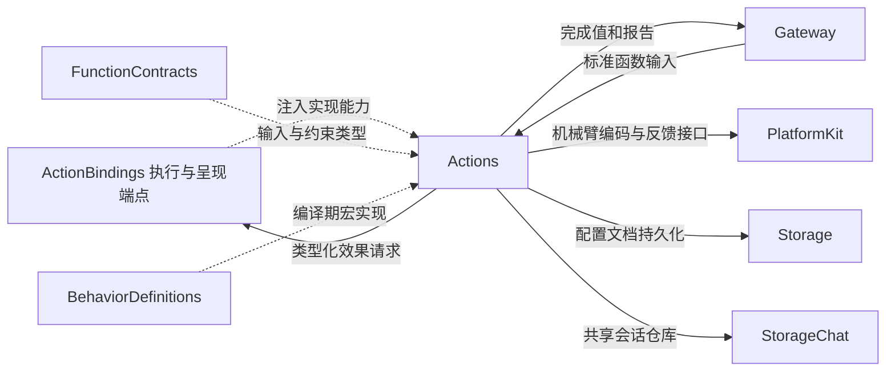
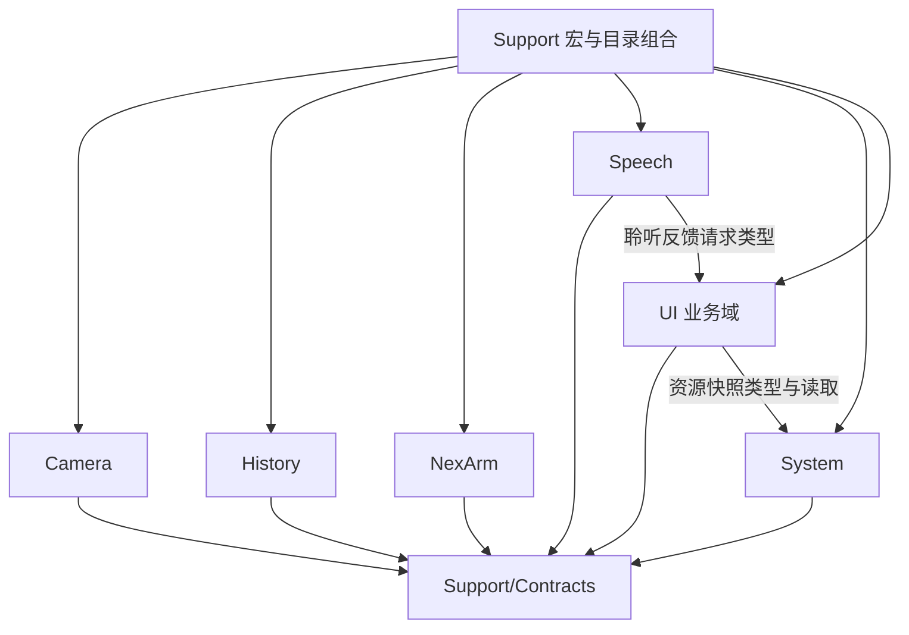

# Actions — 协议中立的业务函数

## 简介

Actions 定义应用的业务操作与查询：参数校验、函数说明、资源需求、执行预算和完成语义。每个业务函数通过注入能力执行真实效果，同一实现可供宿主的 Action Call、Tool Call 或可信业务组合使用。

## 职责与边界

六个业务域和共享 Support 构成当前实现。业务域入口使用 `FunctionInput`，不读取 Channel、Agent 权限或调用协议。Gateway 负责授权、调度、资源仲裁与结果传递；App 只创建和连接模块；ActionBindings/领域服务负责真实原生执行与呈现，App 通过公开生命周期接口管理根作用域。

`Package.swift` 将 `Support/Contracts` 单独编译为无项目依赖的 FunctionContracts；其余核心 Swift 源码编译为 Actions；外层集成源由互斥清单独立编译为 ActionBindings。Actions 的项目依赖为 FunctionContracts、PlatformKit、BehaviorDefinitions、Storage、StorageChat。PlatformKit 导入限于 NexArm/Support，StorageChat 导入限于 History，Storage 导入限于 System 的持久化服务。Actions 不导入 Agents、Gateway、UI 或 App 的实现。

## 上下游关系（一级）

图中实线表示直接调用或结果流，虚线表示注入或声明使用；它们不等同于编译依赖。

## 内部模块关系

| 目录 | 责任 | 主要实现 |
| --- | --- | --- |
| [Support](Support/README.md) | 共用协议、作者接口与生产目录组合 | `@Action`、`@ActionCatalog`、CapabilityModules |
| [Camera](Camera/README.md) | 相机命令、拍摄与照片处置 | CameraControlCapability |
| [History](History/README.md) | 会话分页预览、归档、标题与删除 | 查询/修改服务与 StorageChat |
| [NexArm](NexArm/README.md) | 单电机、有限动作与跟踪目标 | 计划、反馈执行器与运动规划 |
| [Speech](Speech/README.md) | 已生成音频播放、聆听策略应用 | 播放/聆听能力 |
| [System](System/README.md) | 资源、云服务、设备与 Task 控制 | 私有请求暂存与持久化事务 |
| [UI](UI/README.md) | 表情、文字、状态、反馈与呈现请求 | 类型化呈现能力与中立数据 |

每个业务域的入口文件承载函数体；域内 Support 承载值类型、能力协议、目录与算法。六个域处于同一个 Actions 编译目标，Speech 使用 UI 的反馈类型，UI 使用 System 的资源数据；这些是当前源码内部关系。

## 定义、组合与执行数据流

1. `@Action` 从入口函数生成声明和 definition 工厂。地址为 `Domain.Module.function`；函数名来自 Swift 方法，title 是显示名。
2. 域目录将 definition 工厂与能力端点绑定。`@ActionCatalog` 从本类型内的工厂调用生成静态 declarations。
3. `CapabilityModules` 组合域目录。宿主通过 `CapabilityCatalog` 校验、冻结函数集合，再选择调用协议与开放范围。
4. 执行方传入 `FunctionInput`。入口解析字符串参数，调用注入能力，返回实际完成值，或向报告端口记录子结果。

函数声明不授予权限，也不保证某个 Skill 开放该函数。标准输入只携带解析后的地址、参数、关联上下文、executionID 与报告端口。宿主注册和业务效果使用同一份函数资源及预算定义。

## 关键技术

- 参数的传输值统一为字符串；整数、有限数值、布尔、枚举、ID 和 JSON 的业务约束由入口或注入端口解析。大多数入口拒绝未知键；个别入口的实际差异见所属域文档。
- `ActionFunction` 的动态预算优先于静态 timeout；缺省静态预算为 30 秒。资源解析器最多返回八个资源。执行与清理机制位于 Gateway，估计耗时不构成最低等待时间。
- 完成语义由业务定义：状态接纳、动画恢复、音频排空、命令准入和电机到位分别属于不同边界。定义存在不等于发生了效果。
- `ActionReport` 保留逐叶结果和独立执行失败；纯取消与真实失败区分，混合失败不能被取消掩盖。记录的成功效果不会因后续异常而自动撤销。

## 生命周期与约束

本模块没有统一的请求队列或应用会话所有者。普通入口依赖调用者的任务生命周期；NexArm 控制器和配置服务拥有各自明确的状态及准入规则。长期播放、捕获、跟踪、页面状态和连接寿命属于注入宿主。

直接调用函数体不自动获得 Gateway 的权限、Channel 排序、资源租约或超时机制。需要这些机制的调用方必须通过对应执行接口；端点仍独立验证其运行所有权。

[整体技术设计](../README.md) · [函数协议](Support/Contracts/README.md) · [Gateway 执行](../Gateway/Runtime/README.md)

## ActionBindings 执行与呈现集成

Actions 核心的依赖和协议中立函数保持独立。ActionBindings 通过互斥源清单编译外层真实绑定，可依赖 UI、PlatformKit、ModelKit SDK、领域仓库、FunctionContracts、ExecutionRuntime、CallRuntime，以及 AgentCore 的中立执行身份/结果契约；不导入 Agents 或 Gateway 实现。

BehaviorAssembly/BehaviorProtocolBindings 属于 ActionBindings，完整函数目录由业务模块组装后提供给组合根。RuntimePresentation 实现 Action 能力端口并调用 UI 公开能力；实际业务资格与会话围栏留在领域端点，UI 自己持有展示状态。相机执行通过注入的 CameraResourceAccess 使用租约，不导入 ResourceCoordinator；感知接入通过帧连接回调注入。CameraCoordinator 独立订阅最新原生帧用于背景呈现，Pose Tool 只更新骨架；两路共享关闭/切换/后台清理边界，姿态失败不清除实时影像。

NexArmControlService 持有不含 UI 类型的连接/执行状态，BluetoothWorkflow 只把完整事实投影为 UI.BluetoothViewSnapshot，并转交 UI 控制。VoiceNativeEffects 持有原生提示音/触觉/播放，ConversationPresentationController 持有呈现接纳；UI 持有真实动画回调。Provider、制品存储和背景传输接入属于 System；照片提交/可选反馈属于 Camera。App 不再转换这些数据或实现这些流程。

## 待实现

- 暂无本目录独立的实现待办；跨模块及实际模型/设备验收见所属模块说明。

## Storage 依赖

✅ 存储访问使用独立的 State、Cache、Database 和 Files 接口；App 注册根实例，消费者通过构造器获得所需能力。存储容器不接管本目录的业务验证、执行和完成语义。

## 公开 State 边界

✅ StorageState 仅承载公开事实；边界检查禁止完整 AgentContext 注册，校验 Skill schema v2/useState。沿用现有源码归属及目标，ActionBindings 显式依赖 StorageState。

[公开 State 契约](../Storage/State/README.md)

✅ Implemented: ActionBindings adds the Action projection of five Skill query functions while retaining their direct Tool projections for fixed/isolated callers. Business handlers, return values, budgets and resources stay protocol-neutral.

## Platform 根、设备接入与同帧呈现

✅ 相机与语音执行端点使用 App 注入的原生能力，不在业务模块创建原生所有者。Pose 内部 Tool 可携带 Gateway 已验证的只读同帧附件，业务函数仍只访问 FunctionInput 和注入端口。

## UI 容器与相机能力注入

✅ CameraCoordinator 留在现有 ActionBindings 目标，构造改由 App 的唯一工厂提供；注入 CameraCapturing 与 CameraPresenting，以快照读展示事实，经呈现接口更新 UI，不查找 IoC、不持有具体 CameraState/AppleCamera。

## ApplicationControl 异常展示

✅ UI.RuntimeDiagnostics.recordFailure 作为代码授权的内部 Tool，接收已分类的中立展示值。ActionBindings 校验 ApplicationControl 根身份后更新注入 UI 状态；Actions 核心不导入 Agents、Gateway 或 UI，函数完成不代表原故障恢复。
## UI 全量容器化

✅ 应用级 UI 状态由八个子容器统一创建，消费者注入所需 Presenting 接口并提交 UI 自有值，不直接写字段。App 注册并管理同一 UI 根；原业务身份/版本校验、原生完成和基础库依赖边界保持。跨模块连接迁移仍是独立待办。
