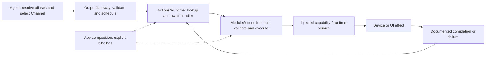
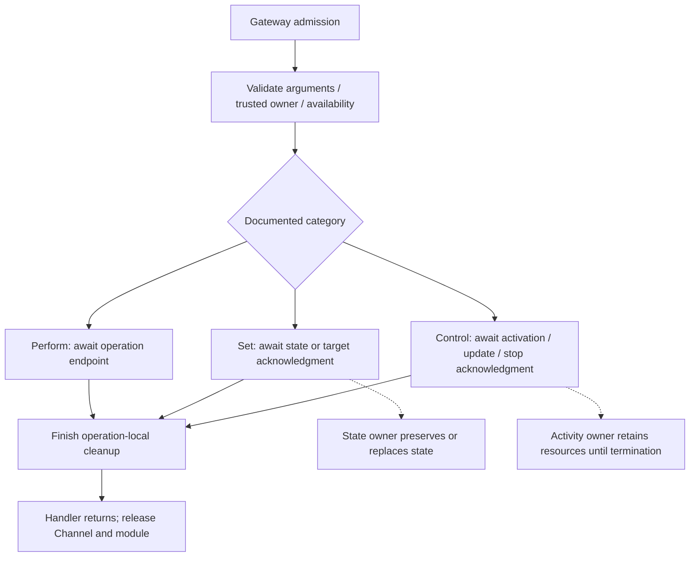
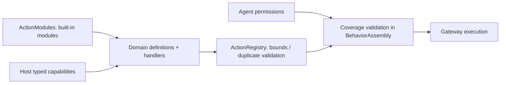

# Actions — Module and Action Authoring Standard

Purpose: implement Agent-selected behavior with explicit completion, ordering and lifetime contracts. Design goals: consistent Swift entry points, cohesive modules, typed dependency injection, bounded execution and understandable ownership of effects.

This is the normative authoring standard for new Actions and deliberate migrations. **Stage 1 runtime support is implemented; Action paths and Channel/wait semantics remain unchanged.** No JSON configuration fields were added. The current implementation and migration exceptions are listed below. Domain READMEs supply exact parameters and operational limits; they must identify any departure from this standard. Examples are design examples, not registered production capabilities.

## 1. Vocabulary and boundaries

| Term | Definition | Example / boundary |
| --- | --- | --- |
| Action | One permission-checked, scheduled behavior identified by `ActionPath(module:function:)`. It validates input, performs an effect and returns at its documented completion point. | `Speech.speak`, `UI.express`; an Action is not an Agent, thread, animation or Swift class. |
| Action module | A cohesive behavior domain and stable path namespace, normally one directory under Actions. Today its name is also the scheduler's process-wide mutual-exclusion key. | `Speech`, `UI`; do not invent another module name to bypass exclusion. |
| Swift target/module | A compilation and dependency boundary. | The single `Actions` target contains Runtime, Speech, UI and NexArm supervised Actions. An Action module does not require a new Swift target. |
| Channel | An ordering lane selected by the Agent declaration or an allowed scope override. | `Display` is a Channel; `UI` is an Action module. Same-named Channels in different tasks do not share FIFO. |
| Alias | An Agent-local model-visible name resolved inside Agents. | `express` resolves to `UI.express`; Runtime never resolves model aliases. |
| Runtime service | An injected owner of mutable state, resources or ongoing work; it is not itself a model-callable Action. | `SpeechPlayback` owns playback/cache handling. Service methods are not implicitly registered. |
| Effect lifetime | How long the resulting state, resource or activity exists after a command returns. | A facial expression may remain after its Action completes. |

Actions differ from Tools by execution and feedback contracts, not by read/write or fast/slow behavior. A quick state setter can still be an Action when it needs Channel ordering. Tools bypass Action scheduling and must not become an alternate route around device ownership checks.

Agents emit resolved calls through OutputGateway. Domain modules own explicit handlers; App binds typed capabilities. Actions receives capability protocols or Sendable callbacks; it imports neither App, concrete Agents, Gateway, PlatformKit nor the Swift UI target. The current target depends on AgentCore and StorageAudio; direct Storage access is not currently required. Model inference belongs to the appropriate Agent/capability flow, not to hidden synthesis inside a playback Action.



## 2. Action categories and completion

Two command semantics are distinguished: **Perform** waits for a finite operation to finish; **Set** waits for a target/state to be accepted or established at a precisely named boundary. Ongoing activities additionally need **Start / Update / Stop** lifecycle commands. These labels are represented by implementation-side `ActionDefinition.Kind` metadata and completion descriptions. They do not select different dispatch algorithms and are not JSON v5 fields.

| Standard category | Intent and completion | Effect after return | Example |
| --- | --- | --- | --- |
| Finite operation — Perform | Perform one bounded operation; return after its promised endpoint and operation-local cleanup. Duration need not be known in advance. | May disappear or remain; persistent consequences do not turn an operation into a setter. | Play supplied audio to drain; nod once; take one photo; move until physically settled. |
| State setting — Set | Validate and commit a state, or have the responsible controller confirm ownership of a target. State exactly which acknowledgment is promised. | Persists until replacement, clear, expiry or documented owner/session teardown. | Set an expression; set a gaze target; set a controller's target angle. |
| Activity control — Start / Update / Stop | Establish, modify or stop an independently owned ongoing activity. Start returns after confirmed activation; Stop returns after termination and promised finalization. | The activity outlives Start and remains owned until stopped, failed or torn down. | Start recording; update tracking parameters; stop recording and finalize the file. |

Every category has admission, execution and terminal success/failure/cancellation. A setter is not zero-time or inherently resource-free. Every handler occupies its Channel and module until it returns; it does not occupy a thread while suspended with `await`.

### Finite operations

**Await the whole operation, not an invented completion gate for every internal step.** Actions validate arguments and `try await` the injected capability through its documented completion and cleanup. Device trajectory timing, feedback sampling and control-mode handoffs belong to PlatformKit. Do not implement a second per-waypoint stability loop, arbitrary settling sleeps, command replay, or a device queue inside an Action. Do not start an unjoined `Task` and return early: that releases Channel/module exclusion before the effect has finished. Nominal trajectory durations may schedule internal frames, but do not by themselves establish whole-operation success. NexArm Cartesian playback verifies fresh final home; native head gestures retain their measured handoff and segment gates. See [NexArm authoring pitfalls](NexArm/README.md#authoring-nexarm-actions-avoid-these-patterns) before adding robot Actions.

- Await the actual promised endpoint: speaker drain, gesture completion, saved photo, or device-reported arrival within documented tolerance. Enqueuing work or closing an XML tag is not completion.
- Keep retries, waits and buffers bounded. A duration estimate or `Task.sleep` is not evidence of physical/animation completion; await the owning capability's acknowledgment.
- Cancellation stops owned work and joins cleanup before releasing execution resources. Already visible/physical effects are not automatically rolled back.
- A one-shot gesture may temporarily override a base state. Define composition and conflict policy. If restoring the base, restore the **current** base under an ownership/version check, never blindly write a snapshot that can overwrite a newer command.

### State setting

- Prefer `setExpression`, `setTarget`, `clearExpression` names for new APIs. Existing `UI.express` retains its published name; immediate `UI.moveEyes` now belongs to Tools.
- Return after the documented state/target acknowledgment. Do not wait until a persistent state is removed; do not promise visible interpolation or physical arrival unless actually acknowledged.
- A committed state belongs to its state owner after return. Define replacement, reset, lifetime and repeated-setting semantics. Repeated same-value Set should be idempotent unless a documented reason requires another behavior; `toggle` is not equivalent to `setEnabled(true)`.
- Distinguish requested target from observed state. `setTarget(90)` must not claim the arm has reached 90 degrees. Use a finite `moveTo(90)` or an explicit arrival observation/barrier for subsequent operations that require arrival.
- Cancel before commit: make no new effect where possible. Cancel/fail after commit: do not assume rollback; report the error and retain or reconcile state according to the documented owner policy.

### Activity control

- The ongoing activity must have an explicit actor/lifecycle owner retained independently of an Action call or UI page. App assembles this owner and its capabilities. A handler may delegate activation to that owner; it must not create an unowned `Task` and return success.
- Document activity identity (including owner/session), states, resource ownership, capacity, repeat-start/update/stop policy and who may stop it. If only one activity per session is supported, say so and reject conflicting starts. Do not silently coalesce device commands.
- Start awaits activation and cleans up partial activation on failure/cancellation before ownership handoff. After handoff, cancellation of the completed call is not an implicit Stop. Session teardown must explicitly stop and join its activities.
- Stop awaits termination and required cleanup/finalization. “Stop requested” must be named and documented as a weaker contract if a future API intentionally provides it. A file is not ready merely because capture stopped.
- Release the command lane after Start; never wait there for the whole activity, which could prevent a queued Stop on the same lane from running. Persistent resource ownership is separate from this lane.
- Later failures require bounded, correlated observations through InputGateway, rather than retroactively failing an already completed Start. Agent-originated messages still go through OutputGateway → InputGateway. Stage 2 implements terminal ActionResult and a direct ActivityEvent route; a generic activity registry/event outbox remains outstanding.



`<wait>` joins handler completion only. It does not upgrade a setter into “wait for animation/arrival,” and it does not wait for a started activity to end. Current module exclusion ends with the handler; persistent resource leases and group takeover are implemented in Gateway/Output/Resources. Each device must still integrate real stop acknowledgment and activity supervision before these examples can control hardware. Actor isolation alone does not guarantee ordering across suspension points.

## 3. Types, class policy and canonical signatures

Use a **caseless enum `<Module>Actions`** as the stateless namespace. Declare it exactly once in `<Module>Actions.swift` and implement related short Actions together. Use an extension file only for a cohesive separate concern, such as a separate family of Agent behaviors; a function does not require its own file. Do not use a singleton, base Action class, one class per function, or an actor merely to namespace functions.

| Responsibility | Swift form | Rule |
| --- | --- | --- |
| Callable Action entry | `public static func` in `<Module>Actions` | One entry per Action; validate and await its declared effect. |
| Arguments, identifiers, results internal to a capability | Immutable `Sendable` struct / enum | Use typed values beyond the string-transport boundary; add `Equatable` when comparisons are useful. |
| Dependencies without mutable runtime state | `Sendable` protocol, callback or immutable struct | Inject explicitly; avoid service lookup and global mutable state. |
| Shared mutable runtime/resource state | Actor with a named responsibility | App creates/retains it; do not add a second scheduling queue without a concrete need and documented bounds. |
| SwiftUI presentation state | MainActor-owned type in the separate UI target | App adapts Action values to UI values; Actions does not import SwiftUI. |
| Reference identity required by an adapter | `final class` with justified isolation | Use only for an actual platform/reference constraint; no inheritance framework or unchecked Sendable shortcut. |

The Void adapter boundary for finite/state/update handlers is:

```swift
public typealias ActionHandler = @Sendable (ActionInvocation) async throws -> Void
```

The stored registry handler is `ActionCompletionHandler`, returning `ActionCompletion`; activity start/stop use the typed `completing:` initializer.

The standard Action-entry shape is:

```swift
// Signature template: replace placeholders with module-specific types.
public static func verb(
    invocation: ActionInvocation,
    using perform: @escaping @Sendable (Arguments, ActionInvocation) async throws -> Void
) async throws
```

For a parameterless Action, the callback is `@Sendable (ActionInvocation) async throws -> Void`. For a cohesive multi-operation dependency, use `using capability: any <Domain>Capability` instead; define the smallest Sendable protocol needed by real Actions. Do not create both a protocol and an equivalent closure wrapper without a need. Use `using` consistently; give the local name a concrete meaning such as `play`, `apply`, `start` or `stop`.

`ActionInvocation` is the existing trusted call/context carrier. Do not add caller IDs, permissions, Channel names or service references to model parameters. A callback receives typed arguments and this context so the bound implementation can validate session/turn ownership. Finite/state/update helpers may return `Void`, adapted by the registry to `.completed`. Activity start/stop helpers return `ActionCompletion` carrying the activity ID through the typed terminal result; arbitrary capability values do not become an undeclared return channel.

Entry order is consistent:

1. Check cancellation; parse parameters and validate all names, types, ranges, sizes, units and relationships before effects.
2. Convert transport strings into typed values. Reject unknown parameters for new Actions; declare every permitted optional default. Never silently clamp, reinterpret or fall back after malformed input.
3. Invoke the injected dependency. The owner must validate current permission/session/availability and commit atomically enough for its resource; an earlier gateway check does not freeze platform state.
4. Await the documented acknowledgment, including cleanup required by the contract. Then check cancellation again and return. A post-effect cancellation error does not prove that no effect occurred.

Prefer shared `ActionArguments` readers for transport validation; map decoding errors to domain errors before calling dependencies. Use scoped, meaningful error enums (for example `NodError.invalidCount`) conforming to `Error` and `Sendable`; use `Equatable` when tests compare them. Preserve dependency errors and `CancellationError`. No `try!`, success-producing `try?`, retry without a bound, detached execution, or guessed success. Best-effort cleanup must have an explicit policy that retains the primary error and exposes cleanup failure; uncertain physical cleanup must not be treated as a free device.

## 4. Modules, files and formatting

A module groups related effects and a coherent control domain; it is not a category folder such as `Instant` or `Blocking`. Different Action categories may share a module. Module names are UpperCamelCase (established acronyms such as `UI` remain); function names are lowerCamelCase verbs. A path's function matches its Swift entry name; filenames describe cohesive responsibilities rather than individual verbs. Aliases may differ but resolve only inside Agents.

Implemented module layout (create only files with real responsibilities):

```text
Actions/
├── README.md
├── Runtime/                       # Reusable execution contracts and built-in catalog
│   ├── ActionModules.swift
│   └── README.md
└── <Module>/
    ├── README.md                  # Per-Action contracts and file inventory
    ├── <Module>Actions.swift       # Namespace plus related callable entries
    └── Support/
        ├── README.md
        ├── <Module>ActionModule.swift  # Definitions and consumed capability protocols
        ├── <Module>Types.swift         # Real domain values and complete error definitions
        └── <Owner>.swift               # Only for an actual runtime/resource service
```

- Domain roots make callable behavior easy to discover. `Support` owns non-callable registration, capability interfaces, types and resource services. Shared cross-domain infrastructure belongs to `Runtime`; never create a miscellaneous global helpers directory.
- Group related short entries; split when a distinct responsibility, dependency or lifecycle makes navigation clearer, not after an arbitrary line count. NexArm uses `NexArmActionModules.swift` for its two production registration types. Do not expose a device diagnostic as an Action solely to exercise the harness; direct diagnostic tests belong with the device capability.
- Use domain-qualified type filenames, such as `NexArmTypes.swift` and `UIActionTypes.swift`, because all domains compile into one Actions target. Preserve public nested type names; directory placement does not determine Swift access control or model permissions.
- Keep each error's cases, localized description and failure classification together. Do not split an error declaration from its presentation conformance across files. Add helpers only for actual shared logic; do not replace explicit entries with generic factories or reflection.
- Keep stateful services separate from stateless entry validation, inside the owning domain's Support. Device engines/adapters remain in PlatformKit; rendering remains in UI; Gateway alone owns Channel/wait scheduling.
- Keep imports explicit and minimal, declarations on separate lines, and types before methods. Run the repository Swift formatter. Use the same entry signature and cancellation/validation order regardless of file grouping.
- An Action may use internal helpers or capability operations to implement one declared effect. It must not directly invoke another registered Action to bypass that Action's permissions, Channel or module exclusion. Agent-level sequences are separate resolved calls through OutputGateway.
- Keep tests under root `Tests/` in the existing appropriate target. Root Package.swift maps shared source files; do not duplicate sources or recreate Packages/HarnessKit/Sources.
- Update every touched directory's README. Tooling/runtime queues require design descriptions and Mermaid diagrams, with producer/consumer, capacity, overflow, ordering, finish and cancellation behavior.

## 5. Implementation examples

The following three snippets illustrate the proposed standard using the **current** ActionInvocation/ActionHandler boundary. They are not production APIs, device implementations or an instruction to create these domains. Namespace declarations are shown with entries; keep related short entries together and move support types to the domain Support directory when implementing a real module. The injected callbacks must fulfill the stated contracts, not merely enqueue work.

### A. Finite operation: `Motion.nod`

`count` is required and limited to 1–3. Return only after all nod cycles and playback/controller cleanup complete. The controller defines the endpoint and interruption policy; it must stop and join on cancellation. Repeating this call performs another gesture, so automatic retry is not safe by default.

```swift
public enum MotionActions {}

extension MotionActions {
    public enum NodError: Error, Equatable, Sendable {
        case invalidCount
    }

    public static func nod(
        invocation: ActionInvocation,
        using perform: @escaping @Sendable (Int, ActionInvocation) async throws -> Void
    ) async throws {
        try Task.checkCancellation()
        let count: Int
        do {
            let arguments = ActionArguments(invocation.call.parameters)
            try arguments.validateAllowedKeys(["count"])
            count = try arguments.requiredInt("count", range: 1...3)
        } catch { throw NodError.invalidCount }
        try await perform(count, invocation)
        try Task.checkCancellation()
    }
}
```

### B. State setting: `Face.setExpression`

Success commits the expression target; it does not await animation. The state owner retains the expression until replacement/clear or session teardown. Applying the same value does not restart a one-shot gesture. The domain uses semantic values, not SwiftUI types, and `clear` restores its defined neutral/default state.

```swift
public enum FaceActions {}

extension FaceActions {
    public enum Expression: String, Sendable {
        case clear, smile, angry
    }

    public enum SetExpressionError: Error, Equatable, Sendable {
        case invalidExpression
    }

    public static func setExpression(
        invocation: ActionInvocation,
        using apply: @escaping @Sendable (Expression, ActionInvocation) async throws -> Void
    ) async throws {
        try Task.checkCancellation()
        let expression: Expression
        do {
            let arguments = ActionArguments(invocation.call.parameters)
            try arguments.validateAllowedKeys(["expression"])
            expression = try arguments.requiredEnum("expression", as: Expression.self)
        } catch { throw SetExpressionError.invalidExpression }
        try await apply(expression, invocation)
        try Task.checkCancellation()
    }
}
```

### C. Activity control: `Camera.startRecording` / `Camera.stopRecording`

These parameterless commands use the trusted session identity to address one recording per session. The injected owner must reject a conflicting owner, bound the number of active sessions and retain the running capture independently of the Action. For this example, repeated Start for the same active owner and repeated Stop after confirmed termination are idempotent. Start success means capture is active; Stop success means capture has ended and the media writer has finalized. A failure must remain observable and must not be converted into “already stopped.” Concurrent transitions and lifecycle teardown need an explicit owner state machine; the entry wrappers below do not implement it.

```swift
import Foundation
import AgentCore

public enum CameraActions {}

extension CameraActions {
    public enum RecordingCommandError: Error, Equatable, Sendable {
        case unexpectedParameters
    }

    public static func startRecording(
        invocation: ActionInvocation,
        using start: @escaping @Sendable (ActionInvocation) async throws -> UUID
    ) async throws -> ActionCompletion {
        try Task.checkCancellation()
        guard invocation.call.parameters.isEmpty else {
            throw RecordingCommandError.unexpectedParameters
        }
        let id = try await start(invocation)
        try Task.checkCancellation()
        return .activityStarted(id)
    }

    public static func stopRecording(
        invocation: ActionInvocation,
        using stop: @escaping @Sendable (ActionInvocation) async throws -> UUID
    ) async throws -> ActionCompletion {
        try Task.checkCancellation()
        guard invocation.call.parameters.isEmpty else {
            throw RecordingCommandError.unexpectedParameters
        }
        let id = try await stop(invocation)
        try Task.checkCancellation()
        return .activityStopped(id)
    }
}
```

For a real module, keep start/stop entries together in CameraActions.swift; their shared error belongs in Support/CameraTypes.swift. An Update command uses typed validated arguments like the Set example, while preserving the activity's identity and ownership. A photo/file identifier would need an explicitly designed observation or returning Tool contract; the activity ID in ActionCompletion is not a media-file result.

### Explicit App binding

The registry is not an authorization catalog. Model-callable declarations stay in versioned Agent JSON v5; fixed internal permissions stay in Agent code, following [Agents](../Agents/README.md). App binds each real implementation explicitly. Do not add `kind`, `completion` or `lifetime` to v5: those fields are not supported. Describe completion in the existing Action `doc` and in the domain README.

```swift
// Composition example using the hypothetical FaceActions above.
// The caller supplies the actual owner-backed callback; no global lookup.
func makeExampleRegistry(
    applyExpression: @escaping @Sendable (FaceActions.Expression, ActionInvocation) async throws -> Void
) throws -> ActionRegistry {
    try ActionRegistry(definitions: [
        ActionDefinition(
            path: ActionPath(module: "Face", function: "setExpression"), displayName: "setExpression", kind: .state,
            completion: "Expression target committed; visual interpolation is not joined."
        ) { invocation in
            try await FaceActions.setExpression(invocation: invocation, using: applyExpression)
        }
    ])
}
```

This App-side example requires `import Actions` and `import AgentCore` after the example Actions are implemented in the Actions target. It is only the implementation binding; an authorized Agent still emits a resolved call through OutputGateway. Configuration or missing-handler errors propagate without fallback.

## 6. Required domain contract and verification

Each domain README must include purpose/design goals, current files, implemented ✅ and outstanding ❌ items, and this inventory for **each** Action. Fill concrete values; do not ship a table of unspecified policies.

| Contract field | Required content |
| --- | --- |
| Identity | Stable module/function, required displayName (nonblank, at most 256 UTF-8 bytes), Swift entry, file, model/internal exposure; default Channel belongs to the Agent declaration, not the implementation. |
| Category | Finite operation, state setting, or activity start/update/stop. |
| Parameters | Required/optional keys, typed meaning, units, ranges, byte/count limits, defaults and unknown-key rejection. |
| Dependencies | Injected interface, state/resource owner, isolation and platform permission checks. |
| Completion | Observable endpoint and what success does **not** imply (for example target accepted versus physical arrival). |
| Lifetime | Effects remaining after return; state reset or activity teardown owner and trigger. |
| Conflicts | Channel/module serialization plus any persistent ownership, replacement, temporary override or rejection policy. |
| Cancellation / failure | Before and after commit; partial effects, cleanup/join, deadlines, uncertain hardware state and error propagation. |
| Repetition / feedback | Idempotency, retry/deduplication policy and bounded correlated observations where applicable. |
| Limits / evidence | Queue and resource bounds, overflow policy, test locations and outstanding device acceptance. |

Tests should verify contracts rather than mirror the function body. For finite operations, hold a fake completion acknowledgment and verify that following same-lane work cannot start early. For Set, verify committed state and lane release without waiting for animation. For activity control, verify activation acknowledgment, Stop reachability, resource retention, partial-start cleanup and teardown. Cover invalid input before effects, stale/wrong-owner calls, cancellation and dependency failures where relevant. Use deterministic acknowledgments, not timing sleeps. General activity ownership tests become required when that feature is implemented; the examples do not imply it exists today.

Run `./scripts/check.sh` and, with full Xcode, `./scripts/build-ios.sh`; report unavailable checks explicitly. Builds and fake capabilities do not prove physical completion or device safety. Runtime-contract migrations require ADR and roadmap updates; Stage 1 runtime-contract changes are recorded in [ADR 0065](../../docs/adr/0065-action-runtime-contracts.md).

## 7. Current implementation audit

✅ UI and Speech now follow the namespace/file/signature standard: UIActions.swift and SpeechActions.swift contain their caseless namespaces and `invocation:using:` entries. Domain Support directories own UIActionModule and SpeechActionModule with their typed interfaces; Runtime/ActionModules.swift owns the catalog. Runtime is infrastructure, not a callable domain, and does not need a RuntimeActions namespace.

| Path | Kind / endpoint | Validation / dependency |
| --- | --- | --- |
| Speech.speak | finite / playback drained and single-use audio released | audioID only, UUID at most 36 UTF-8 bytes; typed playback capability |
| UI.express | state / accepted expression target | exact Emotion enum; no animation acknowledgment |

All entries reject undeclared keys, check cancellation before validation and after their awaited effect, and preserve dependency errors. Fixed caption/gaze/recognition presentation now belongs to Tools/UI, including PresentationError and gaze values. Expression remains here. Speech retains the existing SpeechAudioError.missingAudio for invalid audio handles for compatibility with the audio domain. SpeechPlayback is a typed runtime service, not the Action entry, and joins cancellation cleanup before returning a failure.

✅ Existing paths, permissions, completion kinds, parameter meaning and Channel/wait semantics remain unchanged. The expression path remains UI.express; immediate UI.moveEyes belongs to Tools. Registry and resource contracts remain in Runtime/Gateway.

❌ One-shot expression/restore, Camera Actions, generic activity supervision, audio/robot resource integration and physical-device timing acceptance remain separate work. They are not implemented by renaming or wrapping an entry. Tracking aim is `Robot.aim` in Tools, not an Action.

## 8. Stage 2: results and resource ownership

✅ The implementation registry now stores typed `ActionCompletion`. Finite/state/update implementations can keep the Void `handler:` adapter. Start and stop definitions must use `completing:` and return the ongoing service's activity ID:

```swift
ActionDefinition(
    path: ActionPath(module: "Camera", function: "startCapture"), displayName: "startCapture",
    kind: .activityStart, completion: "Capture started; service retains lifetime.",
    resources: [.cameraCapture],
    completing: { invocation in
        let id = try await captureService.start(invocation: invocation)
        return .activityStarted(id)
    }
)
```

This is an authoring example with an injected service, not a registered production Camera Action. Resource ownership must be acquired through the bound ResourceControl before a protected start is admitted. A stop/release command must reach that control port without queuing behind the activity it is stopping. Return only after the declared acknowledgment; keep long-lived state/tasks in the injected actor. Register the same resource on every Action/Tool that uses it; direct host paths must call ResourceCoordinator.run. Resource names describe physical conflict domains, not module names.

✅ Gateway reserves a result slot before admission, reports correlated terminal status through InputGateway and retries delivery without re-execution. Default feedback is failuresOnly for opted-in Agents; explicit terminal mode includes success. Current Agents retain bounded receipts without triggering model inference. ActivityEvent is separate from start/stop Action completion.

✅ Persistent resource leases are owner/instance/session-bound, expire unless renewed and support atomic group takeover. Cleanup failure/timeout keeps affected resources gated. Production camera capture uses the coordinator through App lifecycle. See [results](../Gateway/Output/Results/README.md), [resources](../Gateway/Output/Resources/README.md) and [ADR 0066](../../docs/adr/0066-action-results-resource-leases.md).

❌ General activity registry/event subscriptions, audio/robot resource integration, device safety watchdogs, durable delivery remain outstanding. Camera capture is not video recording; current UI expressions remain state acceptance, without waiting for animation.

## 9. Module-owned registration

✅ Each domain implements ActionModule and owns its complete ActionDefinition list. ActionModules.builtIn is the explicit catalog. Add an Action by editing its implementation and domain module, then update Agent permissions only when it should be callable. Add a domain by editing ActionModules; do not add a registration in App. ActionRegistry(modules:) flattens and validates modules with bounds and duplicate rejection.

UIActionModule receives UIPresentationCapability; SpeechActionModule receives SpeechPlaybackCapability. Typed capability protocols live beside the domain that consumes them, without App or concrete device imports. They are required initializer dependencies. UI parsing/validation stays in Actions; App implements semantic effects. A new behavior implemented using existing capability operations requires no App changes. A new native primitive or changed lifetime requires an explicit capability/adapter extension.



The earlier explicit single-definition binding example illustrates isolated construction; production bindings now belong to domain module lists. BehaviorAssembly in App/Composition/Behaviors is an independently compiled pure assembly target, not an application service. ❌ No reflection, implicit registration, permission expansion or generic string/Any effect dispatch. See [ADR 0067](../../docs/adr/0067-domain-owned-behavior-assembly.md).

## NexArm integration

✅ [NexArm](NexArm/README.md) provides Agent-used gestures and built-in `NexArm.shakeBase(cycles:)` with required typed host injection and controller feedback. ✅ iPhone foreground BLE binding is implemented. ❌ Autonomous motion and physical-stop proof remain unavailable.

## NexArm entertainment skills (2026-09-30)

✅ NexArm now adds waveWrist, tiltWrist, lookAround, celebrate and dance as typed finite Actions, alongside shakeBase. The domain owns registration and per-verb validation; all share NexArm exclusion. See [contracts](NexArm/README.md). ❌ New gesture sequences await physical acceptance.

## Immediate presentation migration

✅ UIActionModule now registers only model-selected expression. Fixed caption append, transcript replacement/closure, voice phase, gaze and turn initialization moved to Tools/UI with typed ToolInvocation and shared CallArguments. Every remaining Action is displayed without per-path filters. ❌ Native model Tool output remains pending; expression retains scheduling by product choice.

## Cohesive source organization

✅ Fifteen Swift files replace the former thirty-one. Production public symbols, paths, arguments, completion semantics and the built-in catalog remain unchanged; the unused diagnostic Action and its support types were removed. Domain roots contain entries, Support contains non-callable implementation support, and Runtime contains shared infrastructure. The source check recursively discovers definitions and accepts grouped entries; Swift compilation and assembly tests remain responsible for semantic validation.

❌ This reorganization adds no generic action factory, device behavior or runtime contract. Future splits should follow real responsibilities.

## Execution display metadata

✅ Every ActionDefinition requires a nonblank displayName of at most 256 UTF-8 bytes. Declare the human-readable operation name beside its implementation registration in domain Support. It is independent of Agent aliases, permission JSON, Channel selection and completion text; no SwiftUI/localization-framework type crosses the boundary. The scheduler copies the validated name into each execution record at admission, so history needs no registry lookup. Production currently supplies Chinese names; richer localization remains future work.

✅ UI owns generic phase/completion wording, symbols and layout; AppWorkflows only forwards shared snapshots. Adding an Action through an existing capability requires no action-name or error-code mapping in App/UI. Channel names are displayed exactly as supplied, never inferred from module/device names. See ADR 0086.

❌ This metadata does not change permissions, scheduling or Agent result feedback. Do not put a second model-callable catalog in Swift or presentation metadata in Agent JSON v5.
