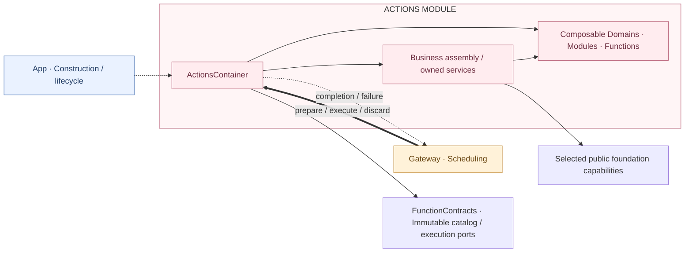

# Actions — Business execution and module lifetime

## Responsibilities and boundaries

ActionsContainer is the single App-scoped execution root. It owns compiled function registration, immutable catalog metadata, effect-free input preparation, budgets/resources, actual execution, output validation and joined business/native cleanup. App constructs and manages it; Gateway invokes its neutral execution port. Agents owns authorization and supplies cognitive host callbacks through App-bound neutral interfaces.

Domains, modules and individual actions remain extensible declarations and function composition. They have no container, lifecycle node or App registration. Stateful execution services are retained by the module root and composed through narrow interfaces. Registration establishes implementation availability, not Skill permission or device readiness. Actions imports neither AgentCore, Agents, Gateway nor App.

## Direct relationships

Lifecycle uses dashed arrows, execution uses thick arrows, and results use dashed return arrows. Cognitive collaboration (Task control, perception connection, model maintenance) uses explicit host ports. Actions does not retain or search an upstream container.

## Source and target ownership

| Owner | Responsibility |
| --- | --- |
| ActionsContainer / ActionsFailure | Unique root, admission state, preparation credentials, execution workers and structured lifecycle errors. |
| ActionsBusinessAssembly / ActionsBusinessBindings / ActionsUIFacades | Actions-owned service construction and narrow public binding ports; helper objects retained by the root, not peer containers. |
| CapabilityModules / BehaviorProtocolBindings / BehaviorAssembly | Explicit compiled declarations, protocol policies and canonical function assembly. Unknown domains can use default bindings; builtin policies remain explicit. |
| ActionEndpoints | Instance-level composition of presentation, speech, camera and Task ports; no capability lookup/downcast. |
| [Camera](Camera/README.md) | Capture, camera control and private photo/album operations. |
| [History](History/README.md) | Queries, full reads, mutations, title jobs and history presentation. |
| [NexArm](NexArm/README.md) | Connection recovery, finite motion, manual/tracking execution and actual feedback. |
| [Speech](Speech/README.md) | Playback, listening, detection and native voice sessions. |
| [System](System/README.md) | Provider, artifacts, device, Task host operations and diagnostics. |
| [UI](UI/README.md) | Callable presentation and interaction facades using UI-owned protocols. Passive Agent activity interpretation remains with Agents. |
| [Support](Support/README.md) | FunctionContracts plus explicitly compiled ExecutionRuntime and CallRuntime mechanisms. |

FunctionContracts has no project dependencies. ExecutionRuntime and CallRuntime retain existing target identities with explicit source lists under Support. Actions imports them and selected foundation SDKs; directory placement alone grants no dependency.

## Registration and validation

Macros emit canonical declarations and factories. CapabilityModules explicitly binds compiled business functions; there is no hot discovery/update. BehaviorAssembly validates definitions and canonical address uniqueness and produces Action/Tool views over the same implementation. Missing required bindings, duplicate definitions, invalid metadata and capacity excess prevent configuration. Optional Task capability is absent from the catalog when unbound. Catalog readers receive descriptors only, without handlers or mutation access. Registration is implementation availability; Agents owns exposure and authorization, Gateway owns neutral coordination, and this module owns business validity. The [overall lifecycle matrix](../README.md#action-lifecycle-responsibilities) describes their complete interaction.

`prepare` validates the registered protocol, argument shape and pure domain decoding, resolves dynamic resources and budget, and retains the invocation behind a single-use PreparedAction. The credential is bound to the root's catalog revision. Gateway owns Channel/wait/resource arbitration and supplies the resource execution context. `execute` consumes the credential, verifies a live permit for declared resources and rechecks current business conditions through the actual handler. The same FunctionExecutor validates inputs, deadlines, completion/report/value output and cancellation for both call protocols.

Agents alone checks roles, Skills, Tasks and decision snapshots. Actions checks service availability, current session/generation, media/native ownership, business preconditions and permits; it does not authorize role names. Already-admitted work never re-queries Skill permissions.

## Lifecycle, bounds and failures

Construction is inert. App configures after foundations and starts Actions before Gateway/Agents. States are cold, configured, running, suspended, stopping, stopped and failed. Reconfiguration fails. The configured catalog may be read before start, but execution requires running state.

The root accepts at most 256 registered addresses, 1,024 prepared invocations, 256 executing calls, eight long-lived workers and 32 cleanup callbacks. Overflow rejects explicitly. Discard, invalidation and stop release preparation; execute consumes a credential once even when admission or a permit later fails. Caller cancellation cancels and joins its owned execution task. Pure preparation never operates a device.

Synchronous invalidation closes execution and cancels active work; foreground transitions join suspension and fence late reopen by revision. App stops Agents and Gateway before Actions, retaining native/host ports through cleanup. Actions stop coalesces, cancels/joins work, invokes cleanup in reverse order and joins native observers. Camera/history/resource/settings interaction workers are included. Primary and multiple cleanup errors remain structured; successful stop releases handlers, descriptors and retained business services. Delivery retries belong to Gateway and cannot re-execute a handler.

State acceptance, animation restoration, audio drain, download admission and motor arrival have distinct completion contracts. Committed effects are not undone by later cancellation/delivery failure. See the owning domain READMEs for native bounds and [overall design](../README.md) for cross-module flows.

## State summaries and detail queries

Business snapshot readers and explicit detail queries share their owning services. Specific device/resource/provider/history queries retain declared parameters, bounds and real outcomes; no generic environment query or Agent-result lookup is bound into Actions. A query does not grant readiness or initiate an unspecified probe. Application summaries belong to Agents, native summaries to PlatformKit, presentation summaries to UI, and actual execution validation remains here.

NexArm action validation and planners reference PlatformKit device ranges, motion-parameter envelopes and update cadence. Actions owns gesture geometry, resource lifetime and execution-result interpretation; the native SDK owns generic position observation, packet validation and connection-wide pacing/backpressure.

NexArm通用设备参数、允许误差、位置反馈观察、经验行程估算与原生恢复分类/预算由 PlatformKit 拥有；Actions 仅消费这些能力并拥有动作目标、资源、执行报告、设备选择及业务生命周期协调。硬件错误保持SDK类型，上层仅适配展示与动作结果，基础模块不依赖业务模块。

## Reflexive state reads

`ActionsContainer.stateSnapshot() async throws` exposes local execution counts/lifecycle/failures and camera/robot indices using module-local ActionsStateSnapshot. stateReaders() binds exact independent readers from the already-owned business assembly. It never constructs a lazy business service. Camera and robot snapshots are owned by their execution services; UI expression facts remain UI-owned. A domain/module declaration is not another container. Runtime counts are observations, not effect receipts. Failed lifecycle or unconfirmed cleanup is a fault; an idle operation is not.

State follows the existing execution-service lifetime. Camera running facts are initially unknown and seeded by its owned observation worker, then maintained at native events and operation completion. Robot facts remain in the service’s latest link observation and motion owner’s memory; reading State does not initialize devices, issue feedback commands or start workers.

App explicitly sequences execution preparation: AgentContainer prepares cognitive inputs; ActionsContainer.configureBusiness owns business assembly preparation and returns execution/catalog/host ports; the Agent preparation validates Skill coverage and returns Gateway configuration; App configures Gateway and calls AgentContainer.bindExecution with the resulting facilities. The executionBindings lifecycle node retains this configuration boundary for partial-start rollback and reverse cleanup. Actions owns internal function binding; App owns the cross-module sequence.

ActionsContainer owns camera/device scene invalidation and joined native suspension through its configured nativeForeground callback. Suspension joins executing work and native cleanup before resume; failures prevent reopening admission. Camera page visibility is a separate App-supplied input combined with scene admission. Agents never shuts down these execution owners.

ActionsContainer.makeBusiness receives ActionsDependencies, creates the private ActionsBusinessAssembly, Bluetooth workflow and photo store, and returns the root plus ActionsHostCapabilities. Public camera/device protocols and UI facades expose only host operations. The root owns cleanup immediately, including stop before catalog configuration. configureBusiness(request:) consumes the internally owned assembly after foundations are ready; App cannot construct or access it.

Speech 的公开聆听启停由 BasicSkill 经 Gateway 调用。Actions 通过中立感知端口取得权威策略 revision 后直接应用并加入原生清理，不将模型输入当作内部策略快照。关闭 Action 不取消并等待其所属回复；生命周期与手势停机仍沿用回复取消契约。详见 [聆听设计](Speech/Listening/README.md)。

The Window module binds six generic presentation controls in the standard catalog with scheduled Actions and direct/returning Tools. WindowExecutionService delegates business lifecycle through WindowContentLifecycle; CameraCoordinator supplies the first implementation. The same UI state and finite receipts are used for model and button requests.

Camera coordinates independent photo and background visual demand over one PlatformKit capture capability. CameraModule binds Capture and Perception explicitly; Perception uses openVision/closeVision/retryVision/flipVision in the unified CameraActions namespace. Both groups use scheduled Action and direct/returning Tool policies. Business lens admission reads UI presentation ordering, then invokes the same native switch; device running/facing State belongs solely to platform.vision.camera.

## Photo/video and listening coordination

ActionsBusinessAssembly connects CameraCoordinator's recording audio hold to the active VoiceSessionCoordinator and injects joined image/video export through PlatformKit.Vision. CameraRecordingSession owns recording completion and pending media independently of window mounting; speech owns listening generation/restoration. Camera, UI, PlatformKit and Storage keep separate facts and completion contracts. The fixed Capture/Video/Perception entry points remain domain-owned @Actions; scheduled Action and direct Tool projections are shared by all three Camera modules. See [Camera](Camera/README.md) and [Listening](Speech/Listening/README.md).

IslandModule提供双端内容发布/更新/结束和compact/expanded展示请求。领域仅发布中立状态、阶段身份和导航入口；UI拥有有界身份账本、串行ActivityKit写入和失败状态。ActionsBusinessAssembly构造唯一服务与根领域观察，不读取硬件或观察自身Action记录，实际频谱只送前台组件，不逐帧提交Action/原生摘要；shutdown加入观察和蓝牙到期任务。

setSceneActive只调用原生场景服务的失活/加入端口，不暂停Actions根或取消其他已接纳Action；Camera与Bluetooth所属服务保持既有前台门。完整setForeground(false)/invalidate/stop仍执行全部取消。语音会话的半双工准入与持续采集见Speech/Listening。

## Web operations

[Web](Web/README.md) owns remote browsing, inspection, navigation and screenshot execution. [Artifacts](Artifacts/README.md) owns project storage, streaming edit transactions, immutable versions and multi-window presentation. ActionsBusinessAssembly injects foundation ports and returns a task-bound streaming continuation; short literal patches validate fresh read ownership and unique matches before atomic replacement; no development model runs inside Actions. Writer selects explicit rendering or per-edit streaming previews; Artifacts performs bounded native file operations and reports render evidence without deciding creative policy.

Camera与Web在创建UI窗口时显式提供各自图标。Actions只选择显示身份，UI.Window拥有图标接纳、最小化尺寸和原生渲染；不新增函数参数或资源访问链路。

生产 BehaviorAssembly 将公开 Action 投影为 scheduled 执行，Tool 投影保留 direct；同一函数可有两种协议适配，业务实现及资源检查仍共享。Assistant 所有 Skill 函数采用 XML Action；Writer 使用独立 Tool 目录。显式测试/宿主注入的注册策略不被生产投影重写。

UI.Island 工具接纳生产者自有的通用语义内容，不管理 Writer 任务生命周期。Writer 与 Assistant 各自由本角色执行所有者通过 Gateway 内部展示工具发布或撤下任务岛；UI/Runtime 的领域观察只投影语音、相机和连接，不反向解读 Agent 任务日志。组件负责语义优先级排序及实际动画/布局。

Artifacts exposes an internal direct workspace preview capability to Writer. Source intake only checkpoints the draft; Writer schedules safe script-disabled snapshots independently of the content stream. Explicit render joins pending previews and executes complete scripts; finish requires a current successful render and publishes once. The UI/Storage modules do not own creative-loop or progress policies.

Web页面读取/截图/导航可按windowID选择既有Writer会话，仍经业务执行与原生验证；作品编辑授权保持Writer域。装配只注入UI根会话查询。

Writer新模型选择读取独立writerThinking，默认minimum；显式开启时enabled。Assistant配置策略不变，当前执行保持配置快照。

Island business execution has one typed Action entry, IslandActions.execute. Agent invocations reach it through Gateway and the registered string adapter; camera/voice/Bluetooth presentation calls it directly through producer-bound endpoints inside Actions. Internal composition does not involve Gateway, transport or synthetic FunctionInvocation. Ownership/revision/generation checks and receipts are shared. The domain observer owns three latest commands, one wake-up slot and one joined expiry/retry timer. Spectrum data and UI's own gestures/layout/lifecycle retain their specialized interfaces. See [Runtime](UI/Runtime/README.md).

Caption execution keeps recognition and reply ownership separate: setTranscript/finishTranscript affect only recognition, while code-owned clearReply retires a caller's old reply request without starting a new reply. Presentation guards reject stale continuations and delayed clears; the Agent decides the boundary, and UI retains text through playback/listening transitions. See [Conversation execution](UI/Conversation/README.md).

Artifacts拥有作品窗口的简洁标题/操作副标题、每项目最新快照和场景恢复。Writer通过Gateway提交命名/步骤；Actions内部直接更新UI，不重新通信。场景隐藏时保留文件与业务执行，渲染返回deferred；恢复不重开用户关闭或最小化的窗口。详见[Artifacts](Artifacts/README.md)。

Artifacts receives the shared SQLite WorkspaceRepository through ActionsDependencies; Actions owns file/SQL publication ordering, editing and rendering, while Storage owns relational persistence. Generic value results have no single-result byte quota; model context remains an Agent concern.

Artifacts consumes the neutral StorageDatabase.Workspaces contracts/coordinator and StorageFiles primitives. It never imports SQLite/GRDB; formats, rendering and acceptance remain Actions responsibilities.
