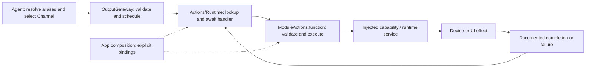
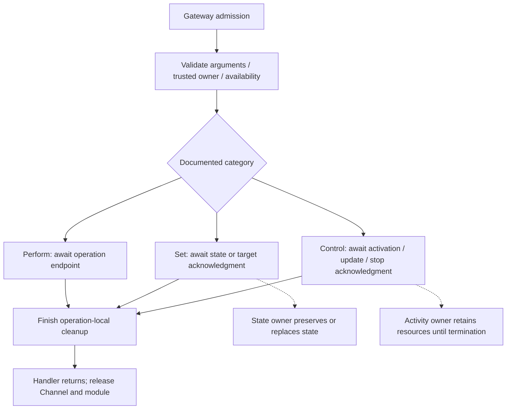

# Actions — Module and Action Authoring Standard

Purpose: implement Agent-selected behavior with explicit completion, ordering and lifetime contracts. Design goals: consistent Swift entry points, cohesive modules, typed dependency injection, bounded execution and understandable ownership of effects.

This is the normative authoring standard for new Actions and deliberate migrations. **Stage 1 runtime support is implemented; Action paths and Channel/wait semantics remain unchanged.** No JSON configuration fields were added. The current implementation and migration exceptions are listed below. Domain READMEs supply exact parameters and operational limits; they must identify any departure from this standard. Examples are design examples, not registered production capabilities.

## 1. Vocabulary and boundaries

| Term | Definition | Example / boundary |
| --- | --- | --- |
| Action | One permission-checked, scheduled behavior identified by `ActionPath(module:function:)`. It validates input, performs an effect and returns at its documented completion point. | `Speech.speak`, `UI.express`; an Action is not an Agent, thread, animation or Swift class. |
| Action module | A cohesive behavior domain and stable path namespace, normally one directory under Actions. Today its name is also the scheduler's process-wide mutual-exclusion key. | `Speech`, `UI`; do not invent another module name to bypass exclusion. |
| Swift target/module | A compilation and dependency boundary. | The single `Actions` target contains Runtime, Speech and UI. An Action module does not require a new Swift target. |
| Channel | An ordering lane selected by the Agent declaration or an allowed scope override. | `Display` is a Channel; `UI` is an Action module. Same-named Channels in different tasks do not share FIFO. |
| Alias | An Agent-local model-visible name resolved inside Agents. | `express` resolves to `UI.express`; Runtime never resolves model aliases. |
| Runtime service | An injected owner of mutable state, resources or ongoing work; it is not itself a model-callable Action. | `SpeechPlayback` owns playback/cache handling. Service methods are not implicitly registered. |
| Effect lifetime | How long the resulting state, resource or activity exists after a command returns. | A facial expression may remain after its Action completes. |

Actions differ from Tools by execution and feedback contracts, not by read/write or fast/slow behavior. A quick state setter can still be an Action when it needs Channel ordering. Tools bypass Action scheduling and must not become an alternate route around device ownership checks.

Agents emit resolved calls through OutputGateway. App binds explicit handlers. Actions receives capability protocols or Sendable callbacks; it imports neither App, concrete Agents, Gateway, PlatformKit nor the Swift UI target. The current target depends on AgentCore and StorageAudio; direct Storage access is not currently required. Model inference belongs to the appropriate Agent/capability flow, not to hidden synthesis inside a playback Action.



## 2. Action categories and completion

Two command semantics are distinguished: **Perform** waits for a finite operation to finish; **Set** waits for a target/state to be accepted or established at a precisely named boundary. Ongoing activities additionally need **Start / Update / Stop** lifecycle commands. These labels are represented by implementation-side `ActionDefinition.Kind` metadata and completion descriptions. They do not select different dispatch algorithms and are not JSON v5 fields.

| Standard category | Intent and completion | Effect after return | Example |
| --- | --- | --- | --- |
| Finite operation — Perform | Perform one bounded operation; return after its promised endpoint and operation-local cleanup. Duration need not be known in advance. | May disappear or remain; persistent consequences do not turn an operation into a setter. | Play supplied audio to drain; nod once; take one photo; move until physically settled. |
| State setting — Set | Validate and commit a state, or have the responsible controller confirm ownership of a target. State exactly which acknowledgment is promised. | Persists until replacement, clear, expiry or documented owner/session teardown. | Set an expression; set a gaze target; set a controller's target angle. |
| Activity control — Start / Update / Stop | Establish, modify or stop an independently owned ongoing activity. Start returns after confirmed activation; Stop returns after termination and promised finalization. | The activity outlives Start and remains owned until stopped, failed or torn down. | Start recording; update tracking parameters; stop recording and finalize the file. |

Every category has admission, execution and terminal success/failure/cancellation. A setter is not zero-time or inherently resource-free. Every handler occupies its Channel and module until it returns; it does not occupy a thread while suspended with `await`.

### Finite operations

- Await the actual promised endpoint: speaker drain, gesture completion, saved photo, or device-reported arrival within documented tolerance. Enqueuing work or closing an XML tag is not completion.
- Keep retries, waits and buffers bounded. A duration estimate or `Task.sleep` is not evidence of physical/animation completion; await the owning capability's acknowledgment.
- Cancellation stops owned work and joins cleanup before releasing execution resources. Already visible/physical effects are not automatically rolled back.
- A one-shot gesture may temporarily override a base state. Define composition and conflict policy. If restoring the base, restore the **current** base under an ownership/version check, never blindly write a snapshot that can overwrite a newer command.

### State setting

- Prefer `setExpression`, `setTarget`, `clearExpression` names for new APIs. Existing `UI.express` and `UI.moveEyes` retain their names until an explicit migration.
- Return after the documented state/target acknowledgment. Do not wait until a persistent state is removed; do not promise visible interpolation or physical arrival unless actually acknowledged.
- A committed state belongs to its state owner after return. Define replacement, reset, lifetime and repeated-setting semantics. Repeated same-value Set should be idempotent unless a documented reason requires another behavior; `toggle` is not equivalent to `setEnabled(true)`.
- Distinguish requested target from observed state. `setTarget(90)` must not claim the arm has reached 90 degrees. Use a finite `moveTo(90)` or an explicit arrival observation/barrier for subsequent operations that require arrival.
- Cancel before commit: make no new effect where possible. Cancel/fail after commit: do not assume rollback; report the error and retain or reconcile state according to the documented owner policy.

### Activity control

- The ongoing activity must have an explicit actor/lifecycle owner retained independently of an Action call or UI page. App assembles this owner and its capabilities. A handler may delegate activation to that owner; it must not create an unowned `Task` and return success.
- Document activity identity (including owner/session), states, resource ownership, capacity, repeat-start/update/stop policy and who may stop it. If only one activity per session is supported, say so and reject conflicting starts. Do not silently coalesce device commands.
- Start awaits activation and cleans up partial activation on failure/cancellation before ownership handoff. After handoff, cancellation of the completed call is not an implicit Stop. Session teardown must explicitly stop and join its activities.
- Stop awaits termination and required cleanup/finalization. “Stop requested” must be named and documented as a weaker contract if a future API intentionally provides it. A file is not ready merely because capture stopped.
- Release the command lane after Start; never wait there for the whole activity, which could prevent a queued Stop on the same lane from running. Persistent resource ownership is separate from this lane.
- Later failures require bounded, correlated observations through InputGateway, rather than retroactively failing an already completed Start. Agent-originated messages still go through OutputGateway → InputGateway. A general ActionResult/activity-feedback framework is not implemented today.



`<wait>` joins handler completion only. It does not upgrade a setter into “wait for animation/arrival,” and it does not wait for a started activity to end. Current module exclusion ends with the handler; persistent resource leases, physical takeover and activity supervision require separate implementation before these examples can control real hardware. Actor isolation alone does not guarantee ordering across suspension points.

## 3. Types, class policy and canonical signatures

Use a **caseless enum `<Module>Actions`** as the stateless namespace. Declare it exactly once in `<Module>Actions.swift`; place each Action in an extension in its own file. Do not use a singleton, base Action class, one class per function, or an actor merely to namespace functions.

| Responsibility | Swift form | Rule |
| --- | --- | --- |
| Callable Action entry | `public static func` in `<Module>Actions` | One entry per Action; validate and await its declared effect. |
| Arguments, identifiers, results internal to a capability | Immutable `Sendable` struct / enum | Use typed values beyond the string-transport boundary; add `Equatable` when comparisons are useful. |
| Dependencies without mutable runtime state | `Sendable` protocol, callback or immutable struct | Inject explicitly; avoid service lookup and global mutable state. |
| Shared mutable runtime/resource state | Actor with a named responsibility | App creates/retains it; do not add a second scheduling queue without a concrete need and documented bounds. |
| SwiftUI presentation state | MainActor-owned type in the separate UI target | App adapts Action values to UI values; Actions does not import SwiftUI. |
| Reference identity required by an adapter | `final class` with justified isolation | Use only for an actual platform/reference constraint; no inheritance framework or unchecked Sendable shortcut. |

The registry boundary remains exactly:

```swift
public typealias ActionHandler = @Sendable (ActionInvocation) async throws -> Void
```

The standard Action-entry shape is:

```swift
// Signature template: replace placeholders with module-specific types.
public static func verb(
    invocation: ActionInvocation,
    using perform: @escaping @Sendable (Arguments, ActionInvocation) async throws -> Void
) async throws
```

For a parameterless Action, the callback is `@Sendable (ActionInvocation) async throws -> Void`. For a cohesive multi-operation dependency, use `using capability: any <Domain>Capability` instead; define the smallest Sendable protocol needed by real Actions. Do not create both a protocol and an equivalent closure wrapper without a need. Use `using` consistently; give the local name a concrete meaning such as `play`, `apply`, `start` or `stop`.

`ActionInvocation` is the existing trusted call/context carrier. Do not add caller IDs, permissions, Channel names or service references to model parameters. A callback receives typed arguments and this context so the bound implementation can validate session/turn ownership. Public Action success remains `Void`; capability-internal handles do not become an undeclared Action return channel.

Entry order is consistent:

1. Check cancellation; parse parameters and validate all names, types, ranges, sizes, units and relationships before effects.
2. Convert transport strings into typed values. Reject unknown parameters for new Actions; declare every permitted optional default. Never silently clamp, reinterpret or fall back after malformed input.
3. Invoke the injected dependency. The owner must validate current permission/session/availability and commit atomically enough for its resource; an earlier gateway check does not freeze platform state.
4. Await the documented acknowledgment, including cleanup required by the contract. Then check cancellation again and return. A post-effect cancellation error does not prove that no effect occurred.

Prefer shared `ActionArguments` readers for transport validation; map decoding errors to domain errors before calling dependencies. Use scoped, meaningful error enums (for example `NodError.invalidCount`) conforming to `Error` and `Sendable`; use `Equatable` when tests compare them. Preserve dependency errors and `CancellationError`. No `try!`, success-producing `try?`, retry without a bound, detached execution, or guessed success. Best-effort cleanup must have an explicit policy that retains the primary error and exposes cleanup failure; uncertain physical cleanup must not be treated as a free device.

## 4. Modules, files and formatting

A module groups related effects and a coherent control domain; it is not a category folder such as `Instant` or `Blocking`. Different Action categories may share a module. Module names are UpperCamelCase (established acronyms such as `UI` remain); function names are lowerCamelCase verbs. A path's function matches its Swift entry name, and `<Verb>.swift` uppercases the first letter of that function. Aliases may differ but resolve only inside Agents.

Target layout for a module **when its real implementation is migrated**:

```text
Actions/
├── README.md
├── Runtime/                 # Registry / invocation / executor, not a callable domain
│   └── README.md
└── <Module>/
    ├── README.md            # Purpose, contract inventory, design, ✅ / ❌
    ├── <Module>Actions.swift # Namespace declaration only
    ├── <Verb>.swift         # One callable verb + its action-specific types/helpers
    ├── Types.swift          # Only if multiple Actions actually share these values
    └── <Owner>.swift        # Only if a real runtime service is needed
```

- Put types used by one Action in that Action file, nested in `<Module>Actions` with specific names (`NodError`, not a module-wide ambiguous `Error`). Put genuinely shared domain values in `Types.swift`; do not introduce empty files.
- Put runtime-service files beside the consuming Actions when they belong to that domain. Device engines and general platform adapters remain in PlatformKit; UI rendering remains in UI. Gateway alone owns Channel/wait scheduling.
- Keep imports explicit and minimal, declaration/member ordering consistent (types, entry, private helpers), and declarations on separate lines. Run the repository Swift formatter; do not invent per-module formatting rules.
- An Action may use internal helpers or capability operations to implement one declared effect. It must not directly invoke another registered Action to bypass that Action's permissions, Channel or module exclusion. Agent-level sequences are separate resolved calls through OutputGateway.
- Keep tests under root `Tests/` in the existing appropriate target. Root Package.swift maps shared source files; do not duplicate sources or recreate Packages/HarnessKit/Sources.
- Update every touched directory's README. Tooling/runtime queues require design descriptions and Mermaid diagrams, with producer/consumer, capacity, overflow, ordering, finish and cancellation behavior.

## 5. Implementation examples

The following three snippets illustrate the proposed standard using the **current** ActionInvocation/ActionHandler boundary. They are not production APIs, device implementations or an instruction to create these domains. Namespace declarations are shown with entries for readability; split them into the files described above when implementing a real module. The injected callbacks must fulfill the stated contracts, not merely enqueue work.

### A. Finite operation: `Motion.nod`

`count` is required and limited to 1–3. Return only after all nod cycles and playback/controller cleanup complete. The controller defines the endpoint and interruption policy; it must stop and join on cancellation. Repeating this call performs another gesture, so automatic retry is not safe by default.

```swift
public enum MotionActions {}

extension MotionActions {
    public enum NodError: Error, Equatable, Sendable {
        case invalidCount
    }

    public static func nod(
        invocation: ActionInvocation,
        using perform: @escaping @Sendable (Int, ActionInvocation) async throws -> Void
    ) async throws {
        try Task.checkCancellation()
        let count: Int
        do {
            let arguments = ActionArguments(invocation.call.parameters)
            try arguments.validateAllowedKeys(["count"])
            count = try arguments.requiredInt("count", range: 1...3)
        } catch { throw NodError.invalidCount }
        try await perform(count, invocation)
        try Task.checkCancellation()
    }
}
```

### B. State setting: `Face.setExpression`

Success commits the expression target; it does not await animation. The state owner retains the expression until replacement/clear or session teardown. Applying the same value does not restart a one-shot gesture. The domain uses semantic values, not SwiftUI types, and `clear` restores its defined neutral/default state.

```swift
public enum FaceActions {}

extension FaceActions {
    public enum Expression: String, Sendable {
        case clear, smile, angry
    }

    public enum SetExpressionError: Error, Equatable, Sendable {
        case invalidExpression
    }

    public static func setExpression(
        invocation: ActionInvocation,
        using apply: @escaping @Sendable (Expression, ActionInvocation) async throws -> Void
    ) async throws {
        try Task.checkCancellation()
        let expression: Expression
        do {
            let arguments = ActionArguments(invocation.call.parameters)
            try arguments.validateAllowedKeys(["expression"])
            expression = try arguments.requiredEnum("expression", as: Expression.self)
        } catch { throw SetExpressionError.invalidExpression }
        try await apply(expression, invocation)
        try Task.checkCancellation()
    }
}
```

### C. Activity control: `Camera.startRecording` / `Camera.stopRecording`

These parameterless commands use the trusted session identity to address one recording per session. The injected owner must reject a conflicting owner, bound the number of active sessions and retain the running capture independently of the Action. For this example, repeated Start for the same active owner and repeated Stop after confirmed termination are idempotent. Start success means capture is active; Stop success means capture has ended and the media writer has finalized. A failure must remain observable and must not be converted into “already stopped.” Concurrent transitions and lifecycle teardown need an explicit owner state machine; the entry wrappers below do not implement it.

```swift
public enum CameraActions {}

extension CameraActions {
    public enum RecordingCommandError: Error, Equatable, Sendable {
        case unexpectedParameters
    }

    public static func startRecording(
        invocation: ActionInvocation,
        using start: @escaping @Sendable (ActionInvocation) async throws -> Void
    ) async throws {
        try Task.checkCancellation()
        guard invocation.call.parameters.isEmpty else {
            throw RecordingCommandError.unexpectedParameters
        }
        try await start(invocation)
        try Task.checkCancellation()
    }

    public static func stopRecording(
        invocation: ActionInvocation,
        using stop: @escaping @Sendable (ActionInvocation) async throws -> Void
    ) async throws {
        try Task.checkCancellation()
        guard invocation.call.parameters.isEmpty else {
            throw RecordingCommandError.unexpectedParameters
        }
        try await stop(invocation)
        try Task.checkCancellation()
    }
}
```

For a real module, place the two entries in StartRecording.swift and StopRecording.swift; their shared error belongs in Types.swift. An Update command uses typed validated arguments like the Set example, while preserving the activity's identity and ownership. A photo/file identifier would need an explicitly designed observation or returning Tool contract; these Void Actions do not secretly return one to the model.

### Explicit App binding

The registry is not an authorization catalog. Model-callable declarations stay in versioned Agent JSON v5; fixed internal permissions stay in Agent code, following [Agents](../Agents/README.md). App binds each real implementation explicitly. Do not add `kind`, `completion` or `lifetime` to v5: those fields are not supported. Describe completion in the existing Action `doc` and in the domain README.

```swift
// Composition example using the hypothetical FaceActions above.
// The caller supplies the actual owner-backed callback; no global lookup.
func makeExampleRegistry(
    applyExpression: @escaping @Sendable (FaceActions.Expression, ActionInvocation) async throws -> Void
) throws -> ActionRegistry {
    try ActionRegistry(definitions: [
        ActionDefinition(
            path: ActionPath(module: "Face", function: "setExpression"), kind: .state,
            completion: "Expression target committed; visual interpolation is not joined."
        ) { invocation in
            try await FaceActions.setExpression(invocation: invocation, using: applyExpression)
        }
    ])
}
```

This App-side example requires `import Actions` and `import AgentCore` after the example Actions are implemented in the Actions target. It is only the implementation binding; an authorized Agent still emits a resolved call through OutputGateway. Configuration or missing-handler errors propagate without fallback.

## 6. Required domain contract and verification

Each domain README must include purpose/design goals, current files, implemented ✅ and outstanding ❌ items, and this inventory for **each** Action. Fill concrete values; do not ship a table of unspecified policies.

| Contract field | Required content |
| --- | --- |
| Identity | Stable module/function, Swift entry, file, model/internal exposure; default Channel belongs to the Agent declaration, not the implementation. |
| Category | Finite operation, state setting, or activity start/update/stop. |
| Parameters | Required/optional keys, typed meaning, units, ranges, byte/count limits, defaults and unknown-key rejection. |
| Dependencies | Injected interface, state/resource owner, isolation and platform permission checks. |
| Completion | Observable endpoint and what success does **not** imply (for example target accepted versus physical arrival). |
| Lifetime | Effects remaining after return; state reset or activity teardown owner and trigger. |
| Conflicts | Channel/module serialization plus any persistent ownership, replacement, temporary override or rejection policy. |
| Cancellation / failure | Before and after commit; partial effects, cleanup/join, deadlines, uncertain hardware state and error propagation. |
| Repetition / feedback | Idempotency, retry/deduplication policy and bounded correlated observations where applicable. |
| Limits / evidence | Queue and resource bounds, overflow policy, test locations and outstanding device acceptance. |

Tests should verify contracts rather than mirror the function body. For finite operations, hold a fake completion acknowledgment and verify that following same-lane work cannot start early. For Set, verify committed state and lane release without waiting for animation. For activity control, verify activation acknowledgment, Stop reachability, resource retention, partial-start cleanup and teardown. Cover invalid input before effects, stale/wrong-owner calls, cancellation and dependency failures where relevant. Use deterministic acknowledgments, not timing sleeps. General activity ownership tests become required when that feature is implemented; the examples do not imply it exists today.

Run `./scripts/check.sh` and, with full Xcode, `./scripts/build-ios.sh`; report unavailable checks explicitly. Builds and fake capabilities do not prove physical completion or device safety. Runtime-contract migrations require ADR and roadmap updates; Stage 1 runtime-contract changes are recorded in [ADR 0065](../../docs/adr/0065-action-runtime-contracts.md).

## 7. Current implementation and migration exceptions

Current files (not the target layout above):

```text
Actions/
├── Runtime/
│   ├── ActionDefinition.swift
│   ├── ActionArguments.swift
│   ├── ActionDiagnostics.swift
│   ├── ActionRegistry.swift
│   ├── ActionInvocation.swift
│   ├── ActionExecutor.swift
│   ├── ActionExecutionError.swift
│   └── README.md
├── Speech/
│   ├── SpeechPlayback.swift
│   └── README.md
├── UI/
│   ├── Types.swift
│   ├── Print.swift
│   ├── Express.swift
│   ├── MoveEyes.swift
│   ├── SetTranscript.swift
│   ├── FinishTranscript.swift
│   ├── BeginReplyTurn.swift
│   ├── SetVoiceState.swift
│   ├── ConversationPresentation.swift
│   └── README.md
└── README.md
```

| Current implementation | Current category / completion | Migration exception or outstanding work |
| --- | --- | --- |
| `Speech.speak` → `SpeechPlayback.play(_:using:)` | Finite audio-ID playback; drain playback and release the single-use cache lease. | No SpeechActions namespace/Speak.swift entry yet. Keep the real actor's cache handling; add a standard entry only during migration. No hidden TTS. |
| `UI.express` | State setting; MainActor accepts expression, not animation completion. | Existing name and `present:` callback; no one-shot smile/restore behavior. |
| `UI.moveEyes` | State setting; accepts a normalized gaze target, not rendered arrival. | Existing name and `present:` callback; no physical motion. |
| `UI.setTranscript`, `UI.setVoiceState` | State setting; accepted presentation update. | Current callbacks use `present:`; all UI entries now reject unknown keys locally. |
| `UI.print` | Finite append operation; accepted text append, not animation completion. Appended text may persist. | UIActions namespace is declared in Print.swift; migrate declaration to UIActions.swift. Repeated content is not intrinsically idempotent. |
| `UI.beginReplyTurn`, `UI.finishTranscript` | State transitions; accepted turn initialization or transcript closure. | Retain existing turn/sequence policy and parameterless validation. |
| `ConversationPresentation` | Supporting bounded presentation acceptance policy, not an Action. | Stale/duplicate UI updates may intentionally be ignored; handler success does not prove an update was rendered. This explicit presentation policy is not permission to discard device Actions. |

Preserve existing paths, permissions, parameter limits and cancellation behavior until a reviewed migration updates implementations, bindings, tests and domain documentation together. Do not make incidental renames while adding an unrelated Action. Current per-function error types, callback labels and namespace placement are acknowledged exceptions, not examples to copy into new modules.

- ✅ [Runtime](Runtime/README.md): explicit immutable registry, trusted invocation and awaited Void handlers; Gateway owns scheduling.
- ✅ [Speech](Speech/README.md): audio-ID playback with bounded StorageAudio PCM, read-starvation failures and cleanup; synthesis belongs to SpeechSynthesisAgent.
- ✅ [UI](UI/README.md): captions, expression/gaze targets and bounded turn/sequence acceptance. State effects may remain after the handler returns.
- ✅ This document defines vocabulary, categories, Swift/file conventions and illustrative implementation patterns.
- ✅ Runtime stage 1: validated ActionDefinition registration and startup coverage, consistent invocation/execution IDs, shared ActionArguments (adopted by UI), separated scheduling/domain errors and bounded scheduler diagnostics. See [Runtime](Runtime/README.md) for API limits and completion/effect semantics.
- ❌ Existing code has not yet migrated fully to the namespace/file/signature standard.
- ❌ Camera/robot Actions, one-shot expression completion, general activity supervision, persistent resource ownership and ActionResult feedback are not implemented.
- ❌ Physical-device timing, animation and sustained-operation acceptance remain separate work.
