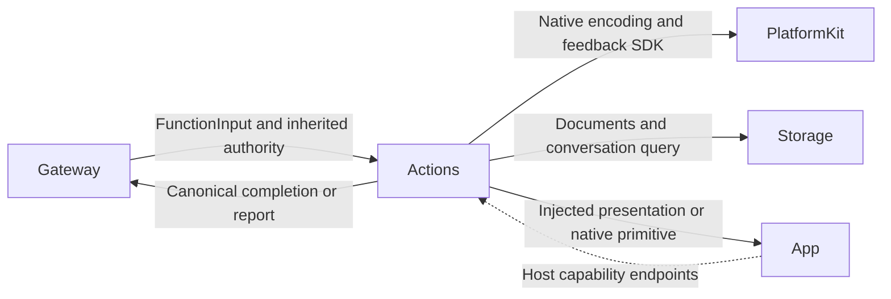
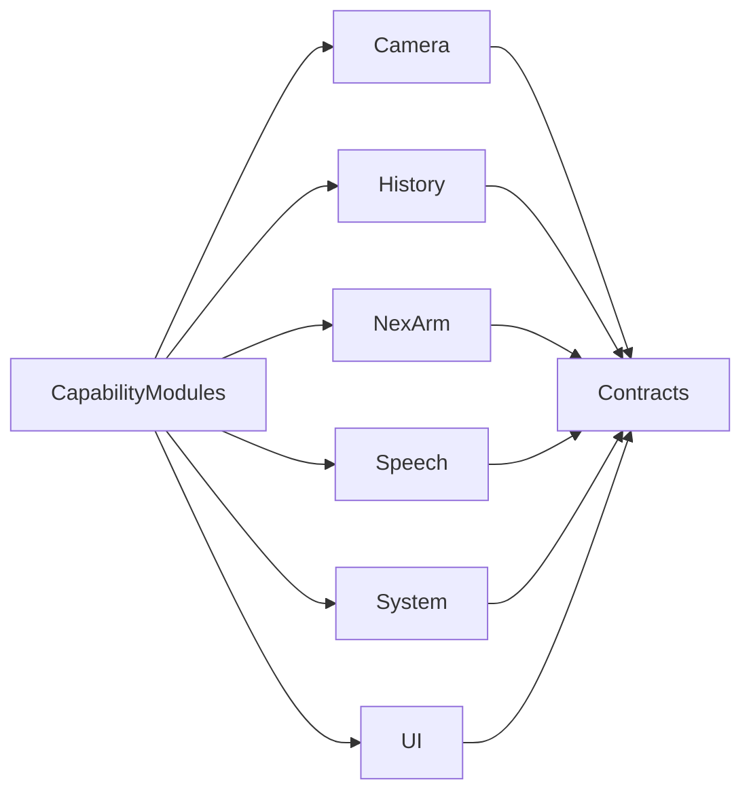

# Actions — Canonical Business Functions

## Summary

Protocol-neutral business operations, queries and finite composition with explicit injected capabilities.

## Ownership and boundaries

Agents chooses behavior; Gateway validates and executes. Actions owns arguments, semantics, intrinsic resources/budgets and producer reports. It depends on FunctionContracts, the macro plugin, PlatformKit, Storage and StorageChat; device imports within Actions are confined to NexArm/Support.

## External relationships and data flow

Runtime arrows show data or capability calls; dashed arrows show injection.

## Internal structure

## Definition and registration

ActionFunction describes a canonical domain/module/function, display name, kind, completion, resource requirements and execution budget. @Action generates the function factory, not Agent permissions or protocol policy. CapabilityModules composes explicit domain catalogs; App freezes them and chooses Action/Tool projections.

A function may serve multiple Agents and both host protocols. Role JSON/code defines model/internal grants separately. Standard FunctionInput carries neutral request plus trusted opaque execution context/report sink; handlers import no Gateway or Agent implementation. Pure definition constraints cannot be weakened by a binding.

## Effect and failure contracts

Validate unknown/missing/value arguments and cancellation before effects. Return only actual completion; submission acknowledgment, UI state commitment, drained playback and motor arrival are different boundaries. Shared executor retains child reports and later exceptions. Ordinary leaf failure does not authorize replay or cancel unrelated Channel work.

Support subdirectories own domain values/catalogs/capabilities and meaningful algorithms. Entry files own callable bodies; namespace enums provide used names without duplicate forwarding implementations. Native/session ownership remains with injected App/PlatformKit services.

✅ Canonical definitions, explicit catalogs and standard business inputs/outcomes are implemented.

## Related design

[Parent design](../README.md) · [Camera](Camera/README.md) · [Contracts](Contracts/README.md) · [History](History/README.md) · [NexArm](NexArm/README.md) · [Speech](Speech/README.md) · [System](System/README.md) · [UI](UI/README.md)

## Skill/task-mode contract

✅ Canonical metadata lives beside each owning @Action; neutral FunctionContracts carries its compiled declaration projection; pure Skills reference it. Agent.Task controls are real System/Support functions injected through TaskControlCapability, without importing Agents.

## Action-owned documentation and Skill instruction contract

✅ 本域函数用 `@Action(doc:parameters:)` 维护说明与参数契约。所属模块注册自动生成声明投影；业务顺序和调用示例由 Skill Instructions.md 教学，不再登记 examples。

### 新增函数标准

在所属业务目录新增/修改函数，使用 `@Action` 声明地址、title、doc、parameters 与执行边界。在同域 CapabilityModule 的 definitions 中绑定实现依赖；`@ActionCatalog` 从该模块实际 factory 调用生成 declarations，无须修改公共函数元数据列表。新增整个业务域才需要修改 CapabilityModules 的模块组合。模型开放的函数必须写明确的 doc、必填/可选参数和约束；枚举参数用 ActionParameter.values 同时生成原生 Tool enum。字符串仍是两种调用协议的传输类型，实际值由 Action 验证。

Skill.json 引用 canonical path 并选择 Action/Tool、别名和 Channel；Instructions.md 教授业务步骤和示例。公共目录只保留结构定义，不保存具体业务函数文档。App 在任何 Agent 配置读取前安装 immutable declarations；重复安装相同目录允许，替换或重复路径明确失败，不能改变在途请求。

## Channel-owned Action ordering

✅ Function metadata and business attributes have no serialization key. Scheduled ordering belongs to [ChannelScheduler](../Gateway/Output/Scheduling/README.md); resources/budgets and native capability admission remain explicit.

## Action timeout contract (2026-10-12)

✅ ActionMacro 将动态预算参数统一命名为 dynamicTimeout，与静态 timeout 对应。默认超时由基础 FunctionContracts 持有，不依赖调用方；业务域可显式扩大或缩短。动态预算异常直接失败，不能以默认值掩盖。

✅ Implemented: UI domain adds two feedback functions and neutral request/capability values. Speech.Listening.update remains the internal policy entry but awaits native activation and returns actual child report. Device ownership stays in App/PlatformKit, finite composition stays in App using the shared ExecutionRuntime tree; no Actions→UI/Gateway dependency.

✅ Implemented: UI feedback adds save/discard profiles; camera save/ignore receipts may include bounded feedbackIssues independent of actual committed disposition. Canonical definitions remain reused; no new domain, directory or native dependency.

✅ Implemented (2026-10-13): UI.Notice.showNotice/dismissNotice and UI.Light.updateLight are canonical presentation Actions for trusted business calls, currently registered by no Skill. Neutral Actions values cross RuntimePresentation into root-owned HomeEffectsWorkflow, which retains one replaceable notice expiry and one light expiry, UUID-fenced cleanup, and explicit stop. Notices remain separate from factual ExecutionIssue history; actual upper-layer errors have display priority and Action failures remain panel-only. Decorative light accepts normalized origin, initial opacity/intensity and duration; it never changes consent, microphone or eyes. Native renderer separates light generations from listening eye generations and preserves existing exit fade. RuntimePresentation converts neutral Action requests into UI-owned values; AppPresentationWorkflow retains existing dependencies. No UI project dependencies or new directories.

✅ Implemented (2026-10-13 Skill scope review): canonical Actions unify trusted business calls and model calls; Skill exposure is optional and must serve an actual procedure. ExpressionInteraction retains two expression functions; Feedback/Notice/Light model exposure is removed while implementations and business bindings remain. ApplicationControl keeps navigation/status/resource/Bluetooth operations, removing duplicate robot functions; RobotInteraction owns them. BasicSkill removes unused send while production background contracts are absent. Affected instructions/revisions and explicit communication-only test catalogs are aligned; all six Skills were audited for prerequisites, result handling and cross-Skill references.
