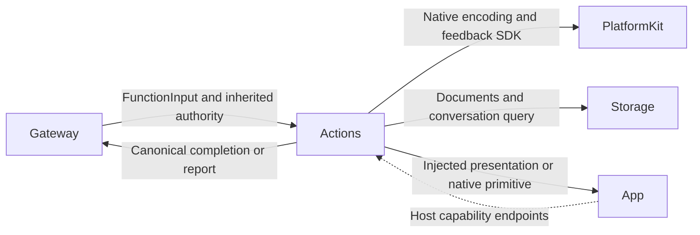
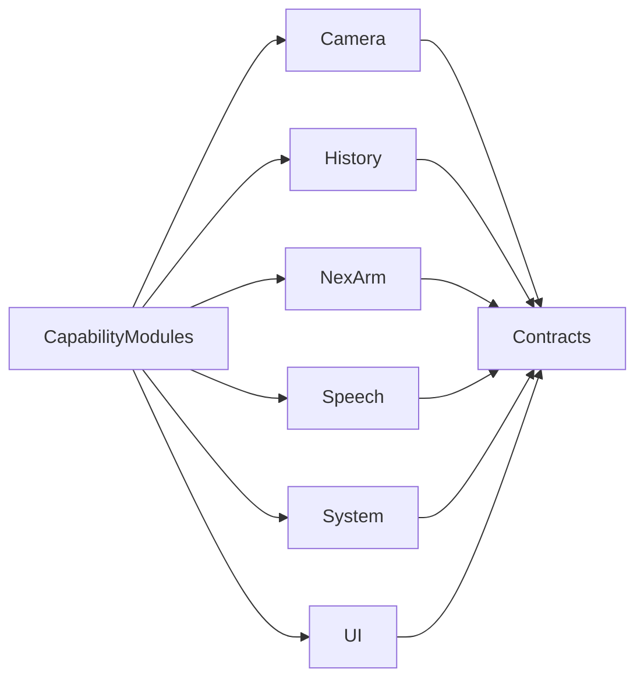

# Actions — Canonical Business Functions

## Summary

Protocol-neutral business operations, queries and finite composition with explicit injected capabilities.

## Ownership and boundaries

Agents chooses behavior; Gateway validates and executes. Actions owns arguments, semantics, intrinsic resources/serialization/budgets and producer reports. It depends on FunctionContracts, the macro plugin, PlatformKit, Storage and StorageChat; device imports within Actions are confined to NexArm/Support.

## External relationships and data flow

Runtime arrows show data or capability calls; dashed arrows show injection.

## Internal structure

## Definition and registration

ActionFunction describes a canonical domain/module/function, display name, kind, completion, serialization/resource requirements and execution budget. @Action generates the function factory, not Agent permissions or protocol policy. CapabilityModules composes explicit domain catalogs; App freezes them and chooses Action/Tool projections.

A function may serve multiple Agents and both host protocols. Role JSON/code defines model/internal grants separately. Standard FunctionInput carries neutral request plus trusted opaque execution context/report sink; handlers import no Gateway or Agent implementation. Pure definition constraints cannot be weakened by a binding.

## Effect and failure contracts

Validate unknown/missing/value arguments and cancellation before effects. Return only actual completion; submission acknowledgment, UI state commitment, drained playback and motor arrival are different boundaries. Shared executor retains child reports and later exceptions. Ordinary leaf failure does not authorize replay or cancel unrelated Channel work.

Support subdirectories own domain values/catalogs/capabilities and meaningful algorithms. Entry files own callable bodies; namespace enums provide used names without duplicate forwarding implementations. Native/session ownership remains with injected App/PlatformKit services.

✅ Canonical definitions, explicit catalogs and standard business inputs/outcomes are implemented.

## Related design

[Parent design](../README.md) · [Camera](Camera/README.md) · [Contracts](Contracts/README.md) · [History](History/README.md) · [NexArm](NexArm/README.md) · [Speech](Speech/README.md) · [System](System/README.md) · [UI](UI/README.md)
